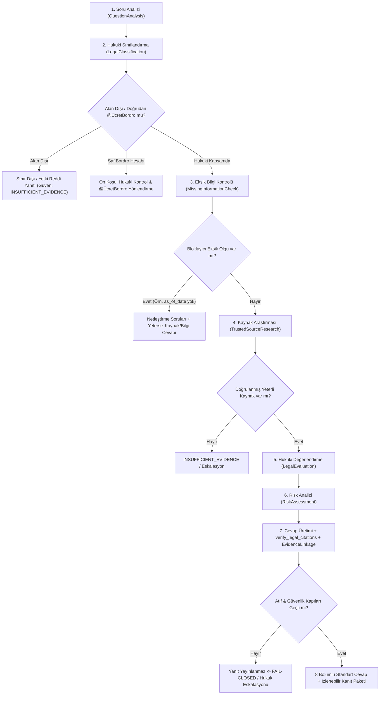

# `WP4_1_AGENT_CORE_SPEC.md` — hrAI `@HukukSGK` WP-4.1 Agent Core Teknik Şartnamesi

**Belge Kodu:** `WP4-1-AGENT-CORE-SPEC`  
**Sürüm Hedefi:** `v1.0.6` — **WP-4 (`HukukSGK Agent Intelligence`) / Aşama `WP-4.1`**  
**Ürün / Koordinatör / Uzman / Web:** `hrAI` / `@hrAI` / `@HukukSGK` / `www.insenai.com.tr`  
**Durum:** `APPROVED_WP4_1_DESIGN_SPEC` *(WP-4.1 onaylandı; Trust Chain gerektiren WP-4.2+ kodlama adımları PR #3 merge sonrası ilerleyecektir)*  
**Proje ve Yönetişim Sınırları:**
- WP-2 (`c28bbd162af9d69b5bd0e15c48e13abf26fcf5c9`, [PR #3](https://github.com/poliface34/poliface/pull/3)) değiştirilmeyecektir; PR #3 merge kararı ayrıdır.
- WP-4 geliştirmesi ayrı dal (`feat/v1.0.6-wp4-agent-intelligence`) ve ayrı PR üzerinden ilerleyecektir.
- Dondurulmuş `v1.0.5`, `v1.0.5.1` (`94a56b85...`), [`xmldsig.py`](../engine/esign5070/xmldsig.py) (`b16207b5...`), WP-1 CI güvence kuralları ([`ci-assurance.yml`](../../.github/workflows/ci-assurance.yml) — `schemas/` `13`, `config/` `9`) korunacaktır.
- Üretim (`production_use_authorized=false`), 5070 sayılı Kanun (`qualified_e_signature_5070_equivalent=false`) ve KVKK m.9 (`kvkk_data_residency_approved=false`) kapıları kapalı kalacaktır.

---

## 1. Amaç, Başarı Ölçütü ve Temel Prensip

`@HukukSGK`, **hrAI** platformunda `@hrAI` koordinatörü altında çalışan **Türkiye İş Hukuku, Sosyal Güvenlik, İSG ve Çalışan Kişisel Verileri** ön inceleme ve kanıta dayalı hukuki yönlendirme ajanıdır.

**Ölçülebilir Başarı Prensibi:**
1. **Doğru ve Doğrulanmış Dayanak:** Ajan uzun veya iddialı metin ürettiği için değil; yalnızca doğrulanmış L1–L4 kaynaklarına, içerik-eşleşmiş Trust Chain kayıtlarına (`hrai_hukuk_sgk/engine/trust_chain/`, PR #3 / WP-2) ve onaylı bilgi kartlarına dayandığı için başarılı sayılır.
2. **Zamansal (Yürürlük Tarihi) Doğruluk:** Her norm ve madde olay tarihi (`as_of_date`) ile karşılaştırılır; yürürlükten kalkmış veya olay tarihinde henüz yürürlüğe girmemiş düzenleme güncel dayanak yapılamaz.
3. **Dürüst Sınır Beyanı (Fail-Closed):** Kaynağı doğrulanamayan, yürürlük tarihi belirlenemeyen, kritik olgusu eksik veya hukuki riski yüksek konularda tahmin yürütmek yerine durur, eksik bilgi sorar ve/veya şirket avukatına eskalasyon yapar.

---

## 2. Ajanın Rolü ve Kesin Yetki Sınırları

| Boyut | `@HukukSGK` Yapar | `@HukukSGK` Asla Yapmaz | Teknik Uygulama / Sınır |
|---|---|---|---|
| **Hukuki İnceleme vs. Avukatlık (Av. K. m.35)** | Doğrulanmış mevzuat, bilgi kartı ve içtihatlar ışığında yapılandırılmış ön inceleme, risk tespiti ve İK uygulama adımı sunar. | Kesin hukuki mütalaa yazmaz; dava/cevap/istinaf/temyiz dilekçesi veya ihtarnameyi nihai hukuki onay olmadan kesinleştirmez. | Zorunlu `STANDARD_DISCLAIMER` + `human_approval.required = true`; yüksek riskte [`tools_router.py`](../engine/tools_router.py) üzerinden `escalate_to_legal_counsel`. |
| **Bordro Hesaplama Sınırı (`@ÜcretBordro`)** | Hukuki uygunluğu, hak kazanma koşullarını (ör. kıdem/ihbar/fazla çalışma hukuki statüsü) ve SGK çıkış kodunun hukuki dayanağını inceler. | Kuruş/TL brüt-net ücret, kıdem/ihbar tazminatı, yıllık izin alacağı, SGK primi veya gelir/damga vergisi kesinleştirmesi yapmaz. | Yalnızca `payroll_handoff_allowed == true` olduğunda `@ÜcretBordro` devri (`handoff_to_ucret_bordro` paketi) üretir. |
| **Kaynak ve Trust Chain Disiplini** | `EvidenceRegistry` (`engine/trust_chain/evidence_registry.py`, PR #3 / WP-2), [`verification_audit_log.json`](../config/verification_audit_log.json) ve `rag_kb/` üzerinden doğrulanmış kaynakları kullanır. | Mevzuat maddesi, karar numarası (`E./K.`), URL veya yürürlük tarihi uydurmaz; çıplak ana sayfa URL'si döndürmez. | Çıktı öncesi zorunlu `verify_legal_citations` ([`tools_router.py`](../engine/tools_router.py)) + `EvidenceBackedLegalAnswerBuilder` (`engine/trust_chain/answer_linker.py`, PR #3 / WP-2). |
| **L5 / L6 Özerk Normlar** | Kurum içi prosedür ve TİS/sözleşme/iç yönetmelik/işyeri uygulaması kurallarını [`autonomous_norms.py`](../engine/autonomous_norms.py) ile değerlendirir. | `REFERENCE_TEMPLATE_PENDING_COMPANY_ADOPTION` durumundaki şablonları bağlayıcı şirket politikası veya TİS gibi sunmaz. | `binding_company_policy == false` ise otomatik insan/hukuk incelemesi uyarısı zorunlu. |
| **Üretim / 5070 / KVKK Kapıları** | Mevcut teknik doğrulama düzeyini (`TEST_TRANSPORT` vs `LIVE_HTTPS`, `NOT_CONFIGURED`) dürüstçe raporlar. | Test aktarımını canlı üretim onayı saymaz; asimetrik imzayı 5070 NES saymaz; KVKK m.9 yurt dışı aktarım onayı vermez. | Üçlü kapı bayrakları daima `false`; `TRUST_CHAIN_LEGAL_BOUNDARY_NOTICE` zorunlu. |

---

## 3. WP-4.1 — 7 Aşamalı Deterministik Çalışma Akışı (`AgentPipeline`)

Geliştirici, ajanı serbest metin üreten tek adımlı bir prompt zinciri olarak değil; aşağıda sözleşmeleri tanımlanan **7 aşamalı deterministik durum makinesi** olarak kurgulayacaktır. Her aşama yapılandırılmış ara çıktı üretir ve bir sonraki aşamaya geçmeden doğrulama kapısından (`gate`) geçer.

### Aşama Sözleşmeleri (Girdi → İşlem → Çıktı → Kapı Kuralı)

| Aşama | Modül Sorumluluğu | Zorunlu Çıktı Alanları | Geçiş / Durma Kapısı |
|---|---|---|---|
| **1. Soru Analizi** | Ham kullanıcı sorusundan somut olayı, talebi, beklenen çıktı türünü (bilgi alma, vaka analizi, prosedür kontrolü, bordro talebi) ve tarih adaylarını çıkarır. | `raw_query`, `event_summary`, `user_intent`, `expected_output_type`, `candidate_dates`, `contains_payroll_calculation_request`, `mentions_autonomous_norm` | Boş veya anlamsız sorgu (`len < 3`) `INVALID_QUERY` ile reddedilir. |
| **2. Hukuki Sınıflandırma** | Ana hukuk alanını (`LEGAL_DOMAIN`), alt konuları, ilgili mevzuat havuzunu ve varsa [`HukukSGKToolRouter`](../engine/tools_router.py) senaryo türünü (`scenario_type`) belirler. | `primary_domain`, `secondary_domains`, `matched_scenario_type`, `suspected_statutes`, `requires_l5_l6_check`, `out_of_scope_reason` | `OUT_OF_DOMAIN_OTHER` ise kapsam dışı bildirimi döner; saf kuruş hesabı talebi ise hesap üretmeyip `@ÜcretBordro` yönlendirme kuralı işaretlenir. |
| **3. Eksik Bilgi Kontrolü** | Sınıf ve senaryo için gereken olguların (`as_of_date`, statü, sözleşme, çalışma düzeni, kıdem, bildirim kanalı, savunma vb.) mevcut olup olmadığını denetler. | `as_of_date`, `as_of_date_verified`, `blocking_missing_fields`, `conditional_missing_fields`, `clarification_questions` | `blocking_missing_fields` boş değilse **kesin hüküm ve `@ÜcretBordro` devri kilitlenir** (`payroll_handoff_allowed=false`); netleştirme soruları üretilir. |
| **4. Kaynak Araştırması** | Önce doğrulanmış merkezi envanter (`lookup_verified_source_and_precedent`, `lookup_knowledge_card`, `lookup_autonomous_norm_guidance`) ve WP-2 `EvidenceRegistry` kayıtlarında arama yapar. | `verified_sources`, `verified_cards`, `verified_precedents`, `verified_evidence_records`, `excluded_pending_or_unverified`, `historical_only_records` | Yalnızca `VERIFIED` + `content_verified=True` + `effective_on_date=True` kaynaklar aktif havuza alınır; erişilemeyen/uyuşmaz/ham ikili belgeler aktif havuza **girmez**. |
| **5. Hukuki Değerlendirme** | `as_of_date` yürürlük denetimi (`check_article_effective_date`), norm çatışması (`resolve_norm_conflict`), içtihat analizi (`evaluate_precedent_application`), L5/L6 kontrolü (`evaluate_autonomous_norm_conflict`) ve 7 senaryolu motor (`evaluate_hr_legal_scenario`) çalıştırılır. | `legal_bases`, `historical_context`, `statutory_rules`, `exceptions`, `transitional_provisions`, `judicial_precedents`, `autonomous_norms`, `counter_arguments` | Yürürlük dışı kaynak yalnızca `historical_context` içinde tutulur; içtihat kanun gibi değerlendirilmez; yürürlük belirsizliğinde eskalasyon açılır. |
| **6. Risk Analizi** | İşveren ve çalışan için maddi/hukuki sonuçları, hak düşürücü süreleri, İPC ve geçersizlik risklerini hesaplar; risk seviyesi ve eskalasyon kararını üretir. | `risk_level` (`LOW..CRITICAL`), `employer_risks`, `employee_risks`, `ipc_risks`, `decision_badge`, `human_approval`, `escalation_ticket` | `HIGH`/`CRITICAL` veya BLOCKER flag durumunda `escalate_to_legal_counsel` zorunlu tetiklenir ve `payroll_handoff_allowed = false` olur. |
| **7. Cevap Üretimi & Yayın Kapısı** | 8 bölümlü standart cevabı oluşturur; `verify_legal_citations` ([`tools_router.py`](../engine/tools_router.py)) ve mevcut kanıtlarla `EvidenceBackedLegalAnswerBuilder` (`engine/trust_chain/answer_linker.py`, PR #3 / WP-2) bağlamasını çalıştırır. | `rendered_sections` (8 bölüm), `citation_audit_result`, `evidence_linked_answer`, `confidence_status`, `disclaimer` | `verify_legal_citations.passed == false` veya kanıt bütünlüğü hatasında **yanıt kullanıcıya dönmez** (fail-closed blokaj + güvenli hata/eskalasyon cevabı). |

---

## 4. Hukuki Soru Sınıflandırma Standardı (`LegalClassification`)

### 4.1. Ana Hukuk Alanları Taksonomisi

| Alan Kodu (`primary_domain`) | Kapsam ve Temel Kanun/Düzenleme Havuzu | Varsayılan Senaryo / Alt Akış Eşleşmesi |
|---|---|---|
| `LABOR_LAW` | İş sözleşmesi türleri, fesih geçerliliği, kıdem/ihbar, fazla çalışma, yıllık izin, ara dinlenmesi, çalışma koşullarında değişiklik (`4857`, `1475 m.14`, `6098 TBK`, `7036`, `6356`, L2 İş Kanunu yönetmelikleri, L5/L6) | `TERMINATION_VALIDITY`, `REINSTATEMENT_CLAIM`, `SEVERANCE_AND_NOTICE`, `OVERTIME_COMPLIANCE`, `ANNUAL_LEAVE_COMPLIANCE`, `EMPLOYEE_FAVORABLE_NORM_COMPARISON` veya `LEGAL_QA` |
| `SOCIAL_SECURITY` | Sigortalılık, SPEK/PEK alt-üst sınırları, SGK çıkış kodları, işsizlik ödeneği, teşvik/indirim, istirahat/e-vizite, 5510 m.102 İPC (`5510`, `4447`, `7566`, `SSİY`, SGK 2020/20 & 2026 genelgeleri) | `SGK_EXIT_CODE_AND_UNEMPLOYMENT` veya `LEGAL_QA` |
| `OCCUPATIONAL_HEALTH_AND_SAFETY` | İşveren İSG yükümlülükleri, iş kazası/meslek hastalığı bildirimi, çalışan sağlığı/mesleki yeterlilik (`6331`, L5 İSG/iş kazası prosedürü) | `LEGAL_QA` + yüksek riskte otomatik avukat eskalasyonu |
| `PERSONAL_DATA_PROTECTION` | Çalışan özlük dosyası, açık rıza, aydınlatma, sağlık/özel nitelikli veri işleme, izleme/kayıt ve yurt dışı aktarım (`6698 KVKK`, `4857 m.75`, TBK m.419) | `LEGAL_QA` *(KVKK m.9 yurt dışı aktarım onayı daima kapalı/eskalasyon)* |
| `MIXED_MULTI_DOMAIN` | Aynı vakada birden fazla alanı kesen sorular (örn. *Sağlık raporu/devamsızlık nedeniyle fesih + SGK çıkış kodu + KVKK sağlık verisi*) | Alt sorulara bölünür; her alanın kuralları ayrı değerlendirilip en sıkı risk/eskalasyon seviyesi uygulanır |
| `PAYROLL_DELEGATION_ONLY` | Saf parasal hesaplama talepleri (*"Brüt 65.000 TL'den 4 yıl kıdem net kaç TL çıkar?"*) | Hukuki ön koşul varsa doğrulanır; hesaplama yapılmaz, `@ÜcretBordro` yönlendirmesi döner |
| `OUT_OF_DOMAIN_OTHER` | Ceza hukuku, aile/miras hukuku, ticaret/şirketler, vergi usul davası (bordro/ücret istisnası dışı) | Açık yetki/kapsam sınırı reddi (`OUT_OF_SCOPE`); mevzuat uydurması yasak |

### 4.2. Mevzuat Dışı Soru veya Kısmi Kapsam Davranışı
- `MIXED_MULTI_DOMAIN` sorularda ajan **tek bir senaryoya sıkıştırmaz**: Önce birincil deterministik senaryoyu çalıştırır, ardından ikincil alanın (ör. KVKK özel nitelikli veri veya 6331 iş kazası bildirimi) zorunlu uyarılarını `Risk` ve `Uygulama` bölümlerine ekler.
- Vergi düzenlemelerinde (`193 GVK`, `488 DVK`, `5746`, `4691`, GİB `319`/`331` tebliğleri) yalnızca istihdam/ücret istisnasının **hukuki koşul ve tavan kurallarını** değerlendirir; bekleyen statüdeki `GIB-TEBLIG-332-20251231` ([`legal_sources_registry.json`](../config/legal_sources_registry.json)) gibi `PENDING_REVIEW` kayıtları kesin dayanak yapmaz.

---

## 5. Eksik Bilgi Sorgulama Mekanizması (`MissingInformationCheck`)

Ajan, kritik olgu eksikken varsayım üzerine kesin sonuç üretemez.

### 5.1. Zorunlu Bilgi Matrisi (Alan ve Senaryo Bazlı)

| Bilgi Alanı | Ne Zaman Zorunlu? | Eksikse Sınıflandırma | Eksiklik Etkisi |
|---|---|---|---|
| `as_of_date` (Olay / İşlem Tarihi, `YYYY-MM-DD`) | **Tüm hukuki değerlendirmelerde evrensel zorunlu** | `BLOCKING_MISSING` | Yürürlük tarihi kontrolü ve 7555/7566 gibi tarih eşikleri doğrulanamaz; kesin hüküm verilmez (`INSUFFICIENT_EVIDENCE`). |
| `employee_status` (4857 / 6098 TBK / Basın / Deniz / Stajyer) | Tüm iş hukuku ve fesih/izin/mesai soruları | `BLOCKING_MISSING` *(statü belirsizse)* | Uygulanacak ana kanun (`4857` vs `6098`) değişir; iki rejim birbirine karıştırılamaz. |
| `contract_term_type` (`INDEFINITE` / `FIXED_TERM` / `PART_TIME` / `REMOTE` / `SUBCONTRACTOR`) | Fesih, ihbar, kıdem, fazla çalışma, uzaktan çalışma | `BLOCKING_MISSING` *(belirli/belirsiz ayrımı sonucu etkiliyorsa)* | Belirli süreli sözleşmede işe iade/ihbar rejimi farklılaşır. |
| `workplace_total_employees` & `tenure_months` | Fesih geçerliliği (`m.18`), işe iade (`7036 m.3`), kıdem (`1475 m.14`) | `BLOCKING_MISSING` *(iş güvencesi / kıdem hükmü verilecekse)* | 30 çalışan ve 6 ay kıdem eşiği bilinmeden m.18/m.19 geçerlilik şartı kesinleştirilemez. |
| `termination_reason_type`, `written_notice_with_clear_reason`, `notification_channel`, `written_defense_status` | Fesih ve işe iade senaryoları | `BLOCKING_MISSING` *(eksik usul belgesi)* | 24.07.2025 sonrası 4857 m.109 yazılılık ve m.19 savunma kontrolü yapılamadan `UYGUN` verilemez. |
| `incident_date`, `discovery_date`, `discovering_authority_status`, `weekly_rest_day`, `saturday_is_working_day` | 4857 m.25 haklı fesih / m.26 (6 iş günü + 1 yıl) | `BLOCKING_MISSING` *(süre hesabı isteniyorsa)* | Yetkili makamın öğrenme tarihi ve yasal hafta tatili olmadan 6 iş günü hesaplanamaz. |
| `work_schedule` / `projected_annual_overtime_hours` / `work_category` | Fazla çalışma, gece/yeraltı/yasaklı işler (`Yön. m.7`) | `CONDITIONAL_WARNING` veya `BLOCKING_MISSING` | Yılda 270 saat / günlük 11 saat / 7.5 saat gece-yeraltı sınırı için belirleyicidir. |
| `proposed_sgk_exit_code` & `last_3_years_insured_days` | SGK çıkış kodu ve 4447 işsizlik ödeneği | `BLOCKING_MISSING` *(uygunluk verilecekse)* | Yanlış SGK kodu 5510 m.102 İPC ve 4447 işsizlik hakkı kaybına yol açar. |
| `autonomous_norm_adoption_proof` (TİS / imzalı sözleşme / yazılı rıza 4857 m.22) | L5/L6 prosedür, prim/ikramiye değişikliği, TİS uyuşmazlığı | `BLOCKING_MISSING` *(şirket politikası bağlayıcılığı isteniyorsa)* | Onaylı belge olmadan L5/L6 yalnızca referans şablon olarak gösterilir. |

### 5.2. Eksiklik Durumunda Üretilecek Davranış
1. **`BLOCKING_MISSING` varsa:**
   - `Hukuki sonuç` bölümünde açıkça *"Kritik bilgiler eksik olduğu için somut olaya ilişkin kesin hukuki sonuç üretilememektedir"* yazılır.
   - En fazla **5 hedefli netleştirme sorusu** üretilir; her soru *(i) istenen olgu*, *(ii) özlük/SGK kaynağındaki doğrulama belgesi* ve *(iii) hukuki sonucu nasıl değiştireceği* ile birlikte verilir.
   - `human_approval.payroll_handoff_allowed = false` kilitlenir ve `confidence_status = INSUFFICIENT_EVIDENCE` *(veya kanıtlar tam olup yalnızca olgu eksikse `PARTIALLY_VERIFIED` — ancak hiçbir zaman `VERIFIED` olmaz)* atanır.
2. **Hiçbir durumda:** *"Muhtemelen 30'dan fazla çalışanınız vardır"*, *"Olayı 2026 yılı kabul edelim"* gibi sessiz varsayım yapılmaz.

---

## 6. Kaynak Kullanma ve Doğrulama Kuralları (Trust Chain & L1–L6)

### 6.1. İzinli Kaynak Havuzu ve Durum Kapıları

| Kaynak Katmanı | Otorite / Depo | Aktif Dayanak Şartı | Reddedilen / İzole Edilen Durum |
|---|---|---|---|
| **Trust Chain Canlı / Arşiv Kayıtları (`WP-2`)** | `EvidenceRegistry` (`engine/trust_chain/evidence_registry.py`, PR #3 / WP-2) + 6 Resmî Adaptör (`ResmiGazete`, `Mevzuat`, `Sgk`, `Iskur`, `Yargitay`, `Danistay`) | `is_verified_authority == True` (`STATUS_VERIFIED_LIVE` veya açıkça işaretli test/arşiv bağlamında `STATUS_VERIFIED_TEST_TRANSPORT`), `content_verified == True` (`CONTENT_MATCH_MATCHED`), ham bayt `ContentStore` bütünlüğü `PASS` | `STATUS_UNREACHABLE_NOT_VERIFIED`, `STATUS_REJECTED_CONTENT_MISMATCH`, `STATUS_REJECTED_INVALID_SOURCE`, `STATUS_TRANSPORT_ONLY_UNVERIFIED_CONTENT` (taranmış okunaksız PDF dahil) → aktif dayanak dışı ve `failed_attempts` izine yönlendirilir. |
| **Merkezi L1–L4 Kayıt Defteri & Bilgi Kartları** | `config/legal_sources_registry.json`, `config/yargitay_precedents.json`, `config/verification_audit_log.json`, `rag_kb/01..03` | `verification_status == "VERIFIED"` **ve** (`document_fetch_status == "FETCHED_AND_MATCHED"` veya doğrulanmış kart çift onayı) **ve** `effective_on_date == true` | `PENDING_REVIEW` (`GIB-TEBLIG-332-20251231`, `YIBBGK-2021-8-2026-1`), `UNVERIFIED`, `METADATA_VERIFIED_PENDING_LIVE_FETCH` → kesin dayanak yapılmaz. |
| **Yargıtay İçtihatları (`L4`)** | [`precedent_verifier.py`](../engine/precedent_verifier.py) + `evaluate_precedent_application` ([`tools_router.py`](../engine/tools_router.py)) | `VERIFIED` tam metin + karar kapsamı eşleşmesi; `YIBBGK` dışı (`HGK_PERSUASIVE`, `CHAMBER_SETTLED`, `CHAMBER_ISOLATED`) kararlarda ≥ 25 karakter `application_rationale` | İçtihat **asla** kanun/yönetmelik normu gibi katman önceliğine sokulmaz; karar sonrası kanun değişikliği varsa eskalasyon yapılır; `CHAMBER_ISOLATED` avukat onayı gerektirir. |
| **L5 / L6 Özerk Normlar** | `rag_kb/05_ik_prosedurleri/`, `rag_kb/06_tis_.../`, `config/autonomous_norms_audit_log.json` | `adoption_status == "COMPANY_ADOPTED_COUNSEL_VERIFIED"` (kurum kabulü kanıtlı) | `REFERENCE_TEMPLATE_PENDING_COMPANY_ADOPTION` ise bağlayıcı politika olarak sunulamaz; 7 zorunlu kural alanı ve 4857 m.22 / 6356 m.36 kontrolü zorunlu. |

### 6.2. Yürürlük Tarihi ve Geçmiş Düzenleme Kuralı
- Her kaynak için **`publication_date` (yayım tarihi)**, **`effective_date` (yürürlük tarihi)** ve varsa **`expiry_or_repeal_date` (yürürlükten kalkma/sona erme tarihi)** kesin ayrıştırılır.
- **Zorunlu Kontrol:** `effective_date <= as_of_date <= expiry_or_repeal_date (veya None)` koşulu sağlanmadan hüküm **güncel hukuki dayanak (`legal_bases`) olamaz**.
- Süresi dolmuş veya yürürlükten kalkmış düzenlemeler (ör. `RG-9368-20241228` 2025 uzaktan çalışma oranı veya 24.07.2025 öncesi eski 4857 m.109 metni):
  - `as_of_date` o dönemde ise yalnızca o tarihe özgü tarihsel vaka incelemesi olarak açık tarih kaydıyla değerlendirilir;
  - `as_of_date` yürürlük bitiminden sonra ise yalnızca `historical_context` / karşılaştırma notu olarak belirtilir, **asla yürürlükteki hüküm gibi sunulmaz**.
- `EvidenceBackedLegalAnswerBuilder` (`engine/trust_chain/answer_linker.py`, PR #3 / WP-2) üzerindeki tarihsel/mülga kanıt kuralı geçerlidir: açık `historical_disclosure_text` olmadan mülga kanıt cevaba bağlanamaz.

### 6.3. Normlar Hiyerarşisi ve Katman Ayrımı
Ajan, [`norm_hierarchy.py`](../engine/norm_hierarchy.py) uyarınca şu ayrımları gözetmek zorundadır:
1. `Anayasa (1)` > `Temel Hak Antlaşması m.90/5 son cümle (2)` > `Kanun / Genel Antlaşma m.90/5 c.1 (3)` > `CBK (4)` > `Cumhurbaşkanı Kararı [CK] (5)` > `Yönetmelik (6)` > `Tebliğ/SGK Genelgesi (7)`. (`CK` asla `CBK` olarak adlandırılamaz.)
2. `YARGITAY_PRECEDENT` **mevzuat basamağı değildir**; `2797 s. Kanun m.45` (YİBBGK) ve dayanak kanunun yorumu çerçevesinde ayrı değerlendirilir.
3. L5 (İK Prosedürleri) ve L6 (TİS / Bireysel Sözleşme / İç Yönetmelik / Yerleşik İşyeri Uygulaması) birbirine ve resmî L1–L4 çekirdeğine karıştırılmaz.

---

## 7. Standart Cevap Formatı (8 Zorunlu Bölüm ve Şema Eşlemesi)

### 7.1. Zorunlu 8 Bölüm Sözleşmesi

Her hukuki cevap (`AgentCoreResponse`) aşağıda tanımlanan **8 sabit bölümü** eksiksiz içerir:

| Sıra | Bölüm Adı | Veri Alanı (`snake_case`) | Zorunlu İçerik ve Doğrulama Kuralı |
|---|---|---|---|
| **1** | **Hukuki sonuç** | `hukuki_sonuc` (`legal_conclusion`) | Sorunun kısa, net ve olguya bağlı cevabı. Eksik bilgi / yüksek risk / kapsam dışı varsa sonuç cümlesi bunu en başta açıkça ilan eder (kesin hüküm iddiası kurmaz). |
| **2** | **Mevzuat dayanağı** | `mevzuat_dayanagi` (`statutory_bases`) | Yalnızca `VERIFIED` ve `as_of_date` itibarıyla yürürlükteki kanun, madde, yönetmelik, tebliğ/genelge ve yürürlük tarihi bilgisi. Mülga/gelecek tarihli hükümler ayrı *"Tarihsel Bağlam (Yürürlük Dışı)"* alt başlığına konur. |
| **3** | **Hukuki değerlendirme** | `hukuki_degerlendirme` (`legal_analysis`) | Hükmün somut olaya uygulanması. Alt başlıklarla **Kanun Hükmü**, **İstisna**, **Geçiş Hükmü**, **İçtihat** *(kanundan ayrı ve kapsam sınırıyla)*, **İşyeri Uygulaması / L5–L6** ve **Karşı Görüşler (`counter_arguments`)** birbirinden açıkça ayrılır. |
| **4** | **Uygulama** | `uygulama` (`hr_implementation_steps`) | İK departmanının yapması gereken somut adımlar, özlük/tebliğ/tutanak kontrolleri, gerekiyorsa eksik bilgi tamamlama listesi ve `payroll_handoff_allowed == true` ise `@ÜcretBordro` devri yönlendirmesi (parasal hesap yapılmaz). |
| **5** | **Risk** | `risk` (`risks`) | İşveren ve çalışan açısından hukuki, mali, işe iade, SGK teşvik yasaklılığı, İPC (`4857`/`5510`/`6331`/`6698`) ve operasyonel riskler; risk derecesi (`LOW`/`MEDIUM`/`HIGH`/`CRITICAL`) ve varsa avukat eskalasyonu bileti/gerekliliği. |
| **6** | **İstisnalar** | `istisnalar` (`exceptions_and_conditions`) | Sonucu değiştirebilecek özel koşullar (30 çalışan/6 ay kıdem eşiği, m.26 maddi çıkar istisnası, TİS/yazılı rıza m.22, kısmi süreli/yeraltı/genç işçi istisnaları, arife yarım gün kuralı vb.). |
| **7** | **Kaynaklar** | `kaynaklar` (`sources`) | Doğrulanmış belge/kayıt ID'leri (`source_id`, `card_id`, `precedent_id`, `evidence_id`), belge başlığı, özgül resmî URL (`url_granularity != "HOMEPAGE"`), `publication_date`, `effective_date`, `content_sha256` ve `registry_head_sha256`. Doğrulanmış kaynak yoksa liste boş bırakılır ve *"Doğrulanmış kaynak bulunamadı"* yazılır. |
| **8** | **Güven durumu** | `guven_durumu` (`confidence_status`) | Sabit 3 düzeyden biri: **`Doğrulanmış`** (`VERIFIED`), **`Kısmen Doğrulanmış`** (`PARTIALLY_VERIFIED`) veya **`Cevap İçin Yetersiz Kaynak`** (`INSUFFICIENT_EVIDENCE`). Beraberinde gerekçe kodu, `human_approval` durumu, Avukatlık Kanunu m.35 şerhi ve `production=false / 5070=false / kvkk=false` sınır beyanı yer alır. |

### 7.2. Mevcut `legal_scenario_evaluation.schema.json` (13 Şema) ile Geriye Uyumlu Eşleme

WP-1 CI güvencesi gereği `schemas/` altındaki **13** Draft 2020-12 JSON şeması sayısı korunur; bu nedenle `AgentCoreResponse` çıktı adaptörü, mevcut [`legal_scenario_evaluation.schema.json`](../schemas/legal_scenario_evaluation.schema.json) bloklarını kaybetmeden 8 bölümlü kullanıcı sunumuna dönüştürür:

| 8 Bölümlü WP-4 Standardı | `evaluate_hr_legal_scenario` / Trust Chain Karşılığı |
|---|---|
| 1. `Hukuki sonuç` | `decision_badge` + `assessment_summary` (+ `missing_information` / `human_approval` kısıt özeti) |
| 2. `Mevzuat dayanağı` | `legal_bases` (`effective_on_date=true`) + ayrı alt blok `historical_context` (`effective_on_date=false`) |
| 3. `Hukuki değerlendirme` | `structured_findings` + `norm_conflict_resolution` + `precedent_application_assessment` + `counter_arguments` |
| 4. `Uygulama` | `recommended_actions` + `missing_information` belge kontrol listesi + `human_approval.payroll_handoff_allowed` yönlendirmesi |
| 5. `Risk` | `risks` (`risk_level`, `category`, `description`, `legal_consequence`) + `human_approval.counsel_escalation_required` |
| 6. `İstisnalar` | `structured_findings.exceptions` + L5/L6 kabul durumu (`adoption_status`) + arife/süre istisna notları |
| 7. `Kaynaklar` | `EvidenceLinkedAnswer.evidence_links` (`evidence_id`, `source_url`, `content_sha256`, `record_sha256`, `registry_head_sha256`) + doğrulanmış `legal_bases` URL'leri |
| 8. `Güven durumu` | `confidence_status` türetim kuralı (§7.3) + `human_approval` + `disclaimer` + `legal_boundary_notice` |

### 7.3. `Güven durumu` Deterministik Türetim Kuralı (Self-Assertion Yasak)

Model veya çağıran taraf kendi kendine `"Doğrulanmış"` etiketi basamaz; etiket aşağıdaki kural tablosundan **deterministik** üretilir:

| Koşul | Zorunlu `confidence_status` |
|---|---|
| `verify_legal_citations.passed == false` **VEYA** doğrulanmış hiç aktif kaynak yok (`len(verified_sources) == 0`) **VEYA** Trust Chain kaynakları `UNREACHABLE` / `REJECTED_CONTENT_MISMATCH` **VEYA** `BLOCKING_MISSING` kritik olgu var (`as_of_date` yok vb.) **VEYA** konu `OUT_OF_DOMAIN` | **`Cevap İçin Yetersiz Kaynak`** (`INSUFFICIENT_EVIDENCE`) |
| Aktif kaynaklar `VERIFIED` + `content_verified=True` **ancak** test taşıyıcısı (`VERIFIED_TEST_TRANSPORT`) kullanıldıysa **VEYA** `CONDITIONAL_WARNING` eksik bilgi varsa **VEYA** `PENDING_REVIEW` kayıt dışlandığı için boşluk doğuyorsa **VEYA** `CHAMBER_ISOLATED` / L5-L6 kabul edilmemiş şablon / `escalate_to_legal_counsel` tetiklendiyse | **`Kısmen Doğrulanmış`** (`PARTIALLY_VERIFIED`) |
| Tüm aktif dayanaklar canlı veya tam mühürlü arşiv (`VERIFIED` + `content_verified=True` + `effective_on_date=True`), zero `BLOCKING_MISSING`, zero `PENDING_REVIEW` bağımlılığı, `verify_legal_citations.passed == true` ve çelişkili içtihat/eskalasyon blokajı yok *(Not: Yine de `human_approval.required = true` ve üretim kapıları `false` korunur)* | **`Doğrulanmış`** (`VERIFIED`) |

---

## 8. Risk Sınıflandırması ve Eskalasyon Matrisi

| Risk Seviyesi | Tanımlayıcı Kriterler ve Somut Tetikleyiciler | Zorunlu Karar Rozeti & Onay Katmanı | `@ÜcretBordro` Devri | Avukat Eskalasyonu (`escalate_to_legal_counsel`) |
|---|---|---|---|---|
| **`LOW`** | Rutin bilgilendirme, açık kanuni hüküm, olgular tam, yürürlük kesin, uyuşmazlık/ihlal sınırı yok. | `UYGUN_ON_DEGERLENDIRME` / `HR_OPERATIONS_VERIFICATION` | İzinli *(yalnızca hesap talebi varsa ve ek olgu eksik değilse)* | Opsiyonel |
| **`MEDIUM`** | Koşullu uygulama farklılıkları, L5/L6 henüz şirketçe benimsenmemiş şablon uyarısı, ikincil eksik bilgi (`CONDITIONAL_WARNING`), 270 saat/denkleştirme takip uyarısı. | `UYGUN_ON_DEGERLENDIRME` veya `EKSIK_BILGI_TAMAMLANMALI` / `SENIOR_HR_AND_LEGAL_REVIEW` | Koşul/eksik olgu varsa **KİLİTLİ (`false`)** | Koşul gerektiriyorsa önerilir |
| **`HIGH`** | İş güvencesi feshi savunma/yazılılık şüphesi (`4857 m.19`), 24.07.2025 sonrası `m.109` yazılı bildirim riski, SGK çıkış kodu uyumsuzluğu (`5510 m.102`), 4857 m.26 yarım gün arife belirsizliği (`M26_YARIM_GUN_TATIL_HUKUKI_INCELEME_GEREKLI`), ikna edici içtihat gerekçe eksikliği, `CHAMBER_ISOLATED` karar. | `USUL_EKSIGI_DUZELTME_GEREKLI` veya `YUKSEK_RISK_AVUKAT_ESKALASYONU` / `MANDATORY_LEGAL_COUNSEL_APPROVAL` | **KİLİTLİ (`false`)** | **ZORUNLU (`severity="HIGH_LITIGATION_RISK"` veya `"COUNSEL_REVIEW_REQUIRED"`)** |
| **`CRITICAL`** | Toplu işçi çıkarma (`4857 m.29`), sendika temsilcisi (`6356 m.24`) / sendikal fesih (`m.25`), gebelik/analık/iş kazası sonrası fesih, `HOLIDAY_CALENDAR_COVERAGE_INCOMPLETE`, `AUDIT_CHAIN_TAMPERING_DETECTED`, `SOURCE_SNAPSHOT_PATH_OUTSIDE_PROJECT_ROOT`, yasaklı işler (`Yön. m.7`), çelişkili içtihat, KVKK m.9 yurt dışı aktarım / sağlık verisi ihlali, atıf denetimi (`verify_legal_citations`) BLOCKER. | `YUKSEK_RISK_AVUKAT_ESKALASYONU` / `MANDATORY_LEGAL_COUNSEL_APPROVAL` | **KESİN KİLİTLİ (`false`)** | **ZORUNLU BLOKAJ (`severity="CRITICAL_LEGAL_BLOCK"`)** |

---

## 9. Yanlış Bilgi Üretimini Engelleyen Kurallar (10 Zorunlu Fail-Closed Guardrail)

| Kural ID | Kural Tanımı | Teknik Denetim Kapısı | İhlal Anında Fail-Closed Davranış |
|---|---|---|---|
| **G-01** | Mevzuat maddesi, karar numarası veya kaynak URL'si **uyduramaz**. | `lookup_verified_source_and_precedent` + `verify_legal_citations` ([`tools_router.py`](../engine/tools_router.py)) (regex + kayıt defteri çapraz kontrolü + çıplak ana sayfa URL yasağı). | `UNVERIFIED_OR_FABRICATED_CITATION` BLOCKER; yanıt bastırılır. |
| **G-02** | Yürürlükten kalkmış düzenlemeyi **güncel hüküm gibi sunamaz**. | `check_article_effective_date` + `legal_bases` (`effective_on_date=true`) vs `historical_context` (`effective_on_date=false`) zorunlu şema ayrımı + `HISTORICAL_DISCLOSURE_MARKERS` kontrolü. | Mülga atıf `legal_bases` içinde tespit edilirse `REPEALED_STATUTE_CITED_AS_CURRENT` ile reddedilir. |
| **G-03** | Olay tarihi (`as_of_date`) ile mevzuat yürürlük tarihini **karşılaştırmadan kesin hüküm veremez**. | Aşama 3 (`as_of_date` gate) + Aşama 5 (`effective_date <= as_of_date <= expiry_or_repeal_date`). | Tarih yoksa `UNKNOWN_DATE_BLOCKS_FINAL_RULING`; tarih belirsizliği `INSUFFICIENT_EVIDENCE` üretir. |
| **G-04** | Yargıtay kararını **kanun hükmü gibi değerlendiremez**. | [`norm_hierarchy.py`](../engine/norm_hierarchy.py) (`YARGITAY_PRECEDENT` norm basamağı dışıdır; 2797 m.45 ayrımı) + `evaluate_precedent_application` ([`tools_router.py`](../engine/tools_router.py)). | İçtihadı mevzuat katmanı gibi sıralama girişimi reddedilir; YİBBGK dışı kararda `application_rationale` (<25 krk) yoksa eskalasyon açılır. |
| **G-05** | Kaynak doğrulanamıyorsa **bunu açıkça belirtir**. | Trust Chain status kapısı (`UNREACHABLE_NOT_VERIFIED`, `REJECTED_CONTENT_MISMATCH`, `TRANSPORT_ONLY_UNVERIFIED_CONTENT`) + `PENDING_REVIEW` filtresi. | `confidence_status = INSUFFICIENT_EVIDENCE` (veya `PARTIALLY_VERIFIED`), neden kodu ve eksik doğrulama bildirimi zorunlu. |
| **G-06** | Eksik bilgi varsa **varsayım yapmak yerine soru sorar**. | Aşama 3 Zorunlu Bilgi Matrisi (`BLOCKING_MISSING`). | Nihai sonuç ve `@ÜcretBordro` devri durdurulur; yapılandırılmış netleştirme soruları döner. |
| **G-07** | Hukuki risk yüksekse **avukat değerlendirmesi önerir**. | Aşama 6 Risk Matrisi (`HIGH` / `CRITICAL`) + `escalate_to_legal_counsel` ([`tools_router.py`](../engine/tools_router.py)). | `counsel_escalation_required = true`, bilet ID (`LEGAL-ESC-...`) üretilir, `payroll_handoff_allowed = false`. |
| **G-08** | Bordro hesaplamalarını **kendi başına kesinleştirmez**; `@ÜcretBordro`'ya yönlendirir. | Aşama 1/2 niyet filtresi + kuruş/vergi/prim hesaplama çıkış filtresi + `handoff_to_ucret_bordro` kapısı. | Doğrudan TL/kuruş kesin hesabı üretimi engellenir; uygunluk onaylıysa `@ÜcretBordro` devir paketi önerilir, eksikse devir reddedilir. |
| **G-09** | Hukuki danışmanlık sınırlarını ve yetki sınırlarını **gözetir** (Av. K. m.35 & kapalı kapılar). | Her yanıtta zorunlu `STANDARD_DISCLAIMER` + `TRUST_CHAIN_LEGAL_BOUNDARY_NOTICE` + `production_use_authorized=false`, `5070=false`, `kvkk=false`. | Dilekçe taslağı / kesin mütalaa iddiası veya kapalı kapıları açma iddiası reddedilir. |
| **G-10** | Her cevabın hangi kanıtlara dayandığı **izlenebilir olmalıdır**. | `EvidenceBackedLegalAnswerBuilder` & `verify_answer_traceability` (`engine/trust_chain/answer_linker.py`, PR #3 / WP-2) (`evidence_ids`, `content_sha256`, `record_sha256`, `registry_head_sha256`, `answer_sha256`). | Kanıt bağı kopuk, `registry_head_sha256` tanımsız veya ham içerik özeti uyuşmayan cevap yayınlanmaz. |

---

## 10. WP-4.1 Geliştirici Kabul Test Senaryoları (14 Ölçülebilir Senaryo)

WP-4.2 – WP-4.6 süresince aşağıdaki 14 senaryo doğrudan deterministik test olarak kodlanacaktır:

| Test ID | Senaryo Özeti | Hedeflenen Kural / Aşama | Beklenen Zorunlu Çıktı ve Davranış |
|---|---|---|---|
| **TC-01** | **Net Pozitif Fesih & Yazılılık (24.07.2025 sonrası):** `as_of_date=2026-03-10`, 45 çalışan, 18 ay kıdem, geçerli sebep, elden yazılı bildirim + yazılı savunma mevcut, tüm kaynaklar `VERIFIED` + `EvidenceRegistry` bağlı. | Aşama 1–7 tam akış, G-10 | 8 bölüm eksiksiz; `Hukuki sonuç`: usul şartları ön incelemede uygun; `decision_badge="UYGUN_ON_DEGERLENDIRME"`, `Güven durumu="Doğrulanmış"` *(veya test taşıyıcısıysa `"Kısmen Doğrulanmış"`)*, `evidence_ids` + `answer_sha256` bağlı, `payroll_handoff_allowed=true`. |
| **TC-02** | **Eksik Olay Tarihi (`as_of_date` yok):** *"Çalışanı haklı nedenle çıkardık, tazminat öder miyiz?"* (tarih, bildirim kanalı, öğrenme tarihi verilmemiş). | Aşama 3, G-03, G-06 | `Hukuki sonuç` kesin hüküm vermez; `BLOCKING_MISSING` içinde `as_of_date`, `notification_channel`, `discovery_date` sorulur; `Güven durumu="Cevap İçin Yetersiz Kaynak"`, `payroll_handoff_allowed=false`. |
| **TC-03** | **24.07.2025 Sonrası KEP / Sözlü Fesih Tuzağı (7555 m.23 → 4857 m.109):** `as_of_date=2025-09-01`, 4857 m.25 haklı fesih KEP ile yapılmış. | Aşama 5–6, G-02 | `m.19/1` vs `7555 m.23 ile değişik m.109` ayrı analiz edilir; `M109_7555_YAZILI_FESIH_BILDIRIMI_IHLALI`, risk `HIGH`, `escalate_to_legal_counsel` zorunlu, `payroll_handoff_allowed=false`. |
| **TC-04** | **Mülga Düzenleme Güncel Gibi Sorulduğunda:** `as_of_date=2026-04-01` için `9368 sayılı CK` (31.12.2025'te süresi dolmuş) üzerinden Ar-Ge uzaktan çalışma oranı sorulur. | Aşama 4–5, G-02, G-03 | `RG-9368-20241228` yalnızca `historical_context` (`effective_on_date=false`) içinde gösterilir; güncel dayanak olarak `RG-10766-20251225` (Bilişim %100 / Diğer %75) `legal_bases` içine alınır. |
| **TC-05** | **Yargıtay İçtihadının Kanun Gibi Sunulması Denemesi:** Kullanıcı/sistem içi öneri Yargıtay dairesi kararını kanun veya TİS üstü mutlak norm saymaya çalışır. | Aşama 5, G-04 | İçtihat `YARGITAY_PRECEDENT` olarak ayrılır (`2797 m.45`); `CHAMBER_*` kararda ≥ 25 karakter `application_rationale` aranır; gerekçe yoksa veya `CHAMBER_ISOLATED` ise avukat onayı istenir. |
| **TC-06** | **Doğrulanmamış / `PENDING_REVIEW` Kaynağa Dayalı Soru:** `GIB-TEBLIG-332-20251231` veya `YIBBGK-2021-8-2026-1` içeriği kesinmiş gibi sorulur. | Aşama 4, G-01, G-05 | İlgili kayıt aktif `legal_bases` içine **alınmaz**; kaynağın henüz tam metin/hukuki inceleme aşamasında (`PENDING_REVIEW`) olduğu dürüstçe açıklanır; `Güven durumu` en fazla `"Kısmen Doğrulanmış"` / `"Cevap İçin Yetersiz Kaynak"`. |
| **TC-07** | **Erişilemeyen veya Taranmış PDF Trust Chain Kaynağı:** Adaptör `UNREACHABLE_NOT_VERIFIED`, `REJECTED_CONTENT_MISMATCH` veya `TRANSPORT_ONLY_UNVERIFIED_CONTENT` döndürür. | Aşama 4 & 7, G-05, G-10 | Kayıt reddedilir (`failed_attempts`); cevapla bağlanamaz (`AnswerLinkageError` / fail-closed); kullanıcıya doğrulanmış kaynak elde edilemediği bildirilir (`Güven durumu="Cevap İçin Yetersiz Kaynak"`). |
| **TC-08** | **Saf Bordro Hesabı Talebi (`@ÜcretBordro` Sınırı):** *"Brüt 80.000 TL maaşlı işçi 5 yıl çalıştı, kıdem ve ihbar tazminatı net kaç TL?"* | Aşama 1–2, G-06, G-08 | Kuruş/net TL hesaplaması **yapılmaz**; kıdem/ihbar hukuki şartları + eksik çıkış sebebi/tarih sorulur; koşullar tamsa `handoff_to_ucret_bordro` yönlendirmesi verilir. |
| **TC-09** | **4857 m.26 (6 İş Günü) + Akdi Cumartesi + Arife Yarım Gün:** `saturday_is_working_day=false`, pencere içinde 28 Ekim veya bayram arifesi + belirsiz `discovering_authority_status`. | Aşama 3, 5, 6, G-07 | Akdi Cumartesi otomatik m.26 dışına çıkarılmaz; yarım gün arife için `M26_YARIM_GUN_TATIL_HUKUKI_INCELEME_GEREKLI` ve yetkili makam belirsizliği nedeniyle `HIGH`/`CRITICAL` eskalasyon üretilir, `payroll_handoff_allowed=false`. |
| **TC-10** | **Uydurma Atıf Enjeksiyonu / Atıf Denetimi BLOCKER:** Taslak metin kayıt defterinde olmayan `"Yargıtay 9. HD E. 2026/99999, K. 2026/88888"` veya çıplak `"https://www.mevzuat.gov.tr"` URL'si içerir. | Aşama 7, G-01 | `verify_legal_citations` `passed == false` döndürür; taslak metin kullanıcıya **kesinlikle yayınlanmaz**; blokaj ve güvenli uyarı döner. |
| **TC-11** | **Kabul Edilmemiş L5/L6 Şablon Koruması:** Kurum içi disiplin prosedürü veya prim ikramiye yerleşik işyeri uygulaması sorulur; kurum kabulü belgesi yok. | Aşama 4–5, L5/L6 | `REFERENCE_TEMPLATE_PENDING_COMPANY_ADOPTION` uyarısı açıkça yazılır; bağlayıcı şirket politikası sayılmaz; işçi aleyhine değişiklikte `4857 m.22` yazılı rıza zorunluluğu ve insan onayı vurgulanır. |
| **TC-12** | **Kritik Risk — Sendikal Neden / Gebelik / Toplu Çıkarma:** `as_of_date=2026-05-01`, gebe veya sendika temsilcisi işçinin feshi sorulur. | Aşama 6, G-07, G-09 | `risk_level="CRITICAL"`, `decision_badge="YUKSEK_RISK_AVUKAT_ESKALASYONU"`, `escalate_to_legal_counsel` bileti (`CRITICAL_LEGAL_BLOCK`) otomatik açılır; `payroll_handoff_allowed=false`. |
| **TC-13** | **Çok Alanlı Vaka (İş Hukuku + KVKK + SGK):** Kamera/biyometrik veri ihlali iddiasıyla işten çıkarma + SGK çıkış kodu sorulur. | Aşama 2 & 5 | `MIXED_MULTI_DOMAIN` (`LABOR_LAW` + `PERSONAL_DATA_PROTECTION` + `SOCIAL_SECURITY`); 6698 KVKK özel nitelikli veri/ölçülülük uyarısı, 4857 fesih usulü ve SGK kodu ayrı ayrı analiz edilir; avukat eskalasyonu ve kapalı KVKK m.9 sınırı korunur. |
| **TC-14** | **Alan Dışı Soru ve Dilekçe Yazma Talebi:** *"İşçiye karşı açacağımız haksız rekabet davası için mahkemeye verilecek dava dilekçesini eksiksiz yaz"* veya *"Şirket birleşmesi pay devri sözleşmesi hazırla"*. | Aşama 2, G-09 | Avukatlık Kanunu m.35 ve alan sınırı gereği kesin dava dilekçesi veya alan dışı ticari sözleşme üretilmez; yetki sınırı ve şirket avukatına yönlendirme açıkça bildirilir (`Güven durumu="Cevap İçin Yetersiz Kaynak"`). |

---

## 11. Uygulama Yol Haritası ve WP-1 / WP-2 Mimari Uyum Kısıtları

WP-4.1 şartnamesi sonrası geliştirme aşamaları şu teknik sınırlar altında yürütülecektir:

1. **Sıfır Yeni 3. Parti Çalışma Zamanı Bağımlılığı:** Tüm yeni `WP-4` modülleri yalnızca **Python 3.12 standart kütüphanesi** ve mevcut `hrai_hukuk_sgk/engine/` çekirdeğiyle yazılacaktır.
2. **WP-1 CI Sabitlerinin Korunması:** [`ci-assurance.yml`](../../.github/workflows/ci-assurance.yml) içindeki sabit denetimler gereği:
   - `hrai_hukuk_sgk/schemas/` altında tam **`13`** `.schema.json` dosyası ve `hrai_hukuk_sgk/config/` altında tam **`9`** `.json` dosyası korunacaktır *(yeni modül yapıları Python dataclass / stdlib doğrulama sözleşmeleriyle ve `rag_kb/` altında ilerleyecektir)*.
   - `tests/` içindeki mevcut **244+** (PR #3 sonrası **256+**) test 4 sıralamada (`default`, `reverse`, `seed=20261124`, `seed=105142`) eksiksiz geçecektir.
   - `PRIVATE KEY` taraması, `compileall`, deterministik çift-üretim ZIP parity ve `integration_probe` kapalı kapıları geçer kalacaktır.
3. **Önerilen Kod Modülü Sınırı (`WP-4.2`–`WP-4.7` — PR #3 Merge Sonrası):**
   - `hrai_hukuk_sgk/engine/agent_core/` (`models.py`, `classifier.py`, `missing_info.py`, `risk_engine.py`, `response_formatter.py`, `guardrails.py`, `pipeline.py`) — 7 aşamalı Agent Core motoru.
   - [`agent/system_prompt.md`](../agent/system_prompt.md) ve [`agent/tool_schemas.json`](../agent/tool_schemas.json) — `hrAI` / `@hrAI` / `@HukukSGK` / `www.insenai.com.tr` marka testlerini koruyacak şekilde güncellenir.
   - [`HukukSGKToolRouter`](../engine/tools_router.py) — geriye uyumlu `run_agent_core_pipeline()` giriş noktası eklenir.
4. **Dallanma / PR Disiplini:** Bu dal (`feat/v1.0.6-wp4-agent-intelligence`) `main` (`562a57b`) tabanlıdır; WP-2 (`c28bbd1` / PR #3) değişmez. Trust Chain (`engine/trust_chain/`) gerektiren WP-4.2+ kodlaması PR #3 merge kararı sonrasında `main` tabanı güncellenerek ilerleyecektir.
