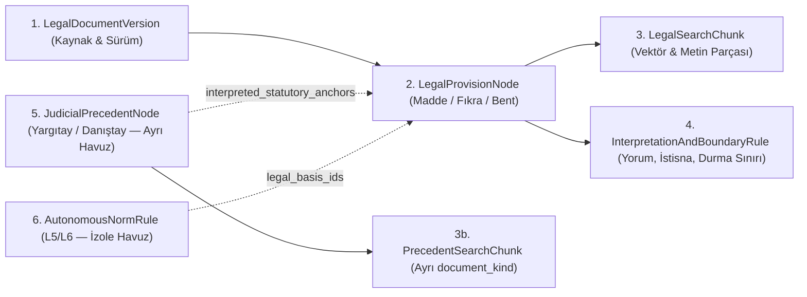
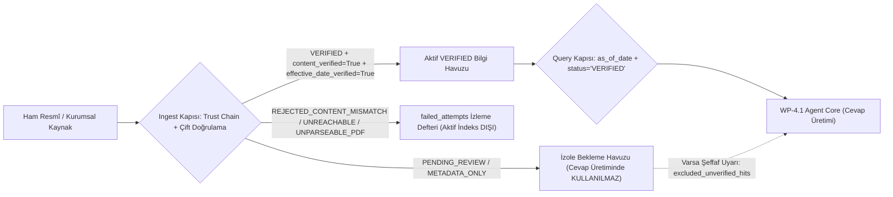

# `WP4_2_LEGAL_KNOWLEDGE_BASE_SPEC.md` — hrAI `@HukukSGK` WP-4.2 Hukuki Bilgi Havuzu Veri Mimarisi Şartnamesi

**Belge Kodu:** `WP4-2-LEGAL-KNOWLEDGE-BASE-SPEC`  
**Sürüm Hedefi:** `v1.0.6` — **WP-4 (`HukukSGK Agent Intelligence`) / Aşama `WP-4.2`**  
**Temel Şartname:** [`WP4_1_AGENT_CORE_SPEC.md`](WP4_1_AGENT_CORE_SPEC.md) (`626b808` — onaylandı)  
**Ürün / Koordinatör / Uzman / Web:** `hrAI` / `@hrAI` / `@HukukSGK` / `www.insenai.com.tr`  
**Durum:** `APPROVED_WP4_2_DESIGN_SPEC`  
**Proje ve Yönetişim Sınırları:**
- WP-2 (`c28bbd162af9d69b5bd0e15c48e13abf26fcf5c9`, [PR #3](https://github.com/poliface34/poliface/pull/3)) değiştirilmez; PR #3 merge kararı bağımsızdır.
- WP-1 CI sabitleri ([`ci-assurance.yml`](../../.github/workflows/ci-assurance.yml)): `hrai_hukuk_sgk/schemas/` (`13` şema) ve `hrai_hukuk_sgk/config/` (`9` yapılandırma) dosya sayıları korunur; `v1.0.5`, `v1.0.5.1` (`94a56b85...`), [`xmldsig.py`](../engine/esign5070/xmldsig.py) (`b16207b5...`) ve mevcut 244+/256+ test bozulmaz.
- Üretim (`production_use_authorized=false`), 5070 sayılı Kanun (`qualified_e_signature_5070_equivalent=false`) ve KVKK m.9 (`kvkk_data_residency_approved=false`) kapıları kapalı kalır.

---

## 1. Mimari İlke: Ham Metin Deposu Değil, Karar ve Sınır Bilinci Taşıyan Bilgi Havuzu

`@HukukSGK` bilgi havuzu yalnızca kanun maddelerinin düz metnini veya ham vektörlerini tutan bir belge deposu değildir. Her bilgi birimi dört katmanı birbirine bağlar:
1. **Normatif Kaynak ve Yapısal Metin Katmanı:** Kanun / Yönetmelik / Tebliğ / CK → Madde → Fıkra → Bent → Alt bent, ilk yayımlanan metin vs. konsolide metin ve yürürlük tarih aralığı.
2. **Yorum, İstisna ve Muhakeme Katmanı:** Hükmün somut olaya nasıl uygulanacağı (`application_rules`), hangi istisnaların sonucu değiştireceği (`exceptions`), karşı görüş/hata tuzakları (`counter_arguments_and_pitfalls`) ve geçici/tarihsel sınırlar (`transitional_rules`).
3. **Kesin Cevap Verilememe ve Durma Sınırları Katmanı (`AbstentionBoundary`):** Hangi eksik olgu varsa durulacağı (`blocking_missing_facts`), hangi sorunun sorulacağı (`clarification_prompts`), hangi belirsizlik/risk hâlinde mutlaka avukat eskalasyonu açılacağı (`escalation_triggers`) ve hangi şartta `@ÜcretBordro` devrinin yasaklanacağı (`payroll_handoff_prohibition`).
4. **Doğrulama ve İzlenebilirlik Katmanı:** Kaynak SHA-256 özeti, Trust Chain `evidence_id` bağı (`engine/trust_chain/`, PR #3 / WP-2), denetim defteri kimliği (`AUD-...`) ve iki aşamalı onay (`source_verification` + `legal_interpretation_verification`).

---

## 2. Mevzuat ve Düzenleme Envanteri (Mevcut Temel + WP-4.2 Kapsam Genişlemesi)

Mevcut kod tabanında ([`verification_audit_log.json`](../config/verification_audit_log.json)) L1–L4 resmî çekirdeği **74 kayıt** (`30` kaynak, `5` Yargıtay YİBBGK, `39` bilgi kartı — `70 VERIFIED`, `3 PENDING_REVIEW`, `1 SUPERSEDED`) ve bağımsız L5/L6 özerk norm katmanı (`9 modül / 19 kural`, tümü `REFERENCE_TEMPLATE_PENDING_COMPANY_ADOPTION`) olarak doğrulanmıştır. WP-4.2 envanteri bu temeli bozmadan aşağıdaki yapıyla genişletir:

### 2.1. L1 Temel Kanunlar Envanteri

| Kanun No | Kaynak ID | Mevcut Durum (`rag_kb/01_kanunlar/`) | WP-4.2 Madde / Fıkra Kapsam Hedefi | Kritik Tarih & Yürürlük Eşiği |
|---|---|---|---|---|
| **4857** *(İş Kanunu)* | `MEVZUAT-4857` | `10` kart (`m.11, 17, 18, 19, 25, 26, 29, 41, 53, Ek m.3`) | m.1–5 (kapsam, alt işveren, eşitlik), m.8–16 (sözleşme türleri, çağrı, kısmi, uzaktan, deneme), m.17–29 (ihbar, iş güvencesi, değişen şart m.22, haklı fesih m.24–25, 6 iş günü m.26, toplu çıkış m.29), m.32–62 (ücret/fazla çalışma/hafta tatili m.46/UBGT m.44-47/yıllık izin), m.63–75 (çalışma süreleri, gece/7.5s, analık m.74, özlük m.75), m.109 (7555 değişikliği) | `24.07.2025` (7555 m.23 → m.109 yazılı fesih zorunluluğu); m.26 arife & 2024–2027 takvimi |
| **1475** *(m.14 Kıdem)* | `MEVZUAT-1475` | `1` kart (`m.14`) | m.14 tüm fıkra ve bentler (kıdem tavanı hukuki sınırı, emeklilik, muvazzaf askerlik, evlilik 1 yıl, haklı fesih) + tarihsel Geçici m.6 bağlamı | Yalnızca yürürlükteki m.14 aktif; 1475'in diğer mülga maddeleri `REPEALED / HISTORICAL` |
| **5510** *(SSGSSK)* | `MEVZUAT-5510` | `4` kart (`m.8-9, 80-82, 81, 102`) | m.4 (4/a, 4/b, 4/c ayrımı), m.8–11 (işe giriş, işten ayrılış 10 gün, işyeri tescili), m.13–21 (iş kazası 3 iş günü, meslek hastalığı, geçici iş göremezlik), m.80–82 (SPEK/PEK & 7566 sonrası 9 kat tavan), m.81 & Geçici m.108 (teşvikler), m.86 (MUHSGK), m.102 (İPC katsayıları) | `7566 s. Kanun` (9 kat SPEK tavanı, %12 MYÖ, 2/5 puan indirim rejimi) |
| **6098** *(TBK)* | `MEVZUAT-6098` | `2` kart (`m.420`, `m.444-447`) | Hizmet sözleşmesi genel rejimi m.393–447 (4857 kapsam dışı çalışanlar, işçiyi gözetme borcu m.417, ibra m.420 — 1 ay/banka şartı, cezai şart m.420/1, rekabet yasağı m.444–447, ölüm/süresiz fesih m.432–440) | `01.07.2012` yürürlük; 4857 ile özel-genel kanun ayrımı |
| **6331** *(İSG Kanunu)* | `MEVZUAT-6331` | `2` kart (`m.4-6`, `m.14`) | m.4–12 (işveren genel yükümlülüğü, risk değerlendirmesi, acil durum), m.13 (çalışmaktan kaçınma hakkı), m.14 (iş kazası/meslek hastalığı bildirimi — 3 iş günü), m.15 (sağlık gözetimi), m.17 (eğitim), m.26 (İPC), m.6-7 istisnaları | Tehlike sınıfı & çalışan sayısı geçiş eşikleri |
| **6698** *(KVKK)* | `MEVZUAT-6698` | `1` kart (`m.5-6-10`) | m.3–4 (tanımlar, ölçülülük/veri minimizasyonu), m.5 (genel işleme şartları), m.6 (7499 sonrası özel nitelikli veri — sağlık, biyometrik, adli sicil), m.9 (yurt dışı aktarım & Standart Sözleşme — kurum kapısı kapalı/eskalasyon), m.10 (aydınlatma), m.11–12 (haklar & veri güvenliği), m.18 (İPC) | `01.06.2024` (7499 s. Kanun m.6 & m.9 değişikliği; öncesi vs. sonrası ayrımı!) |
| **Diğer Çekirdek L1** | `7036`, `6356`, `4447`, `7555`, `7566`, `193`, `488`, `2004`, `5746`, `4691` | `5` kart + kaynak kayıtları | 7036 m.3 & m.11-12 (zorunlu arabuluculuk, 1 ay hak düşürücü süre, zamanaşımı 5 yıl), 6356 m.24–25 & m.36 (sendika temsilcisi, sendikal fesih, TİS doğrudan etki), 4447 m.50–51 & SGK çıkış kodu uyumu | `7555` (`24.07.2025` / `01.08.2025`) ve `7566` (`19.12.2025` / `2026` hükümleri) |

### 2.2. L2–L3 İkincil Düzenlemeler ve L5/L6 Özerk Norm Sınırı

| Katman | Envanter İçeriği | Üst Kanun Bağı & Özel Kural |
|---|---|---|
| **L2 Yönetmelikler** (`rag_kb/02_yonetmelikler/`) | SSİY (`2010/27579` + değ.), Yıllık Ücretli İzin, Çalışma Süreleri, Fazla Çalışma, Alt İşverenlik, Uzaktan Çalışma (`2021` + `25.09.2026 / 33381` hibrit değişikliği), Gebe/Emziren Kadın & Çocuk/Genç İşçi Yönetmelikleri (WP-4.2 eklentisi) | Her kayıt zorunlu `statutory_subordination` (`cannot_override_parent_law = true`) taşır; üst kanuna aykırı yorumlanamaz. |
| **L3 Tebliğ, CK & SGK Genelgeleri** (`rag_kb/03_teblig_ve_genelgeler/`) | GİB `319`, GİB `331`, GİB `332` [**`PENDING_REVIEW` — aktif havuz dışı**], `10766 CK` (`PRESIDENTIAL_DECISION` — 2026 Ar-Ge/Teknokent uzaktan çalışma), mülga `9368 CK` [**`SUPERSEDED` — tarihsel havuz**], SGK `2020/20` (07-Puantaj, işveren vekili), SGK `2026/1` (2/5 puan teşvik), SGK `2026/2 PEK` | `CK` (`PRESIDENTIAL_DECISION`, öncelik `5`) asla `CBK` (`4`) ile karıştırılmaz; idari genelge kanun tabanını daraltamaz. |
| **L5 İK Prosedürleri & L6 Özerk Normlar** (`05_*`, `06_*`) | 5 L5 kurumsal İK prosedürü + 4 ayrı L6 modülü (`TİS`, `Bireysel Sözleşme`, `İç Yönetmelik`, `Yerleşik İşyeri Uygulaması` — 19 kural) | L1–L4 indeks havuzundan ayrı tutulur; `adoption_status != COMPANY_ADOPTED_COUNSEL_VERIFIED` ise bağlayıcı politika olarak döndürülmez. |

---

## 3. İçtihat Havuzu (Yargıtay & Danıştay — Kanunlardan Kesin Ayrı Sınıflandırma)

### 3.1. Kanunlardan Ayırma Prensibi (`NOT_A_STATUTE_LAYER`)
- İçtihat kayıtları **hiçbir zaman** `STATUTORY_PROVISION` veya `SECONDARY_REGULATION` tablosuna/indeks kovasına karıştırılmaz; ayrı `document_kind = JUDICIAL_PRECEDENT` sınıfında ve kendi otorite modelinde tutulur:
  - **Yargıtay:** `YIBBGK` (**2797 s. Kanun m.45** uyarınca kanuni birleştirme bağlayıcılığı), `HGK_PERSUASIVE` (Hukuk Genel Kurulu), `CHAMBER_SETTLED` (9./22./10./21. HD yerleşik içtihadı), `CHAMBER_ISOLATED` (münferit daire kararı — yalnızca zorunlu avukat onayıyla).
  - **Danıştay:** `DANISTAY_IBK` (**2575 s. Danıştay Kanunu m.39** uyarınca bağlayıcı İBK), `DANISTAY_IDDK` (İdari Dava Daireleri Kurulu — ikna edici üst karar), `DANISTAY_DAIRE_SETTLED` (örn. SGK prim/İPC, İSG idari para cezası, İşKUR teşvik/uyuşmazlık daireleri), `DANISTAY_ISOLATED` (münferit daire kararı).
- Her içtihat kaydı zorunlu olarak:
  1. `interpreted_statutory_anchors` (yorumladığı kanun/madde — ör. `4857 m.25/I-b`, `5510 m.102`),
  2. `operative_holding` (hüküm fıkrası özeti ve kaynak doğrulaması),
  3. `scope_limitations_detail` (`applies_to` + `does_not_apply_to` kapsam sınırı),
  4. `post_decision_statute_check` (karar sonrası dayanak kanunda değişiklik olup olmadığı; değişiklik varsa otomatik `ESCALATE` bayrağı)
  alanlarını taşır.

### 3.2. Mevcut Durum ve WP-4.2 İçtihat Genişleme Kapsamı
- Mevcut [`yargitay_precedents.json`](../config/yargitay_precedents.json) üzerinde 5 `YİBBGK` kaydı vardır (`4 VERIFIED`, `1 PENDING_REVIEW`: `YIBBGK-2021-8-2026-1`).
- **WP-1 Şema Sınırı Koruması:** Mevcut [`yargitay_precedent_registry.schema.json`](../schemas/yargitay_precedent_registry.schema.json) (`13` şemadan biri) yalnızca Yargıtay/AYM'yi kapsadığından ve `schemas/` (`13`) ile `config/` (`9`) sayıları CI'da sabit olduğundan, genişletilmiş Yargıtay daire kararları + **Danıştay içtihat havuzu** `WP-4.2` içinde yeni `hrai_hukuk_sgk/rag_kb/04_yargitay_ictihatlari/` (ve Danıştay alt havuzu) ile sıkı Python dataclass/doğrulayıcı katmanı üzerinden, WP-2 `YargitayAdapter` ve `DanistayAdapter` (`PR #3`) tam metin + SHA-256 doğrulaması geçilerek eklenir; mevcut [`yargitay_precedents.json`](../config/yargitay_precedents.json) ve `74/74` denetim defteri korunur.

---

## 4. Hukuki Veri Modeli (Hiyerarşik Yapı + Yorum / İstisna / Durma Katmanı)

Geliştirici, bilgi havuzunu aşağıdaki **dört çekirdek veri sözleşmesi** üzerine kuracaktır (`hrai_hukuk_sgk/engine/knowledge_base/models.py`):

### 4.1. Varlık İlişki Şeması



### 4.2. Çekirdek Alan Sözleşmeleri

| Varlık | Zorunlu Alanlar | Amaç / Kısıt |
|---|---|---|
| **`LegalDocumentVersion`** | `document_version_id`, `source_id`, `evidence_id` (WP-2 Trust Chain), `document_kind` (`STATUTE`, `DECREE`, `DECISION`, `REGULATION`, `CIRCULAR_COMMUNIQUE`), `norm_layer`, `norm_priority`, `statute_no`, `title`, `official_gazette_no`, `publication_date`, `effective_from`, `effective_to`, `supersedes_version_id`, `content_sha256`, `verification_status`, `document_fetch_status`, `audit_log_id` | Kanun/ikincil düzenleme sürüm kimliği. `effective_to=None` yalnızca yürürlükteki güncel sürümde olabilir; mülga sürüm asla silinmez. |
| **`LegalProvisionNode`** | `provision_id` (`"4857:m-25:f-1:b-b"`), `document_version_id`, `source_id`, `law_no`, `chapter_title`, `article_no`, `paragraph_no`, `subparagraph_no`, `sub_clause_no`, `article_title`, `hierarchy_path` (`"4857 > Bölüm 2 > Madde 25 > Fıkra 1 > Bent b"`), `raw_text`, `normalized_text`, `publication_date`, `effective_from`, `effective_to`, `amendment_history[]`, `transitional_provision_ref`, `cross_reference_ids[]`, `norm_character` (`ABSOLUTE_MANDATORY`, `RELATIVE_EMPLOYEE_FAVORABLE`, `SUPPLEMENTARY_DEFAULT`), `content_sha256`, `verification_status` | Madde-fıkra-bent granülerliğinde hukuki metin düğümü. |
| **`InterpretationAndBoundaryRule`** | `rule_id`, `provision_id`, `card_id` (mevcut `rag_kb/` ile bağ), `how_to_interpret[]` (`scenario_id`, `condition`, `legal_rule`, `statutory_basis`), `exceptions[]` (`exception_id`, `trigger`, `legal_effect`, `affected_groups`), `transitional_rules[]` (`cutoff_date`, `pre_cutoff_rule`, `post_cutoff_rule`), `counter_arguments_and_pitfalls[]`, `required_documents[]`, **`cannot_conclude_when`** (`blocking_missing_facts[]`, `clarification_questions[]`, `mandatory_escalation_triggers[]`, `payroll_handoff_prohibition_conditions[]`, `unanswerable_boundary_reason`), `legal_interpretation_verification` | **"Önemli" kuralı burada kodlanır:** Ajan bir maddeyi çekerken bu maddenin nasıl yorumlanacağını, hangi istisnalara tabi olduğunu ve **hangi koşullarda kesin cevap veremeyip duracağını** veri modelinden okur. |
| **`JudicialPrecedentNode`** | `precedent_id`, `court_system` (`YARGITAY` / `DANISTAY` / `AYM`), `chamber`, `binding_level`, `requires_application_rationale`, `esas_no`, `karar_no`, `decision_date`, `official_gazette_no`, `official_source_url`, `evidence_id`, `interpreted_provision_ids[]`, `legal_principle`, `operative_holding`, `applies_to[]`, `does_not_apply_to[]`, `post_decision_amendment_status` (`UNAFFECTED` / `REQUIRES_COUNSEL_REVIEW_POST_AMENDMENT`), `conflicting_precedent_ids[]`, `verification_status`, `content_sha256` | İçtihatların kanunlardan kesin ayrı sınıflandırması ve kapsam sınırı. |

---

## 5. Bilgi Parçalama (RAG Chunking) Yaklaşımı

### 5.1. Yasak ve Zorunluluklar
- **YASAK:** Sabit token/karakter sayısıyla (`fixed 512 tokens`) madde veya fıkra ortasından kör parçalama **kesinlikle yasaktır**. Bir maddenin giriş cümlesini bentlerinden veya istisna fıkrasını ana hükümden ayıran parçalama kullanılamaz.
- **ZORUNLU:** Türk mevzuatının yapısal gramerine (`Madde X` → `(1)` Fıkra → `a)` Bent → `1)` Alt bent → `Geçici Madde` → `Ek Madde`) göre **hiyerarşik, atomik bütünlüklü chunking**.

### 5.2. 4 Katmanlı Chunk Tipolojisi

| Chunk Türü (`chunk_kind`) | Parçalama Kuralı ve Bütünlük Sınırı | Zorunlu Bağlam Başlığı (Context Header) | Örnek |
|---|---|---|---|
| **`STATUTORY_PARAGRAPH`** | Doğal sınır = **1 fıkra** (veya kısa tüm madde ≤ 450 kelimeyse tek madde parçası). Bir fıkra alt bentler nedeniyle `> 650` kelimeyi aşarsa, fıkranın **giriş cümlesi + tek bent** ayrı alt parça yapılır; giriş cümlesi asla düşürülmez. İki farklı madde **asla** tek parçada birleştirilmez. | `[K: {law_no} \| M: {article_no} \| F: {paragraph_no} \| Katman: {norm_layer} \| Yürürlük: {effective_from}..{effective_to}]` | `4857 m.25/I` giriş + `b) Sağlık sebepleri` ayrı veya birleşik bütün |
| **`RULE_AND_EXCEPTION`** | `InterpretationAndBoundaryRule` içindeki yorum kuralları (`application_scenarios`), istisnalar (`exceptions`), geçiş kuralları (`transitional_rules`) ve karşı görüş tuzakları `provision_id` bağlantılı anlamlı bütün olarak tutulur. | `[YORUM & İSTİSNA \| Dayanak: {provision_id} \| Kart: {card_id} \| Onay: {verification_status}]` | `4857 m.26` maddi çıkar istisnası, 5 günlük işyeri Cumartesi kuralı, yarım gün arife |
| **`ABSTENTION_BOUNDARY`** | `cannot_conclude_when` blokları (`blocking_missing_facts`, `escalation_triggers`, `payroll_handoff_prohibition`) doğrudan aranabilir/bağlı sınır parçası olarak saklanır; ilgili madde getirildiğinde otomatik eşlik eder. | `[DURMA & ESKALASYON SINIRI \| Dayanak: {provision_id}]` | `as_of_date` yoksa dur; `24.07.2025` sonrası KEP fesihte m.109 eskalasyonu |
| **`PRECEDENT_UNIT`** | İçtihatlar yalnızca kendi havuzunda 2 alt parçaya bölünür: `(a)` Hukuki İlke + Operative Holding, `(b)` Kapsam Sınırları (`applies_to` + `does_not_apply_to` + kanun değişikliği uyarısı). Tam metin PDF/HTML deponun bütünü `ContentStore` içinde saklanır. | `[İÇTİHAT — KANUN DEĞİL \| {court_system} {chamber} \| {binding_level} \| E.{esas_no} K.{karar_no}]` | `YIBBGK E.2017/9 K.2018/10` savunma istisnası & m.18-19 kapsam dışı |

---

## 6. Vektör Arama (`PostgreSQL + pgvector`) ve Metadata Filtreleme

### 6.1. Sağlayıcıdan Bağımsız Mimari (Üretim PG + Test/CI Uyumluluğu)
Mevcut `hrai_hukuk_sgk` çekirdeğinin WP-1/WP-2 tasarım ilkesi gereği çalışma zamanı Python 3.12 standart kütüphanesi üzerinde **sıfır harici zorunlu bağımlılıkla** test edilebilir kalmalıdır. Bu nedenle (tıpkı [`interfaces.py`](../engine/trust_root/interfaces.py) yapısında olduğu gibi):
1. **`LegalKnowledgeStoreProvider` (Soyut Arayüz):** `upsert_document_bundle()`, `hybrid_search(query, filters, as_of_date)`, `get_interpretation_boundaries(provision_ids)`, `resolve_version_as_of(provision_id, as_of_date)`.
2. **`PostgresPgvectorKnowledgeStore`:** Gerçek `PostgreSQL 16+` ve `pgvector` uzantısı (`Cloud SQL PostgreSQL europe-west3` — [`production_trust_root_config.json`](../config/production_trust_root_config.json) veya Türkiye içi PostgreSQL konuşlandırması) için üretim/entegrasyon adaptörü. Bağlantı yapılandırılmamışsa `NOT_CONFIGURED` döndürür, asla sahte canlı erişim iddia etmez.
3. **`LocalDeterministicHybridStore`:** Birim testleri, çevrimdışı geliştirme ve WP-1 4-sıralı temiz CI için dış veritabanı gerektirmeyen Python stdlib BM25 + TF-IDF kosinüs + birebir aynı metadata ön-filtreleme kurallarını uygulayan deterministik bellek/dosya deposu.

### 6.2. PostgreSQL + `pgvector` Tablo ve İndeks Tasarımı

```sql
-- Kavramsal hedef şema (WP-4.2 kodlama fazı için referans; mevcut DB yapılandırılmadıkça NOT_CONFIGURED)
CREATE EXTENSION IF NOT EXISTS vector;

CREATE TABLE kb_provision_chunks (
    chunk_id              TEXT PRIMARY KEY,          -- Deterministik SHA-256 öneki
    provision_id          TEXT NOT NULL,             -- Örn: "4857:m-25:f-1:b-b"
    document_version_id   TEXT NOT NULL,
    source_id             TEXT NOT NULL,
    evidence_id           TEXT,                      -- WP-2 EvidenceRegistry bağı
    document_kind         TEXT NOT NULL,             -- STATUTORY_PROVISION | SECONDARY_REGULATION | JUDICIAL_PRECEDENT | AUTONOMOUS_NORM
    chunk_kind            TEXT NOT NULL,             -- STATUTORY_PARAGRAPH | RULE_AND_EXCEPTION | ABSTENTION_BOUNDARY | PRECEDENT_UNIT
    norm_layer            TEXT NOT NULL,
    norm_priority         SMALLINT NOT NULL,
    law_no                TEXT,
    article_no            TEXT,
    effective_from        DATE NOT NULL,
    effective_to          DATE,                      -- NULL => güncel yürürlükte
    verification_status   TEXT NOT NULL,             -- Yalnızca 'VERIFIED' aktif aramaya girer
    content_verified      BOOLEAN NOT NULL DEFAULT FALSE,
    adoption_status       TEXT,                      -- L5/L6 için zorunlu
    content_sha256        CHAR(64) NOT NULL,
    raw_text              TEXT NOT NULL,
    context_header        TEXT NOT NULL,
    tsv_tr                TSVECTOR GENERATED ALWAYS AS (
                              to_tsvector('turkish', coalesce(context_header, '') || ' ' || coalesce(raw_text, ''))
                          ) STORED,
    embedding             VECTOR(1024) NOT NULL,     -- Yapılandırılan deterministik model boyutu
    metadata_json         JSONB NOT NULL
);

CREATE INDEX idx_kb_chunks_gate ON kb_provision_chunks (verification_status, content_verified, document_kind, norm_layer);
CREATE INDEX idx_kb_chunks_dates ON kb_provision_chunks (effective_from, effective_to);
CREATE INDEX idx_kb_chunks_tsv ON kb_provision_chunks USING GIN (tsv_tr);
CREATE INDEX idx_kb_chunks_vec ON kb_provision_chunks USING hnsw (embedding vector_cosine_ops);
```

### 6.3. Zorunlu Ön-Filtreleme (`Pre-Filtering`) ve Hibrit Arama Kuralları
Vektör benzerliği **hiçbir zaman tek başına karar verici değildir**; sorgu yürütme şu deterministik sırayla çalışır:
1. **Zorunlu Güvenlik Ön-Filtresi (`WHERE`):**
   - `verification_status = 'VERIFIED' AND content_verified = TRUE` *(Doğrulanmamış, `PENDING_REVIEW`, `FAILED`, `REJECTED_CONTENT_MISMATCH`, `TRANSPORT_ONLY_UNVERIFIED_CONTENT` kayıtlar **asla** aktif sorguya girmez).*
   - `effective_from <= :as_of_date AND (effective_to IS NULL OR effective_to >= :as_of_date)` *(Tarihsel bağlam istendiğinde yalnızca ayrı ikinci sorguda `historical_only = TRUE` kovasına alınır).*
   - Havuz izolasyonu: Mevzuat araması (`STATUTORY_PROVISION`, `SECONDARY_REGULATION`), içtihat araması (`JUDICIAL_PRECEDENT`), özerk norm araması (`AUTONOMOUS_NORM` — `adoption_status = 'COMPANY_ADOPTED_COUNSEL_VERIFIED'` olmayanlar bağlayıcı kovaya giremez) **ayrı sorgulanır/etiketlenir**.
   - Konu/alan daraltması (`law_no`, `primary_domain`, `court_system`, `chamber`, `binding_level`).
2. **`pgvector` HNSW Ön-Filtre Güvencesi:** `pgvector >= 0.8` üzerinde `SET LOCAL hnsw.iterative_scan = strict_order;` etkinleştirilir ki dar tarih/durum ön-filtresi uygulandığında HNSW sonuç sayısının sıfıra düşmesi (recall drop) engellensin.
3. **Hibrit Birleştirme (`Vector + Lexical RRF`):**
   - Anlamsal arama (`1 - (embedding <=> :q_vec)`) + PostgreSQL `tsvector` + tam tanımlayıcı güçlendirme (`4857`, `m.25/I-b`, `10766 CK`, `E.2017/9 K.2018/10`, `SGK kod 29`) **Reciprocal Rank Fusion (RRF)** ile birleştirilir.
   - RRF yalnızca **ön-filtreden geçmiş `VERIFIED` ve yürürlükteki adaylar** üzerinde çalışır.
   - Döndürülen her madde chunk'ı otomatik olarak bağlı olduğu `InterpretationAndBoundaryRule` (yorum + istisna + durma sınırı) nesnesini birlikte getirir (`companion_boundary_rule`).

---

## 7. Sürüm Yönetimi (Tarihsel Mevzuat ve Append-Only Koruma)

| İlke | Teknik Uygulama |
|---|---|
| **Eski Metin Asla Silinmez (`Append-Only`)** | Bir madde değiştiğinde mevcut `LegalProvisionNode` silinmez/ezilmez; eski sürümün `effective_to` alanı değişikliğin yürürlükten bir gün öncesiyle kapatılır (`2025-07-23`) ve `supersedes_version_id` bağı ile yeni sürüm (`2025-07-24`) eklenir. |
| **İlk Metin / Konsolide / Değişiklik Ayrımı** | Her kayıt `original_publication` (ilk Resmî Gazete), `consolidated_text` (ilgili tarihte geçerli metin) ve `amendment_history[]` (değiştiren kanun, RG no, yayım ve yürürlük tarihi) alanlarını korur. |
| **Çift-Zamanlı Sorgu (`Bitemporal Point-in-Time`)** | `resolve_version_as_of(provision_id, as_of_date)` her zaman `as_of_date` tarihindeki hukuki durumu döner. Örneğin `4857 m.109` sorgulandığında `2025-07-15` için 7555 öncesi metin, `2025-08-01` için 7555 m.23 sonrası zorunlu yazılı fesih metni döner; ikisi asla birbirinin yerine geçmez. |
| **WP-2 Trust Chain Senkronu** | Yeni bir resmî metin/değişiklik yalnızca WP-2 `SourceAdapter` + `EvidenceRegistry` (`PR #3`) üzerinden ham baytı ve `record_sha256` zinciri doğrulanarak versiyon zincirine eklenir. |

---

## 8. Bilgi Kalitesi ve Doğrulanmamış Kaynak Engelleme Mekanizması



**Kesin Engelleme Kuralları:**
1. **`PENDING_REVIEW` & `UNVERIFIED` Yasağı:** Örneğin `GIB-TEBLIG-332-20251231` ([`legal_sources_registry.json`](../config/legal_sources_registry.json)), [`03_gib_332_2026_tarife_ve_istisnalar.json`](../rag_kb/03_teblig_ve_genelgeler/03_gib_332_2026_tarife_ve_istisnalar.json) (`CARD-GIB-332-2026-TARIFE`) ve `YIBBGK-2021-8-2026-1` aktif retrieval sonucuna **asla** dönmez; sadece ayrı `excluded_pending_or_unverified_notices` listesinde *"tam metin/hukuki inceleme tamamlanmadığı için hariç tutuldu"* bilgisi olarak raporlanır.
2. **Trust Chain Reddi:** `REJECTED_CONTENT_MISMATCH`, `TRANSPORT_ONLY_UNVERIFIED_CONTENT` (taranmış okunaksız PDF) ve `UNREACHABLE_NOT_VERIFIED` kaynaklar indekse **alınamaz**.
3. **SHA-256 Bütünlük Denetimi:** İndeksteki her `kb_provision_chunks.content_sha256`, periyodik ve sorgu anında kaynak kayıt SHA-256 özetiyle karşılaştırılır; tahrifatta kayıt karantinaya alınır (`KB_CHUNK_TAMPER_QUARANTINED`).
4. **L5/L6 Kurum Kabul Kilidi:** `REFERENCE_TEMPLATE_PENDING_COMPANY_ADOPTION` durumundaki prosedür/TİS kartları "bağlayıcı kurum politikası" aramalarında filtrelenir; yalnızca referans şablon uyarısıyla ayrı blokta gösterilebilir.

---

## 9. Bilgi Erişim Doğruluğu Test Veri Seti (`KB Retrieval Benchmark`)

WP-4.2 kodlaması sırasında oluşturulacak altın İK erişim test seti (**minimum 16 vaka**, `tests/fixtures/wp42_kb_retrieval_benchmark.json`), hem `LocalDeterministicHybridStore` hem de sorgu ön-filtreleme mantığı üzerinde çalıştırılacaktır:

| Test ID | Gerçek İK Vakası Özeti | Beklenen Doğru Erişim (`Gold`) | Beklenen Dışlama / Durma Koşulu |
|---|---|---|---|
| **RET-01** | `2026-03-10` — Performans düşüklüğü nedeniyle fesih (35 işçi, 1 yıl kıdem) | `4857:m-18`, `4857:m-19`, `CARD-4857-M18`, `CARD-4857-M19`, `YIBBGK-2017-9-2018-10` (karşılaştırma) | `YIBBGK-2017-9-2018-10`'un yalnızca m.25/I-b sağlık feshinde savunma istisnası getirdiği, davranış/verimde savunma zorunlu olduğu `does_not_apply_to` notuyla dönmeli |
| **RET-02** | `2025-09-01` — 4857 m.25 haklı fesihte KEP ile bildirim geçerliliği | `4857:m-109` (7555 m.23 sonrası `>= 2025-07-24` sürümü), `RG-7555-20250724` | `2025-07-23` öncesi eski m.109 sürümü güncel havuzdan **dışlanmalı**; `cannot_conclude_when` eskalasyon kuralı dönmeli |
| **RET-03** | `2025-07-10` — Aynı `m.109` sorgusunun 7555 öncesi tarihle testi | `4857:m-109` (`2003-06-10 .. 2025-07-23` sürümü) | Henüz yürürlüğe girmemiş `24.07.2025` sonrası 7555 sürümü güncel dayanak yapılmamalı (tarihsel sınır) |
| **RET-04** | `2026-04-01` — Ar-Ge merkezinde bilişim personeli uzaktan çalışma oranı | `RG-10766-20251225`, `CARD-CK-10766-2026`, `MEVZUAT-5746` | Mülga `RG-9368-20241228` yalnızca tarihsel kovada kalmalı, aktif sonuçta yer almamalı; `CK` katmanı `CBK` olarak etiketlenmemeli |
| **RET-05** | `2026-02-01` — GİB 2026 yemek istisnası / gelir vergisi dilimi (`GIB-TEBLIG-332`) | Aktif sonuç `[]` + `excluded_pending_or_unverified_notices` | `PENDING_REVIEW` durumundaki `GIB-TEBLIG-332-20251231` / `CARD-GIB-332-2026-TARIFE` **kesinlikle** aktif sonuca girmemeli |
| **RET-06** | `2026-06-01` — Yıllardır ödenen bayram ikramiyesinin tek taraflı kaldırılması | `CARD-4857-M22` (veya L6 `RULE-L6-04-PRIM-IKRAMIYE-BAGLAYICILIK` uyarısıyla), `4857:m-22` | L6 kuralı `REFERENCE_TEMPLATE_PENDING_COMPANY_ADOPTION` uyarısıyla dönmeli; kurum kabulü yoksa bağlayıcı şirket politikası sayılmamalı |
| **RET-07** | `2026-05-01` — 5 günlük işyerinde Cumartesi & bayram arifesi penceresinde m.26 6 iş günü | `CARD-4857-M26`, `4857:m-26`, `4857:m-46` | Akdi Cumartesi muafiyeti reddi + arife `M26_YARIM_GUN_TATIL` `cannot_conclude_when` durma/eskalasyon kuralı dönmeli |
| **RET-08** | `2026-03-15` — Biyometrik parmak izi PDKS & adli sicil belgesi istenmesi | `CARD-6698-M05-M06-M10` (`7499` sonrası `>= 2024-06-01` sürümü), `6698:m-4`, `m-6` | 7499 öncesi `01.06.2024` eski m.6 sürümü güncel kovadan dışlanmalı; KVKK ölçülülük ve yurt dışı m.9 kapalı sınır uyarısı dönmeli |
| **RET-09** | `2026-04-15` — SGK çıkış kodu 29 vs işsizlik ödeneği + SPEK 9 kat tavanı | `CARD-5510-M80-M82`, `RG-7566-20251219`, `CARD-SGK-2026-PEK-SINIR`, `CARD-4447-M50-M51` | Eski 7.5 kat SPEK tavanı güncel kovaya girmemeli |
| **RET-10** | `2026-03-20` — İş kazası 3 iş günü bildirimi & İSG yükümlülüğü | `CARD-6331-M14`, `6331:m-14`, `5510:m-13`, `CARD-SSIY-M11-M14` | Yalnızca İK prosedürü (`L5-04`) değil üst kanun `6331` & `5510` öncelikli dönmeli |
| **RET-11** | `2026-04-01` — Belirli süreli sözleşmede objektif neden yoksa erken fesih cezai şartı | `CARD-4857-M11`, `CARD-6098-M420`, `YIBBGK-2017-10-2019-1` | İçtihat `JUDICIAL_PRECEDENT` olarak ayrı dönmeli + `6098 TBK m.420/1` tek taraflılık sınırı eşlik etmeli |
| **RET-12** | **Olumsuz Kalite Testi:** `REJECTED_CONTENT_MISMATCH` veya `TRANSPORT_ONLY_UNVERIFIED_CONTENT` (taranmış PDF) belge indekslenmeye çalışılır | Ingest Gate reddi + arama sonucu `[]` | Güvenilmeyen/okunaksız belge sıfır sızıntı ile dışlanmalı |
| **RET-13** | **İçtihat Kanun Karışması Testi:** `resolve_norm_conflict` / retrieval sorgusunda içtihat ile TİS/kanun rekabeti | `JUDICIAL_PRECEDENT` ayrı kovada + dayanak kanun + `applies_to/does_not_apply_to` | İçtihadın sayısal mevzuat katmanı olarak sıralanmaması doğrulanır |
| **RET-14** | **Danıştay İdari İşlem Ayrımı Testi:** SGK İPC / teşvik iptali idari davası | Danıştay içtihat havuzu (`court_system=DANISTAY`, `2575 m.39` sınırı) + `5510 m.102` | Yargıtay içtihatlarıyla karıştırılmamalı; idari yargı/Danıştay ayrı sınıflanmalı |
| **RET-15** | **Eksik Tarihli / Belirsiz Durma Testi:** `as_of_date = None` verilen retrieval çağrısı | Fail-closed red (`MISSING_AS_OF_DATE_FOR_TEMPORAL_SEARCH`) | Tarihsiz arama hiçbir güncel kanun hükmünü kesin olarak döndürmemeli |
| **RET-16** | **Atomik Fıkra/Bent Koruma Testi:** 4857 m.25/II-e vs m.25/I-b arama sorgusu | Doğru fıkra/bent parçası (`4857:m-25:f-2:b-e`), üst giriş başlığı bozulmadan | Yanlış fıkranın (m.25/I sağlık feshinin) ahlak/iyiniyet feshine karışmaması (%100 ayrım) |

### 9.1. WP-4.2 Retrieval Kabul Eşikleri

| Metrik | Kabul Eşiği |
|---|---|
| `Critical Provision Recall@5` (zorunlu ana madde + yorum/istisna kartı) | **`100%`** |
| `Temporal Accuracy@as_of_date` (mülga/gelecek hükmün güncel kovaya sızma oranı) | **`0%` sızıntı (`100%` isabet)** |
| `Unverified & Rejected Document Exclusion` | **`100%` (sıfır `PENDING_REVIEW` / `REJECTED_*` / taralı PDF sızıntısı)** |
| `Precedent-vs-Statute Isolation & Danıştay Separation` | **`100%`** |
| `Abstention Boundary Attachment Rate` (ilgili maddede `cannot_conclude_when` bağının dönüşü) | **`100%`** |
| `LocalDeterministicHybridStore` vs `PostgresPgvectorKnowledgeStore` ön-filtre paritesi | **Aynı `WHERE` filtre sözleşmesi (`100%` davranışsal eşitlik)** |

---

## 10. WP-4.2 Uygulama Adımları

Onaylanan bu şartname doğrultusunda kodlama fazında:
1. `hrai_hukuk_sgk/engine/knowledge_base/` altında veri modelleri, yapısal chunker, L1–L6/içtihat yükleyicisi, `LegalKnowledgeStoreProvider` (`LocalDeterministicHybridStore` + `PostgresPgvectorKnowledgeStore` adaptör arayüzü + DDL/SQL üreticisi), bitemporal sürüm yöneticisi ve çift-kapılı retrieval denetleyicisi kodlanacaktır (Trust Chain `EvidenceRegistry` canlı/tam entegrasyonu PR #3 merge kararı ile eşgüdümlü veya opsiyonel arayüz bağı üzerinden ilerleyecektir).
2. `13` şema / `9` yapılandırma CI sabitleri bozulmadan en az 16 vakalı retrieval benchmark ve negatif/bütünlük testleri eklenecektir.
