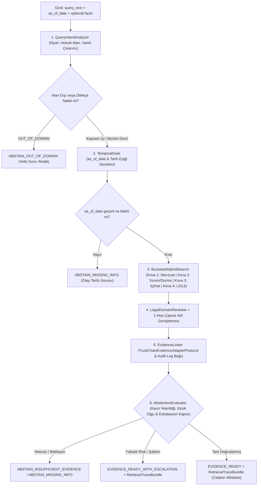

# `WP4_3_RAG_ENGINE_SPEC.md` — hrAI `@HukukSGK` WP-4.3 RAG Engine Teknik Şartnamesi

**Belge Kodu:** `WP4-3-RAG-ENGINE-SPEC`  
**Sürüm Hedefi:** `v1.0.6` — **WP-4 (`HukukSGK Agent Intelligence`) / Aşama `WP-4.3`**  
**Önceki Aşamalar:** [`WP4_1_AGENT_CORE_SPEC.md`](WP4_1_AGENT_CORE_SPEC.md) · [`WP4_2_LEGAL_KNOWLEDGE_BASE_SPEC.md`](WP4_2_LEGAL_KNOWLEDGE_BASE_SPEC.md) · [Draft PR #4 (`3d15eef`)](https://github.com/poliface34/poliface/pull/4)  
**Ürün / Koordinatör / Uzman / Web:** `hrAI` / `@hrAI` / `@HukukSGK` / `www.insenai.com.tr`  
**Durum:** `APPROVED_WP4_3_DESIGN_SPEC`  
**Proje ve Yönetişim Sınırları:**
- [PR #3 (WP-2)](https://github.com/poliface34/poliface/pull/3) (`c28bbd1`) bağımsızdır ve değiştirilmeyecektir; PR #4 üzerinde merge/etiket işlemi yapılmayacaktır.
- WP-1 CI sabitleri (`schemas/` = `13`, `config/` = `9`, sıfır yeni harici çalışma zamanı bağımlılığı, `v1.0.5.1` ve `xmldsig.py` değişmezliği) korunacaktır.
- Üretim (`production_use_authorized=false`), 5070 sayılı Kanun (`qualified_e_signature_5070_equivalent=false`) ve KVKK m.9 (`kvkk_data_residency_approved=false`) kapıları kapalı kalacaktır.

---

## 1. Amaç ve Kabul Hedefi

**WP-4.3 (`RAG Engine`)**, WP-4.2 ile kurulan [`engine/knowledge_base/`](../engine/knowledge_base/__init__.py) veri havuzunu WP-4.4 Answer Engine ve WP-4.1 Agent Core için güvenli, denetlenebilir ve deterministik biçimde kullanılabilir hâle getiren erişim motorudur.

**Kabul Hedefi:**
1. Doğru hukuki kaynağı, olay tarihine (`as_of_date`) ve Anayasal normlar hiyerarşisine uygun şekilde bulmak.
2. **Mevzuat**, **Yorum/İstisna/Durma Sınırı**, **İçtihat (Yargıtay/Danıştay)** ve **Özerk Norm (L5/L6)** kaynaklarını birbirine karıştırmadan ayrı kovalarda getirmek.
3. Kanıt yetersiz, tarih eksik veya yalnızca doğrulanmamış/bekleyen kayıt mevcutsa cevap uydurmak yerine **fail-closed biçimde durmak (`Abstention`)**.
4. Her sonucu kaynak, madde/fıkra/bent, SHA-256 ve mümkün olduğunda `EvidenceRegistry` (`PR #3` / WP-2) kaydına bağlayarak tam izlenebilirlik (`RetrievalTraceBundle`) sunmak.

---

## 2. Uçtan Uca RAG Motoru Akışı (6 Aşamalı Pipeline)



---

## 3. Aşama 1 — Soru Niyeti, Hukuki Alan ve Yapısal Varlık Analizi (`QueryIntentAnalyzer`)

### 3.1. Soru Niyeti Sınıfları (`QueryIntent`)

| Niyet Kodu | Tanım | RAG Retrieval Davranışı |
|---|---|---|
| `FACT_SCENARIO_ANALYSIS` | Somut İK/SGK vakası (fesih, 6 iş günü, savunma, kıdem, fazla çalışma, izin, SGK çıkış kodu) | 4 kovanın ilgili alt kümeleri + 1-hop çapraz atıf + `AbstentionBoundary` zorunlu kontrolü |
| `STATUTE_LOOKUP` | Belirli kanun/madde/CK/genelge metni veya yürürlük tarihi sorgusu | Kova 1 (Mevzuat) + Kova 2 (Yorum/Geçiş) öncelikli; `include_historical=True` opsiyonel |
| `PROCEDURE_AND_AUTONOMOUS_NORM` | Kurumsal İK prosedürü, TİS, bireysel sözleşme, iç yönetmelik, işyeri uygulaması sorusu | Kova 1–2 (`4857 m.22`, `6356 m.36`) + Kova 4 (`L5/L6`, `REFERENCE_TEMPLATE_PENDING_COMPANY_ADOPTION` uyarılı) |
| `PRECEDENT_CHECK` | Yargıtay (`YİBBGK`/`HGK`/`Daire`) veya Danıştay içtihadı ve kapsam sınırı sorgusu | Kova 3 (`JUDICIAL_PRECEDENT`) + dayanak kanunun yer aldığı Kova 1 doğrulaması |
| `PAYROLL_DELEGATION_ONLY` | Saf parasal/kuruş hesaplama talebi (*"5 yıl kıdem net kaç TL?"*) | Hesaplama yapılmaz; yalnızca hak kazanım ön koşulları için Kova 1/2 aranır + `@ÜcretBordro` yönlendirme bayrağı açılır |
| `OUT_OF_DOMAIN` | Ceza/aile/ticaret hukuku veya Av. K. m.35 kapsamındaki dava dilekçesi/kesin mütalaa yazımı | Arama atlanır → `ABSTAIN_OUT_OF_DOMAIN` (`0` uydurma atıf) |

### 3.2. Hukuki Alan Yönlendirme (`DomainRouter`) & Kontrollü Terim Genişletme
- [`WP4_1_AGENT_CORE_SPEC.md`](WP4_1_AGENT_CORE_SPEC.md) §4.1 ile birebir uyumlu 7 alan atanır: `LABOR_LAW`, `SOCIAL_SECURITY`, `OCCUPATIONAL_HEALTH_AND_SAFETY`, `PERSONAL_DATA_PROTECTION`, `MIXED_MULTI_DOMAIN`, `PAYROLL_DELEGATION_ONLY`, `OUT_OF_DOMAIN`.
- `MIXED_MULTI_DOMAIN` vakalarda (ör. *"Sağlık raporu devamsızlığı feshi + SGK iş kazası + KVKK sağlık verisi"*) her saptanan alan için alt arama sorgusu/filtresi üretilir (`sub_queries[]`) ve sonuçlar ana pakette birleştirilir.
- **Kontrollü Eşanlamlılık Sözlüğü (`CONTROLLED_LEGAL_ALIASES`):** Yalnızca denetlenebilir sabit hukuki kavram eşlemesi kullanılır (ör. `"ihbar öneli" → "4857 madde 17"`, `"biyometrik pdks" → "6698 madde 6"`, `"spek tavan" → "5510 madde 82"`, `"bayram ikramiyesi işyeri uygulaması" → "4857 madde 22"`). Serbest üretken sorgu yeniden yazımıyla kayıt dışı kanun/madde numarası uydurulmaz.

---

## 4. Aşama 2 — `as_of_date` Tarih Duyarlı Arama ve Kesim Tarihi Kapısı (`TemporalGate`)

1. **Zorunlu Olay Tarihi Kuralı:**
   - Gelen istekte açık `as_of_date` (`YYYY-MM-DD`) verilmemişse ve metin içinden kesin `YYYY-MM-DD` / `DD.MM.YYYY` olay tarihi ayrıştırılamıyorsa (veya birden fazla çelişkili tarih varsa), RAG Motoru **bugünün tarihini varsaymaz**; `ABSTAIN_MISSING_INFO` (`MISSING_AS_OF_DATE`) döndürür.
   - İstisna yok: [`LocalDeterministicHybridStore.hybrid_search`](../engine/knowledge_base/store.py#L714-L793) ve `PostgresPgvectorKnowledgeStore` zaten tarihsiz aramayı `MISSING_AS_OF_DATE_FOR_TEMPORAL_SEARCH` ile reddeder.
2. **Tarihsel Geçiş ve Mülga Kaynak Ayrımı:**
   - Arama sırasında mülga düzenleme (ör. `9368 CK`) veya geçmiş sürüm (`7555` öncesi `4857 m.109`, `7499` öncesi `6698 m.6`, `7566` öncesi `5510 m.82`) `include_historical=True` ile sorgulandığında bile **yalnızca `historical_context_bucket` içine yazılır**; `normative_bucket` içinde asla yer alamaz.
3. **Tarih Eşiği Farkındalığı (`TemporalCutoffDetector`):**
   - `24.07.2025` (`7555 m.23` → `m.109` KEP fesih yasağı), `01.06.2024` (`7499` → `6698 m.6`), `01.01.2026` (`7566` → `5510 m.82` 9 kat + `10766 CK`), `2024–2027` (arşivlenmiş Diyanet takvimi sınırı) tarihleri `temporal_audit` meta verisinde açıkça raporlanır.

---

## 5. Aşama 3 — 3+1 Ayrı Kovalı Arama Mimarisi (`BucketedHybridSearch`)

WP-4.2 deposundaki `hybrid_search(...)` üzerine tek torba yerine **4 ayrı, tip-korumalı arama kovası** çalıştırılır:

| Kova | İçerik & `document_kinds` Filtresi | Norm / Otorite Kısıtı | Birbirine Karışmama Kuralı |
|---|---|---|---|
| **Kova 1: Normatif Mevzuat** (`normative_bucket`) | `STATUTORY_PROVISION`, `SECONDARY_REGULATION` | `verification_status='VERIFIED'`, `content_verified=True`, `effective_from <= as_of_date <= effective_to` | İçtihat, yorum kartı veya L5/L6 prosedür Kova 1'e giremez. |
| **Kova 2: Yorum, İstisna & Durma Sınırı** (`interpretation_and_boundary_bucket`) | `INTERPRETATION_CARD` + Kova 1 hitlerinin `companion_rules` ekleri (`RULE_AND_EXCEPTION` + `ABSTENTION_BOUNDARY`) | Yalnızca çift-onaylı (`VERIFIED`) ve `as_of_date`'te geçerli kurallar | Kova 1 kanun metninin yerine geçmez; *uygulama, istisna, geçiş, karşı görüş ve durma sınırı* sağlar. |
| **Kova 3: İçtihat Havuzu** (`precedent_bucket`) | `JUDICIAL_PRECEDENT` (`COURT_YARGITAY`, `COURT_DANISTAY`, `COURT_AYM`) | `VERIFIED` + `FETCHED_AND_MATCHED` + `operative_holding` + `scope_limitations_detail` | **Asla** kanun basamağı sayılmaz; idari yargı (`DANISTAY`, `2575 m.39`) ile adli yargı (`YARGITAY`, `2797 m.45`) ayrı etiketlenir. |
| **Kova 4: Özerk Normlar** (`autonomous_norm_bucket`) | `AUTONOMOUS_NORM` (L5/L6) | `require_adopted_autonomous_norms=True`: yalnızca `COMPANY_ADOPTED_COUNSEL_VERIFIED` ise aktif; aksi hâlde `excluded_unverified_notices` + şablon uyarısı | Kabul edilmemiş şablonlar bağlayıcı kural sayılamaz; TİS/sözleşme/yönetmelik/uygulama birbirine indirgenmez. |

---

## 6. Aşama 4 — Hibrit Arama, 1-Adımlı Çapraz Atıf Genişletmesi ve Yeniden Sıralama (`Reranking`)

Her kova kendi içinde deterministik 3 adımlı sıralama uygular (dış ağ/LLM reranker çağrısı gerektirmez; Python 3.12 stdlib):

1. **Taban Skor (`RRF`):** `LocalDeterministicHybridStore` / `PostgresPgvectorKnowledgeStore`'dan dönen `vector_score` + `lexical_score` → **RRF** birleşimi (`base_rrf_score`).
2. **1-Adımlı Çapraz Atıf Genişletmesi (`CrossReferenceExpander`, `max_depth=1`):**
   - Kova 1'de ilk sıralarda bulunan madde düğümlerinin `cross_reference_ids` listesi okunur (ör. `4857:m-25:f-2:b-e` bulunduğunda `4857:m-26:f-1` ve `4857:m-109` ve `1475:m-14`; `6331:m-14:f-2` bulunduğunda `5510:m-13:f-2`).
   - Her çapraz atıf `as_of_date` ve `VERIFIED` kapısından geçirilerek `origin="CROSS_REF_EXPANSION"` etiketiyle Kova 1 & Kova 2'ye eklenir (eksik yan hükümlerin atlanması önlenir).
3. **Kova-İçi Hukuki Yeniden Sıralama (`LegalDomainReranker`):**
   - **Kova 1 (Mevzuat) Rerank Skoru:**
     $$\text{score}_{\text{norm}} = w_{\text{rrf}} \cdot \text{RRF}_{\text{norm}} + w_{\text{clause}} \cdot \text{ClauseMatch} + w_{\text{hier}} \cdot \text{HierarchyScore} + w_{\text{lex\_spec}} \cdot \text{LexSpecialisBonus}$$
     - `ClauseMatch`: Kanun no + Madde + Fıkra + Bent tam eşleşmesi (`4857:m-25:f-2:b-e` vs `m-25:f-1:b-b` ayrımını garantiler).
     - `HierarchyScore`: [`NORM_LAYER_PRIORITY`](../engine/models.py#L11-L21) uyarınca Anayasa (`1`) > Temel Hak Antlaşması (`2`) > Kanun (`3`) > CBK (`4`) > CK (`5`) > Yönetmelik (`6`) > Tebliğ/Genelge (`7`). Alt yönetmelik/genelge üst kanunu bastıramaz.
     - `LexSpecialisBonus`: İş sözleşmesi çekirdeğinde `4857`/`5510`/`6331`/`6356`/`7036` özel kanunlarına; genel hizmet/ibra/cezai şartta `6098 TBK m.420` önceliğine saygı.
   - **Kova 3 (İçtihat) Rerank Skoru (Kova 1'den tamamen bağımsız):**
     - `BindingWeight`: `STATUTORY_BINDING_YIBBGK` / `STATUTORY_BINDING_DANISTAY_IBK` > `HGK_PERSUASIVE` / `DANISTAY_IDDK_PERSUASIVE` > `CHAMBER_SETTLED` / `DANISTAY_DAIRE_SETTLED` > `*_ISOLATED`.
     - `AnchorOverlap`: `interpreted_provision_ids` ile Kova 1'de bulunan maddelerin kesişim oranı.
     - `PostAmendmentPenalty`: `post_decision_amendment_status != "UNAFFECTED"` ise skor düşürülür ve `COUNSEL_REVIEW_REQUIRED` bayrağı basılır.

---

## 7. Aşama 5 — Kanıtların `EvidenceRegistry` ile İlişkilendirilmesi (`EvidenceLinker`)

RAG Motoru, dönen her Kova 1, Kova 2 ve Kova 3 öğesi için kriptografik/denetim bağını [`TrustChainEvidenceAdapterProtocol`](../engine/knowledge_base/models.py#L142-L150) üzerinden doğrular:

| Durum Kodu (`evidence_binding_status`) | Koşul | Kayıt Altındaki Alanlar | Fail-Closed Davranış |
|---|---|---|---|
| `TRUST_CHAIN_EVIDENCE_BOUND` | `trust_chain_adapter` sağlanmış, `evidence_id != None`, `verify_integrity(require_raw_content=True)` başarılı ve `rec.content_sha256 == chunk.content_sha256` | `evidence_id`, `record_sha256`, `registry_head_sha256`, `content_sha256`, `transport_mode`, `live_verified`, `raw_content_verified=True` | Eksik/uyuşmaz `evidence_id` varsa o kanıt reddedilir; aktif pakete alınmaz. |
| `REGISTRY_AUDIT_BACKED_NO_TRUST_CHAIN` | `trust_chain_adapter` henüz bağlanmamış (ör. PR #3 merge öncesi `feat/v1.0.6-wp4-*` testleri) veya kaydın yalnızca merkezi audit log bağı varsa | `audit_log_id`, `content_sha256`, `chunk_sha256`, `source_url`, `evidence_id=None` | **Asla sahte `evidence_id` üretilmez**; WP-4.4 yanıtında `confidence_status` dürüstçe raporlanır. |
| `TRUST_CHAIN_INTEGRITY_MISMATCH` | `trust_chain_adapter` üzerinde kayıt bulunamadı, `is_verified_authority=False`, raw bytes eksik veya SHA-256 uyuşmadı | `quarantined_evidence_mismatches[]` içine hata koduyla loglanır | İlgili kanıt **aktif kovalardan derhal çıkarılır**; başka doğrulanmış kanıt yoksa `ABSTAIN_INSUFFICIENT_EVIDENCE`. |

---

## 8. Aşama 6 — Yetersiz Kanıtta Kaçınma ve Güven Kapısı (`AbstentionEvaluator`)

| `RagGateStatus` | Tetikleyen Koşullar | Zorunlu RAG Çıktısı |
|---|---|---|
| `ABSTAIN_OUT_OF_DOMAIN` | `intent == OUT_OF_DOMAIN` | `active_evidence_count=0`, `clarification_questions=[]`, açık yetki/alan sınırı mesajı (`should_conclude=False`). |
| `ABSTAIN_MISSING_INFO` | `(a)` `as_of_date` eksik/belirsiz **VEYA** `(b)` `FACT_SCENARIO_ANALYSIS` içinde eşleşen `AbstentionBoundary.blocking_missing_facts` olgularından en az biri `facts` içinde eksik (ör. `notification_channel`, `discovery_date`, `workplace_total_employees`) | `should_conclude=False`, `missing_facts[]`, hedefli `clarification_questions[]`, `payroll_handoff_allowed=False`. |
| `ABSTAIN_INSUFFICIENT_EVIDENCE` | `(a)` Kova 1 + Kova 2'de güven eşiğini geçen `VERIFIED` kanıt yok **VEYA** `(b)` soru yalnızca `excluded_unverified_notices` (`PENDING_REVIEW`, `REJECTED_*`, taralı PDF) ile eşleşiyor | `should_conclude=False`, `excluded_unverified_notices[]`, `unverified_disclosure_message`. |
| `EVIDENCE_READY_WITH_ESCALATION` | Yeterli `VERIFIED` kanıt var **fakat** `AbstentionBoundary.mandatory_escalation_triggers` tetiklenmiş (24.07.2025 sonrası `KEP`, m.26 arife/kapsam dışı takvim, KVKK m.9, `CHAMBER_ISOLATED`, L5/L6 kabul edilmemiş şablon, karar sonrası kanun değişikliği) | Kanıtlar + zorunlu `escalation_reasons[]`, `counsel_escalation_required=True`, `payroll_handoff_allowed=False`. |
| `EVIDENCE_READY` | Kova 1/2 doğrulanmış ve yürürlükte, sıfır bloklayıcı eksik bilgi, sıfır zorunlu eskalasyon tetikleyicisi, tüm chunk bütünlük mühürleri sağlam | `should_conclude=True`, `citation_whitelist` dolu (`WP-4.4` kullanımına hazır). |

---

## 9. Madde ve Kaynak Düzeyinde Tam İzlenebilirlik Sözleşmesi (`RetrievalTraceBundle`)

WP-4.3 çıktısı olan `RetrievalTraceBundle` dataclass'ı şu zorunlu alanları üretir:

```text
RetrievalTraceBundle:
  - trace_id: "RAG-TRC-<sha256[:12]>"
  - retrieved_at_utc: ISO-8601 UTC timestamp
  - query_text: str
  - intent_classification: QueryIntentAnalysis (intent, primary_domain, secondary_domains, extracted_entities)
  - as_of_date: str | None
  - temporal_audit: TemporalAuditReport (cutoff_flags, historical_versions_filtered_count)
  - rag_gate_status: RagGateStatus
  - should_conclude: bool
  - counsel_escalation_required: bool
  - escalation_reasons: tuple[str, ...]
  - payroll_handoff_allowed: bool
  - missing_facts: tuple[str, ...]
  - clarification_questions: tuple[str, ...]
  - normative_bucket: tuple[RankedEvidenceItem, ...]           # Kova 1 (Mevzuat)
  - interpretation_bucket: tuple[RankedEvidenceItem, ...]      # Kova 2 (Yorum / İstisna / Durma)
  - precedent_bucket: tuple[RankedEvidenceItem, ...]           # Kova 3 (Yargıtay / Danıştay - Kanun dışı)
  - autonomous_norm_bucket: tuple[RankedEvidenceItem, ...]     # Kova 4 (L5/L6 - kabul şartlı)
  - historical_context_bucket: tuple[RankedEvidenceItem, ...]  # Yürürlükten kalkmış düzenlemeler
  - excluded_unverified_notices: tuple[ExcludedUnverifiedNotice, ...]
  - evidence_bindings: tuple[EvidenceBindingRecord, ...]       # EvidenceRegistry / AuditLog bağı
  - citation_whitelist: CitationWhitelist                      # WP-4.4 Answer Engine'in YALNIZCA kullanabileceği ID/URL/Madde listesi
  - pipeline_audit_trail: tuple[str, ...]                      # Her aşamanın deterministik iz kaydı
  - bundle_sha256: str                                         # Kanonik bütünlük özeti
```

**`CitationWhitelist` Garantisi:** WP-4.4 Answer Engine, üreteceği cevaptaki tüm kanun/madde/karar/URL atıflarını **`RetrievalTraceBundle.citation_whitelist`** ile sınırlayacaktır; beyaz listede olmayan herhangi bir kaynak veya karar numarası [`verify_legal_citations`](../engine/tools_router.py) ve WP-4.1 G-01 tarafından bloklanacaktır.

---

## 10. WP-4.3 Geliştirici Kabul Test Senaryoları (12 Senaryo)

| Test ID | Senaryo | Hedeflenen RAG Bileşeni | Beklenen Doğrulanabilir Sonuç |
|---|---|---|---|
| **RAG-01** | **Niyet & Çoklu Alan Yönlendirme:** *"2026-04-01'de sağlık raporu sebebiyle işten çıkarma, iş kazası bildirimi ve SGK çıkış kodu"* | `QueryIntentAnalyzer` | `intent=FACT_SCENARIO_ANALYSIS`, `primary_domain=MIXED_MULTI_DOMAIN` (`LABOR_LAW`, `SOCIAL_SECURITY`, `OCCUPATIONAL_HEALTH_AND_SAFETY`, `PERSONAL_DATA_PROTECTION`), `as_of_date="2026-04-01"`. |
| **RAG-02** | **Eksik Olay Tarihinde Fail-Closed Durma:** *"KEP ile haklı fesih yaptık geçerli mi?"* (`as_of_date=None`, metinde tarih yok) | `TemporalGate` & `AbstentionEvaluator` | `rag_gate_status=ABSTAIN_MISSING_INFO`, `should_conclude=False`, `MISSING_AS_OF_DATE` + olay tarihi sorusu; bugünün tarihi **varsayılmaz**. |
| **RAG-03** | **Tarihe Göre Sürüm Ayrımı (7555 Kesim Tarihi):** Aynı `m.109 KEP fesih` sorusu `2025-07-10` vs `2025-09-01` | `TemporalGate` + `BucketedHybridSearch` | `2025-07-10`'da eski `m.109` aktif; `2025-09-01`'de `7555` sonrası `m.109` aktif + `EVIDENCE_READY_WITH_ESCALATION` (KEP yasağı faktöründe) ve eski sürüm yalnızca `historical_context_bucket` içinde. |
| **RAG-04** | **3+1 Kova İzolasyonu & Çapraz Atıf Genişletme:** *"4857 m.25/II-e güveni kötüye kullanma feshi"* (`as_of_date=2026-03-10`, eksik olgu yok / var) | `CrossReferenceExpander` + `BucketedHybridSearch` | `normative_bucket` içinde `4857:m-25:f-2:b-e` + otomatik 1-hop genişletmeyle `4857:m-26:f-1` & `4857:m-109`; içtihat `precedent_bucket`'ta kalır. |
| **RAG-05** | **Norm Hiyerarşisi Reranking (Yönetmelik/Genelge Kanunu Bastıramaz):** *"4857 yıllık izin / fazla çalışma süresi veya 10766 CK uzaktan çalışma"* | `LegalDomainReranker` | `STATUTORY_LAW (3)` / `PRESIDENTIAL_DECISION (5)` norm önceliği sırası ve tam madde eşleşmesi korunur; CK asla CBK sayılmaz. |
| **RAG-06** | **Yargıtay / Danıştay Ayrı Sıralama & Kanun Değişikliği Uyarısı:** *"2017/9 sağlık feshinde savunma"* + sentetik Danıştay `5510 m.102` testi | `precedent_bucket` Reranker | `YIBBGK-2017-9-2018-10` yalnızca `precedent_bucket`'ta döner; `scope_limitations` ekli; Danıştay sorgusunda yalnızca `DANISTAY` döner. |
| **RAG-07** | **Yalnızca `PENDING_REVIEW` Kaynakta Kaçınma:** *"2026 GİB 332 Tebliği 300 TL yemek istisnası dilimleri"* (`as_of_date=2026-02-01`) | `AbstentionEvaluator` | `rag_gate_status=ABSTAIN_INSUFFICIENT_EVIDENCE`, `should_conclude=False`, `excluded_unverified_notices` içinde `GIB-TEBLIG-332-20251231` bildirilir. |
| **RAG-08** | **`EvidenceRegistry` Pozitif & Tahrifat Reddi:** Yapısal `TrustChainEvidenceAdapterProtocol` ile bağlı kanıt + bozuk SHA-256 testi | `EvidenceLinker` | Geçerli kanıtta `TRUST_CHAIN_EVIDENCE_BOUND` (`evidence_id`, `record_sha256`, `registry_head_sha256`); SHA-256 uyuşmazlığında `TRUST_CHAIN_INTEGRITY_MISMATCH` ile kanıt düşürülür. |
| **RAG-09** | **Eksik Olgu Matrisinde Durma:** `as_of_date="2026-05-01"` verilmiş fakat `4857 m.26` için `discovery_date` & `notification_channel` eksik | `AbstentionEvaluator` | `rag_gate_status=ABSTAIN_MISSING_INFO`, `missing_facts` + `clarification_questions` döner, `payroll_handoff_allowed=False`. |
| **RAG-10** | **Saf Bordro Hesabı Talebi:** *"Brüt 90.000 TL maaşlı çalışanın 4 yıllık kıdem tazminatı net kaç TL?"* (`as_of_date=2026-04-01`) | `QueryIntentAnalyzer` & `AbstentionEvaluator` | `intent=PAYROLL_DELEGATION_ONLY`; parasal hesap yapılmaz; `1475:m-14` kanıtı + çıkış nedeni eksikse `payroll_handoff_allowed=False` / tam ise `@ÜcretBordro` devir yönlendirmesi. |
| **RAG-11** | **Alan Dışı Soru & Dilekçe Talebi:** *"İşçiye karşı açılacak dava dilekçesini tam yaz"* veya *"Şirket birleşme hisse devri sözleşmesi"* | `QueryIntentAnalyzer` | `rag_gate_status=ABSTAIN_OUT_OF_DOMAIN`, `should_conclude=False`, `normative_bucket=()`. |
| **RAG-12** | **Tam İzlenebilirlik & `CitationWhitelist` Bütünlüğü:** Pozitif vakada üretilen `RetrievalTraceBundle` | `RetrievalTraceBundle` | Tüm kova hitleri `chunk_id`, `provision_id`, `source_id`, `content_sha256`, `audit_log_id` taşır; `citation_whitelist` yalnızca doğrulanmış ve yürürlükteki ID'leri içerir; `bundle_sha256` deterministiktir. |

---

## 11. Uygulama ve Mimari Yerleşim Planı

1. Belge: [`hrai_hukuk_sgk/docs/WP4_3_RAG_ENGINE_SPEC.md`](WP4_3_RAG_ENGINE_SPEC.md).
2. Yeni paket: `hrai_hukuk_sgk/engine/rag/` (`models.py`, `intent.py`, `reranker.py`, `evidence_linker.py`, `abstention.py`, `engine.py`, `__init__.py`) — sıfır harici bağımlılık, `WP-4.2` [`engine/knowledge_base/`](../engine/knowledge_base/__init__.py) üzerine kurulu, [`tools_router.py`](../engine/tools_router.py) dosyasına PR #3 ile çakışmasız/dokunmadan modüler veya ayrı girişle bağlanan yapı.
3. Doğrulama paketi: [`hrai_hukuk_sgk/tests/test_rag_engine_wp43_v106.py`](../tests/test_rag_engine_wp43_v106.py) (`RAG-01`..`RAG-12`) + `13` şema / `9` config / 4-sıralı temiz CI geçerliği.
