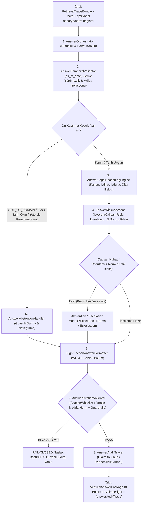

# `WP4_4_ANSWER_ENGINE_SPEC.md` — hrAI `@HukukSGK` WP-4.4 Answer Engine Teknik Şartnamesi

**Belge Kodu:** `WP4-4-ANSWER-ENGINE-SPEC`  
**Sürüm Hedefi:** `v1.0.6` — **WP-4 (`HukukSGK Agent Intelligence`) / Aşama `WP-4.4`**  
**Önceki Aşamalar:** [`WP4_1_AGENT_CORE_SPEC.md`](WP4_1_AGENT_CORE_SPEC.md) · [`WP4_2_LEGAL_KNOWLEDGE_BASE_SPEC.md`](WP4_2_LEGAL_KNOWLEDGE_BASE_SPEC.md) · [`WP4_3_RAG_ENGINE_SPEC.md`](WP4_3_RAG_ENGINE_SPEC.md) · [Draft PR #4 (`6c65bda`)](https://github.com/poliface34/poliface/pull/4)  
**Ürün / Koordinatör / Uzman / Web:** `hrAI` / `@hrAI` / `@HukukSGK` / `www.insenai.com.tr`  
**Durum:** `APPROVED_WP4_4_DESIGN_SPEC`  
**Proje ve Yönetişim Sınırları:**
- `WP-4.3` ([`engine/rag/`](../engine/rag/__init__.py)) kodları değiştirilmeden aynen korunacaktır.
- [`tools_router.py`](../engine/tools_router.py) entegrasyonuna bu aşamada girilmeyecektir; [PR #3 (WP-2)](https://github.com/poliface34/poliface/pull/3) (`c28bbd1`) ve Draft PR #4 üzerinde merge/etiket işlemi yapılmayacaktır.
- WP-1 CI sabitleri (`schemas/` = `13`, `config/` = `9`, sıfır harici çalışma zamanı bağımlılığı — yalnızca Python 3.12 stdlib, `v1.0.5`, `v1.0.5.1` ve `xmldsig.py` değişmezliği) korunacaktır.
- Üretim (`production_use_authorized=false`), 5070 sayılı Kanun (`qualified_e_signature_5070_equivalent=false`) ve KVKK m.9 (`kvkk_data_residency_approved=false`) kapıları kapalı kalacaktır.

---

## 1. Amaç ve Üç Kritik Kabul İlkesi

**WP-4.4 (`Answer Engine`)**, `WP-4.3` [`HukukSgkRagEngine`](../engine/rag/engine.py) tarafından üretilen mühürlü [`RetrievalTraceBundle`](../engine/rag/models.py) çıktısını alıp deterministik hukuki muhakeme, zamansal doğrulama, risk analizi, fail-closed kaçınma, sıkı atıf doğrulaması, 8 bölümlü standart cevap biçimlendirmesi ve uçtan uca denetim izi üreten katmandır.

**Üç Kritik Kabul Kriteri:**
1. **Kaynak Dışı Hukuki İddia Yok:** Üretilen her kanuni, içtihat veya istisna iddiası `RetrievalTraceBundle.citation_whitelist` içindeki aktif, doğrulanmış kayıtlara (`allowed_provision_ids`, `allowed_source_ids`, `allowed_precedent_ids`, `allowed_rule_ids`, `allowed_source_urls`) bağlanmak zorundadır. Beyaz liste dışındaki hiçbir kanun, madde, karar veya URL hukuki dayanak olarak sunulamaz.
2. **Kanıt ile Yorum Kesin Ayrılmalı:** Cevapta dört bilgi türü birbirinden açık etiketlerle (`claim_category`) ve ayrı alt bloklarda tutulur:
   - **`STATUTORY_EVIDENCE` (Kanıt — Normatif Mevzuat):** `normative_bucket` içindeki `VERIFIED` kanun/CK/yönetmelik/genelge metni.
   - **`JUDICIAL_PRECEDENT` (İçtihat — Kanun Değildir):** `precedent_bucket` içindeki Yargıtay/Danıştay kararları (`2797 m.45` / `2575 m.39` ve kapsam sınırıyla).
   - **`LEGAL_INTERPRETATION` (Yorum / İstisna / Geçiş / L5–L6):** `interpretation_bucket` ile deterministik muhakeme yorumları ve şablon/kurum normu ayrımları.
   - **`OPERATIONAL_GUIDANCE` (Operasyonel Öneri):** İK uygulama adımları, belge kontrolü ve koşullu `@ÜcretBordro` yönlendirmesi; asla kanun hükmü gibi sunulmaz.
3. **Tarihsel Doğruluk ve Geriye Yürümezlik (`Non-Retroactivity`) Korunmalı:** Bugünkü veya daha sonraki tarihli mevzuat (`7555 m.23` → `24.07.2025`, `7499` → `01.06.2024`, `7566` 9 kat SPEK & `10766 CK` → `01.01.2026`) geçmişte gerçekleşmiş bir olaya (`as_of_date`) otomatik olarak uygulanamaz; mülga veya tarih dışı hükümler yalnızca `historical_context` (`effective_on_date=false`) içinde açık tarih şerhiyle gösterilebilir.

---

## 2. 8 Bileşenli Answer Engine Mimarisi ve Veri Akışı



---

## 3. Sekiz Bileşenin Ayrıntılı Teknik Sorumlulukları

### 3.1. `AnswerOrchestrator` (`engine/answer/orchestrator.py`)
- **Girdi Sözleşmesi (`AnswerGenerationRequest`):**
  - `trace_bundle: RetrievalTraceBundle` *(WP-4.3 çıktısı — `bundle_sha256` bütünlüğü girişte yeniden doğrulanır; bozulmuş paket `INVALID_TRACE_BUNDLE_INTEGRITY` ile fail-closed reddedilir)*.
  - `facts: dict[str, Any]` *(somut İK olguları)*, `scenario_type: str | None`, `precedent_application_rationale: str = ""`, `competing_norm: NormReference | None = None`, `include_historical_disclosure: bool = True`.
  - Opsiyonel doğrulama kayıt defterleri (`source_registry`, `precedent_registry`, `knowledge_cards`); verilmezse salt okunur olarak mevcut merkezi `config/` dosyalarından yüklenir, **`tools_router.py` veya `engine/rag/` değiştirilmez**.
- **Sorumluluk:** 8 bileşeni sabit sırayla orkestre etmek, hiçbir aşamayı atlamadan nihai `VerifiedAnswerPackage` döndürmek ve `WP-1`/`5070`/`KVKK` kapalı kapı bayraklarını korumak.

### 3.2. `AnswerTemporalValidator` (`engine/answer/temporal_validator.py`)
- **Tarih Doğrulama:** `trace_bundle.as_of_date` (`YYYY-MM-DD`) zorunlu olarak yeniden ayrıştırılır; eksik/geçersizse veya `trace_bundle.temporal_audit.date_valid == False` ise hiçbir hukuki norm değerlendirmesi yapılmaz (`TEMPORAL_ABSTAIN_MISSING_DATE`).
- **Kova Öğeleri Tarihsellik Denetimi:** `normative_bucket`, `interpretation_bucket` ve `autonomous_norm_bucket` içindeki her chunk'ın `effective_from <= as_of_date <= effective_to (veya None)` şartını sağladığı doğrulanır; aykırı öğe aktif havuzdan düşürülür (`TEMPORAL_RETROACTIVITY_VIOLATION_BLOCKED`).
- **Kesim Tarihi ve Geriye Yürümezlik Kuralları:**
  - `7555 m.23` (`4857 m.109` KEP fesih yasağı): Yalnızca `as_of_date >= "2025-07-24"` için aktif kural; `as_of_date <= "2025-07-23"` vakalarda bugünkü `7555` metni geçmiş olaya **uygulanmaz** (`PRE_7555` eski metin esas alınır).
  - `7499 m.33` (`6698 m.6`): `2024-06-01` öncesi vakalarda eski `6698 m.6` açık rıza rejimi geçerlidir.
  - `7566` (`5510 m.82` 9 kat SPEK) & `10766 CK`: `2026-01-01` öncesi vakalarda uygulanamaz; `2026-01-01+` vakalarda `RG-9368-20241228` yalnızca `historical_context` (`effective_on_date=false`) içinde gösterilir.
- **Karar Sonrası Mevzuat Değişikliği Denetimi:** `precedent_bucket` içindeki kararın `decision_date` tarihinden sonra `as_of_date`'e kadar dayanak kanunda değişiklik varsa `PRECEDENT_POST_DECISION_STATUTORY_AMENDMENT` bayrağı eklenir.

### 3.3. `AnswerLegalReasoningEngine` (`engine/answer/reasoning.py`)
Kanıt ile yorumu ayırarak dört bağımsız muhakeme katmanı üretir:
1. **Normatif Kanun Muhakemesi (`StatutoryClaimBlock`):**
   - Yalnızca `normative_bucket` ve `effective_on_date=True` olan aktif hükümlerden üretilir; Anayasal hiyerarşi (`NORM_LAYER_PRIORITY`) ve `CK != CBK` ayrımı korunur.
   - Çatışan iki norm varsa [`resolve_norm_conflict`](../engine/norm_hierarchy.py#L123-L433) çalıştırılır (`CONFLICTING_SAME_LEVEL` veya `ILO` / `m.90/5` belirsizliğinde otomatik eskalasyon açılır).
2. **İçtihat Muhakemesi (`PrecedentAnalysisBlock`):**
   - İçtihatlar **asla** mevzuat basamağı yapılmaz.
   - `precedent_bucket` içindeki her karar için: `YARGITAY` (`2797 m.45`) vs `DANISTAY` (`2575 m.39`) ayrımı, `STATUTORY_BINDING_YIBBGK` vs ikna edici (`HGK_PERSUASIVE`, `CHAMBER_SETTLED`, `CHAMBER_ISOLATED`) düzeyi ve `applies_to` / `does_not_apply_to` kapsam sınırları yazılır.
   - Merkezi sicildeki Yargıtay kayıtları için [`evaluate_precedent_application`](../engine/norm_hierarchy.py#L436-L774) çağrılarak `>= 25` karakter `application_rationale` zorunluluğu ve `post_decision_amendments` kontrol edilir.
   - `CONFLICTING` (çelişkili) içtihatlar veya karar sonrası kanun değişikliği varsa otomatik hüküm durdurulur (`ESCALATE_TO_LEGAL_COUNSEL`).
3. **İstisna, Geçiş, Karşı Görüş ve L5/L6 Katmanı (`InterpretationAndExceptionsBlock`):**
   - `interpretation_bucket` içindeki `how_to_interpret`, `exceptions`, `transitional_rules`, `counter_arguments_and_pitfalls` ve `required_documents` alanları `LEGAL_INTERPRETATION` etiketiyle çıkarılır.
   - Eşleşen senaryo deterministik olarak [`evaluate_hr_legal_scenario`](../engine/legal_reasoning.py#L3795) veya L5/L6 durumunda [`evaluate_autonomous_norm_conflict`](../engine/autonomous_norms.py#L393) bulgularıyla zenginleştirilir *(yalnızca `citation_whitelist` izinli hükümlerle kesiştirilerek)*.
   - Kabul edilmemiş L5/L6 normlar (`REFERENCE_TEMPLATE_PENDING_COMPANY_ADOPTION`) asla bağlayıcı şirket kuralı sunulmaz; `4857 m.22` yazılı rıza sınırı şerhi düşülür.
4. **Operasyonel İK Adımları ve `@ÜcretBordro` Devri (`OperationalGuidanceBlock`):**
   - Her öneri açıkça `OPERATIONAL_GUIDANCE` (`Kanun hükmü değil, İK uygulama önerisidir`) olarak etiketlenir; parasal/kuruş hesaplama **asla yapılmaz**. Yalnızca `payroll_handoff_allowed=True` ise `@ÜcretBordro` devir özeti hazırlanır.

### 3.4. `AnswerRiskAssessor` (`engine/answer/risk_assessor.py`)
- İşveren ve çalışan perspektifinden çift yönlü risk nesneleri (`EmployerEmployeeRiskItem`: `risk_level`, `perspective` [`EMPLOYER` | `EMPLOYEE` | `BOTH`], `category`, `description`, `legal_consequence`, `grounded_source_ids`) üretir.
- Risk düzeyini `LOW` / `MEDIUM` / `HIGH` / `CRITICAL` olarak deterministik belirler; `HIGH`/`CRITICAL` durumunda `counsel_escalation_required=True`, deterministik `escalation_ticket_id="LEGAL-ESC-<sha256[:10]>"` ve `payroll_handoff_allowed=False` kilitlenir.

### 3.5. `AnswerAbstentionHandler` (`engine/answer/abstention_handler.py`)
Aşağıdaki durumlarda **fail-closed kaçınma / eskalasyon kararı (`AnswerAbstentionDecision`)** üretir:
1. **`OUT_OF_DOMAIN`:** Alan sınırı ve `Av. K. m.35` yetki reddi; 0 mevzuat/içtihat uydurması; `confidence_status = INSUFFICIENT_EVIDENCE`.
2. **`MISSING_INFO`:** Eksik `as_of_date`, çelişkili tarihler veya `blocking_missing_facts` → Kesin hüküm vermez; en fazla 5 hedefli netleştirme sorusu sorar; `payroll_handoff_allowed = False`.
3. **`INSUFFICIENT_EVIDENCE` / `PENDING_REVIEW`:** Doğrulanmamış/bekleyen kaynağın (`GIB-TEBLIG-332-20251231` vb.) neden kullanılamadığını dürüstçe açıklar; `confidence_status = INSUFFICIENT_EVIDENCE`.
4. **`CONFLICTING_LAW_OR_PRECEDENT`:** Çelişkili içtihat veya çözülemeyen eş-düzey norm çatışmasında otomatik hüküm durdurulur (`counsel_escalation_required=True`, `payroll_handoff_allowed=False`).
5. **Deterministik `confidence_status` Türetimi (`WP4_1` §7.3):** Sabit kural tablosundan **`VERIFIED`**, **`PARTIALLY_VERIFIED`** veya **`INSUFFICIENT_EVIDENCE`** türetilir.

### 3.6. `AnswerCitationValidator` (`engine/answer/citation_validator.py`)
Cevap kullanıcıya açılmadan önce **çift katmanlı fail-closed doğrulama** yürütür:

| Doğrulama Katmanı | Denetlenen Kural | İhlalde Tetiklenen Hata Kodu (`BLOCKER`) |
| :--- | :--- | :--- |
| **Katman A1 — `CitationWhitelist` İddia Bağlama** | Her `AnswerClaimRecord` (`STATUTORY_EVIDENCE`, `JUDICIAL_PRECEDENT`, `LEGAL_INTERPRETATION`) içindeki `source_id`, `provision_id`, `precedent_id`, `rule_id`, `source_url`, `evidence_id` alanlarının tamamı `RetrievalTraceBundle.citation_whitelist` içinde olmalıdır. | `UNWHITELISTED_CITATION_BLOCKER` |
| **Katman A2 — Yanlış Madde / Sayı / Tür Çapraz Kontrolü** | Cevap metninde geçen her `Kanun No + Madde No` (ör. `4857 m.18`), `CK`/`CBK` veya `E./K.` ifadesinin `citation_whitelist` içindeki aktif maddeler/kararlar tarafından gerçekten desteklendiği doğrulanır. | `WRONG_ARTICLE_OR_PROVISION_CITED` · `TEMPORAL_RETROACTIVITY_VIOLATION_BLOCKED` |
| **Katman B — Sicil, Tarih, URL & 9 Guardrail** | [`verify_response_citations`](../engine/precedent_verifier.py#L602-L1008) tam çalıştırılır (`HISTORICAL_DISCLOSURE_MARKERS` kontrolü, çıplak ana sayfa URL yasağı, `NORM_TYPE_MISMATCH_DECREE_VS_DECISION`, `ARTICLE_NOT_EFFECTIVE_ON_DATE` ve 9 aşırı genelleme kuralı). | `FABRICATED_STATUTE` · `FABRICATED_PRECEDENT` · `EXPIRED_OR_REPEALED_STATUTE` · `INVALID_SOURCE_URL` · `OVERBROAD_LEGAL_CLAIM_*` |
| **Katman C — Bütçe & Kapı Sınırı** | Kuruş/TL parasal kesin hesap çıktısı veya kapalı kapıları açık gösterme girişimi engellenir. | `UNAUTHORIZED_PAYROLL_CALCULATION` · `GOVERNANCE_GATE_VIOLATION` |

**Fail-Closed Yayın Politikası:** `AnswerCitationValidator.passed == False` ise üretilen taslak cevap **asla** yayınlanmaz; `published_answer_blocked = True` ayarlanır ve yalnızca güvenli blokaj + `LEGAL-ESC-...` yönlendirmesi döner.

### 3.7. `EightSectionAnswerFormatter` (`engine/answer/formatter.py`)
[`WP4_1_AGENT_CORE_SPEC.md`](WP4_1_AGENT_CORE_SPEC.md) §7.1 ile birebir uyumlu sabit **8 bölümlü cevap (`EightSectionAnswer`)** üretir:
`hukuki_sonuc`, `mevzuat_dayanagi`, `hukuki_degerlendirme` *(Kanun / Yorum / İçtihat / L5–L6 / Karşı Görüş alt blokları)*, `uygulama`, `risk`, `istisnalar`, `kaynaklar`, `guven_durumu`.

### 3.8. `AnswerAuditTracer` (`engine/answer/audit_trace.py`)
Cevap ile `RetrievalTraceBundle` arasında kriptografik ve madde düzeyinde izlenebilirlik kütüğü (`AnswerAuditTrace`) üretir:
`source_trace_id == bundle.trace_id`, `source_bundle_sha256 == bundle.bundle_sha256`, `claim_evidence_links`, `answer_sha256` ve `audit_trace_sha256`.

---

## 4. Çıktı Veri Sözleşmesi (`VerifiedAnswerPackage`)

```text
VerifiedAnswerPackage:
  - answer_version: "1.0.6-wp4.4"
  - answer_id: "ANS-<answer_sha256[:12]>"
  - generated_at_utc: ISO-8601 UTC
  - query_text: str
  - as_of_date: str | None
  - status: "ANSWERED" | "ANSWERED_WITH_ESCALATION" | "ABSTAINED_MISSING_INFO"
          | "ABSTAINED_INSUFFICIENT_EVIDENCE" | "ABSTAINED_OUT_OF_DOMAIN"
          | "BLOCKED_CITATION_VALIDATION_FAILED"
  - published_answer_blocked: bool
  - eight_sections: EightSectionAnswer
  - claims: tuple[AnswerClaimRecord, ...]
  - legal_bases: tuple[LegalBasisItem, ...]
  - historical_context: tuple[LegalBasisItem, ...]
  - precedent_assessments: tuple[dict[str, Any], ...]
  - risks: tuple[EmployerEmployeeRiskItem, ...]
  - missing_information: tuple[MissingInfoItem, ...]
  - clarification_questions: tuple[str, ...]
  - human_approval: HumanApprovalRequirement
  - confidence_status: "VERIFIED" | "PARTIALLY_VERIFIED" | "INSUFFICIENT_EVIDENCE"
  - confidence_reason_codes: tuple[str, ...]
  - citation_audit: AnswerCitationAuditReport
  - audit_trace: AnswerAuditTrace
  - governance_gates: dict[str, bool]                  # {"production": False, "law_5070": False, "kvkk_m9": False}
  - answer_sha256: str
```

---

## 5. WP-4.4 Geliştirici Kabul ve Test Hedefleri (26 Senaryo: `ANS-01`..`ANS-26`)

Doğrulama paketi [`hrai_hukuk_sgk/tests/test_answer_engine_wp44_v106.py`](../tests/test_answer_engine_wp44_v106.py) üzerinde şu 26 senaryoyu doğrular:
- **ANS-01..04:** Temiz pozitif, çoklu alan, performans/savunma ve Trust Chain bağlı 8 bölümlü cevaplar.
- **ANS-05..07:** Yanlış madde, `CK` vs `CBK` norm türü hatası ve uydurma karar/çıplak URL engelleri.
- **ANS-08..11:** `7555`, `7499`, `7566`, `9368/10766 CK` tarih duyarlılığı ve geriye yürümezlik testleri.
- **ANS-12..14:** Kanıt vs yorum vs içtihat vs operasyonel öneri + L5/L6 ayrımı testleri.
- **ANS-15..17:** Çelişkili/izole içtihat, `<25` karakter gerekçe, karar sonrası değişiklik ve norm çatışmaları.
- **ANS-18..20:** `CitationWhitelist` dışı iddia, `PENDING_REVIEW` kaynak, aşırı genelleme ve paket tahrifatı reddi.
- **ANS-21..24:** Eksik bilgi, yüksek risk eskalasyonu, bordro `@ÜcretBordro` sınırı ve alan dışı/dilekçe reddi.
- **ANS-25..26:** `AnswerAuditTrace` ↔ `RetrievalTraceBundle` bağ bütünlüğü, deterministik hash ve WP-1 değişmezleri.

---

## 6. Mimari Yerleşim Planı

1. Belge: [`hrai_hukuk_sgk/docs/WP4_4_ANSWER_ENGINE_SPEC.md`](WP4_4_ANSWER_ENGINE_SPEC.md).
2. Yeni paket: `hrai_hukuk_sgk/engine/answer/` (`models.py`, `temporal_validator.py`, `reasoning.py`, `risk_assessor.py`, `abstention_handler.py`, `citation_validator.py`, `formatter.py`, `audit_trace.py`, `orchestrator.py`, `__init__.py`).
3. Test paketi: [`hrai_hukuk_sgk/tests/test_answer_engine_wp44_v106.py`](../tests/test_answer_engine_wp44_v106.py) (`ANS-01`..`ANS-26`).
