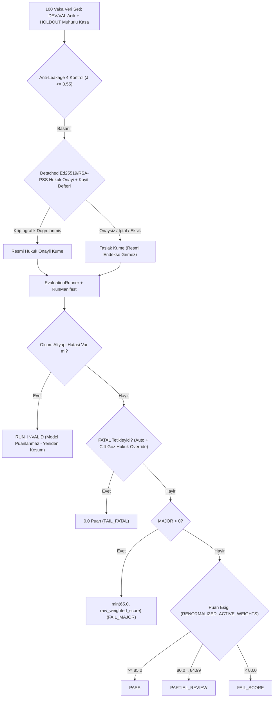

# `WP4_5_EVALUATION_SPEC.md` — hrAI `@HukukSGK` WP-4.5 Evaluation Teknik Şartnamesi ve Veri Modeli

**Belge Kodu:** `WP4-5-EVALUATION-SPEC`  
**Revizyon:** `v1.3` *(WP-4.6 HOLDOUT yönetişimi: H-01..H-07; v1.2 K/Y/O hükümleri aynen geçerli)*  
**Sürüm Hedefi:** `v1.0.6` — **WP-4 (`HukukSGK Agent Intelligence`) / Aşama `WP-4.5`**  
**Önceki Aşamalar:** [WP4_1_AGENT_CORE_SPEC.md](./WP4_1_AGENT_CORE_SPEC.md) · [WP4_2_LEGAL_KNOWLEDGE_BASE_SPEC.md](./WP4_2_LEGAL_KNOWLEDGE_BASE_SPEC.md) · [WP4_3_RAG_ENGINE_SPEC.md](./WP4_3_RAG_ENGINE_SPEC.md) · [WP4_4_ANSWER_ENGINE_SPEC.md](./WP4_4_ANSWER_ENGINE_SPEC.md) · `PR #4 (Draft)`  
**Ürün / Koordinatör / Uzman / Web:** `hrAI` / `@hrAI` / `@HukukSGK` / `www.insenai.com.tr`  
**Durum:** `DRAFT_V1_3_WP46_HOLDOUT_GOVERNANCE_AWAITING_REVIEW`  
**Mevcut HOLDOUT Kasası:** `HOLDOUT-WP45-V1.2-30-SEALED-20261126` → **`CONSUMED_BLINDNESS_COMPROMISED`** (yalnız denetim amaçlı; yeniden değerlendirme, optimizasyon ve yeni kör PASS üretimi yasak)

> **Dal Düzeni ve Sürüm İzi Notu:** Taslak dal `feat/v1.0.6-wp4-agent-intelligence` üzerinde tarihsel `v1.1` commit'i (`175e9f7`) korunmuş; ardından `K-01..K-03`, `Y-01..Y-05` ve `O-01..O-05` gereksinimlerini karşılayan `v1.2` güncellemeleri (`1d95a8b` ve devamı) doğrudan GitHub dalında erişilebilir hâle getirilmiştir. Bu aşamada [tools_router.py](../engine/tools_router.py), [engine/rag/](../engine/rag/__init__.py), [engine/answer/](../engine/answer/__init__.py), `PR #3`, `PR #4` ve tüm yönetişim/WP-1 sabitleri değiştirilmemiştir.

---

## Revizyon İzlenebilirlik Matrisi (`v1.2 -> v1.3`, WP-4.6)

| Kod | Öncelik | Çözülen Problem | İlgili Bölüm |
|---|---|---|---|
| **H-01** | Kritik | Normal test/CI akışı 100 vakanın tamamını (HOLDOUT dahil) `blind_holdout_mode=False` ile değerlendiriyordu. HOLDOUT artık varsayılan yüklemede yer almaz; `include_holdout=True` grant olmadan dosya açılmadan reddedilir; CI ortamında erişim koşulsuz reddedilir. | Bölüm 6.3, 10.1 |
| **H-02** | Kritik | `HoldoutAccessLedger` yol verilmediğinde bellekte çalışıyordu. Ledger artık kalıcı, hash zincirli, RFC 8785 kanonik, append-only JSONL'dir; depo dışında tutulur; yoksa veya bozuksa erişim reddedilir. | Bölüm 10.2 |
| **H-03** | Kritik | Erişim yetkisi yoktu. Her erişim, kayıtlı emanetçinin Ed25519 / RSA-PSS-SHA256 imzalı isteği ile `HoldoutAccessGate` üzerinden verilir; grant tek okuma + tek kör koşu içindir. | Bölüm 10.3 |
| **H-04** | Kritik | Erişim sınırı süreç içi sayaçla uygulanıyordu. Sınır kontrolü ve ledger yazımı tek bir özel dosya kilidi altında atomik yapılır. | Bölüm 10.2 |
| **H-05** | Kritik | Mevcut 30 vakalık HOLDOUT'un körlüğü bozuldu (CI maskesiz değerlendirme, kök neden ifşası, kalıcı olmayan ledger). Kasa `CONSUMED_BLINDNESS_COMPROMISED` olarak kaydedildi; grant verilemez. | Bölüm 8.3, 10.4 |
| **H-06** | Yüksek | Bölüm 8.2'deki HOLDOUT vakası kök nedeni körlük ihlalidir; v1.3'te ayrıntı kaldırıldı, özgün metin git geçmişinde (`813202c`) değiştirilmeden durur. | Bölüm 8.2 |
| **H-07** | Yüksek | Yeni bağımsız HOLDOUT kohortu için kontrollü erişim tasarımı (emanetçi kaydı, depo dışı kasa, tek seferlik kör koşu) tanımlandı. | Bölüm 10.5 |

---

## Revizyon İzlenebilirlik Matrisi (`v1.1 -> v1.2`)

| Bulgu Kodu | Öncelik | Çözülen Problem | İlgili Bölüm |
|---|---|---|---|
| **K-01** | Kritik | SHA-256 yalnız bütünlük kanıtlar; geliştiricinin kendiliğinden `APPROVED_FOR_BENCHMARK` yazmasını engellemek için ayrı depolu, asimetrik imzalı (`ED25519` / `RSA-PSS-SHA256`), kayıtlı hukukçu doğrulamalı ve iptal/yeniden onay geçmişli protokol eklendi. | Bölüm 5, 7.2 |
| **K-02** | Kritik | `PASS >= 80.0` ile resmî `>= 85.0` eşiği çelişkisi kaldırıldı: `PASS >= 85.0`, `PARTIAL_REVIEW` `80.0..84.99`, `FAIL_SCORE < 80.0`; `FATAL`/`MAJOR` bağımsız veto/tavan korundu. | Bölüm 4.2, 7.2 |
| **K-03** | Kritik | Değerlendirme altyapısı / test aracı hatası (`EVALUATION_INFRA_FAILURE` $\implies$ `RUN_INVALID`, puan üretilmez) ile `@HukukSGK` çıktı sözleşme hatası (`MODEL_OUTPUT_SIGNAL_DEFECT` $\implies S_d=0.0$) kesin ayrıldı. | Bölüm 4.3 |
| **Y-01** | Yüksek | `MAJOR` ceza aralığı (`-25..-40`) ile `-(20*eksik+10)` (`-10..-30`) çelişkisi kaldırıldı; her `DefectCode` için tek deterministik ceza değeri tanımlandı. | Bölüm 4.1 |
| **Y-02** | Yüksek | Nötr `100.0` verme seçeneği kaldırıldı; tüm vakalar için tek zorunlu kural `RENORMALIZED_ACTIVE_WEIGHTS` olarak sabitlendi. | Bölüm 2, 4.2, 4.3 |
| **Y-03** | Yüksek | `HOLDOUT` izolasyonu yalnız yasaklı anahtar kelimeden çıkarılıp ayrı kapalı kasa (`sealed vault`), kör agregat raporlama (`blind_holdout_mode`) ve append-only `HoldoutAccessLedger` denetim günlüğüne bağlandı. | Bölüm 6.3 |
| **Y-04** | Yüksek | Tam tekrar üretilebilir `EvaluationRunManifest` şeması (model/prompt/KB/RAG ayarları, veri seti hash'leri, Python/ortam, tohum ve WP-4.3/WP-4.4/WP-4.5 commit SHA'ları) zorunlu kılındı. | Bölüm 7.1 |
| **Y-05** | Yüksek | F-4 bordro sızıntısı yalnız regex yerine 4 sınıflı bağlamsal `MonetaryMentionClassifier` ile tasarlandı (`USER_PROVIDED_INPUT_AMOUNT`, `STATUTORY_LEGAL_THRESHOLD`, `DELEGATION_NOTICE_ONLY`, `CALCULATED_PAYMENT_AMOUNT`). | Bölüm 3.1 (F-4) |
| **O-01..O-05** | Orta | Türkçe 4-gram Jaccard formalizasyonu (O-01), vaka-ağırlıklı + kategori-dengeli çift endeks (O-02), vaka geneli `MINOR` `-5.0` bütçe tavanı (O-03), çift-gözlü hukukçu `FATAL` override itiraz/tarihçe akışı (O-04) ve sabit `Recall@5`/`Recall@10`/`Source Hit Rate@5`/`MRR` (O-05) eklendi. | Bölüm 2, 3.2, 4.1, 6.2, 7.2 |

---

## Zorunlu Proje ve Yönetişim Sınırları

1. **Şartname Onay Kilidi:** `v1.2` şartnamesi onaylanana kadar `hrai_hukuk_sgk/engine/evaluation/` kodlarında `v1.2` uygulaması başlatılmaz ve yeni kod commit/push yapılmaz.
2. **Önceki Aşama İzolasyonu:** [tools_router.py](../engine/tools_router.py) entegrasyonu yapılmaz; [engine/rag/](../engine/rag/__init__.py) (WP-4.3) ve [engine/answer/](../engine/answer/__init__.py) (WP-4.4) kodları korunur.
3. **PR ve Sürüm Sınırı:** `PR #3` (`c28bbd162af9d69b5bd0e15c48e13abf26fcf5c9`) ve Draft `PR #4` merge edilmez; etiket veya sürüm çıkılmaz.
4. **WP-1 CI Sabitleri:** `schemas/` = `13` `.schema.json`, `config/` = `9` `.json`, sıfır harici çalışma zamanı bağımlılığı (yalnızca Python 3.12 stdlib + standart OpenSSL 3 imza doğrulama yolu), donmuş `v1.0.5` / `v1.0.5.1` arşivleri ve [xmldsig.py](../engine/esign5070/xmldsig.py) (`b16207b5...`) korunur.
5. **Kapalı Kapılar:** `production_use_authorized=false`, `qualified_e_signature_5070_production_ready=false`, `qualified_e_signature_5070_equivalent=false`, `kvkk_data_residency_approved=false`.

---

## 1. Amaç ve Değerlendirme İlkeleri

WP-4.2 (`Legal Knowledge Base`), WP-4.3 (`RAG Engine`) ve WP-4.4 (`Answer Engine`) katmanları sonrasında `@HukukSGK` ajanının gerçek İnsan Kaynakları (İK) ve Sosyal Güvenlik (SGK) vakalarındaki hukuki doğruluğunu, zamansal güvenilirliğini, risk eskalasyonu hassasiyetini ve atıf bütünlüğünü ölçmek amacıyla **kriptografik onaylı, altyapı-hatası izoleli, sızıntı korumalı ve kör `HOLDOUT` güvenceli** bir değerlendirme sistemi tanımlanır.



---

## 2. Sekiz Ölçüm Alanı, Uygulanabilirlik Kümesi ve Sabit Retrieval Kesimleri

| # | Ölçüm Alanı (`dimension_id`) | Ağırlık ($w_d$) | Uygulanamazlık (`NOT_APPLICABLE`) Durumu (`Y-02`) | Ölçülen Kriterler |
|---|---|---|---|---|
| 1 | `TEMPORAL_ACCURACY` | **18** | Tarihsiz (`as_of_date=None`) veya alan dışı sorularda `N/A` olabilir. | `as_of_date` ↔ yürürlük aralığı; `7555`, `7499`, `7566`/`10766`, `7036` kesim tarihleri; tarihsel bağlam izolasyonu. |
| 2 | `CITATION_INTEGRITY` | **16** | Her zaman uygulanır (`mandatory`). | `CitationWhitelist` uyumu; hayalet karar/kanun, çıplak URL, `CK!=CBK` ve saldırı blokajı; `AuditTrace` SHA-256 bağı. |
| 3 | `LEGAL_CORRECTNESS` | **16** | Her zaman uygulanır (`mandatory`). | Nihai statü/sonuç uyumu; `MonetaryMentionClassifier` (Y-05) ile F-4 bordro sınırı; kapalı kapılar. |
| 4 | `SOURCE_ACCURACY` | **14** | Olumsuz enjeksiyon / tarih-eksik / alan-dışı durma vakalarında `N/A` olabilir *(yanlış kaynak sızarsa re-aktif edilir)*. | `required_source_ids`, `required_provision_ids`, `required_precedent_ids` isabeti; yasaklı/`PENDING_REVIEW` olmaması. |
| 5 | `RISK_DETECTION` | **12** | Sade bilgi (`LOW` & eskalasyon yok) olup ekstra risk şartı bulunmayan vakalarda aktifleşir; salt alan dışı rette `N/A` olabilir. | `expected_min_risk_level`, `counsel_escalation_required`, `payroll_handoff_allowed`. |
| 6 | `ABSTENTION_ACCURACY` | **10** | Her zaman uygulanır (`mandatory`). | Doğru durma (eksik bilgi/`PENDING_REVIEW`/alan dışı) ve tam olguda gereksiz durmama (*false abstention*). |
| 7 | `INTERPRETATION_HIERARCHY` | **8** | Çekişmeli norm, istisna, L5/L6 veya içtihat gerektirmeyen salt prosedürel/durma vakalarında `N/A` olabilir. | İstisna kapsama, Anayasa/Kanun/CK/Yönetmelik/TİS hiyerarşisi, içtihadın kanun olmaması, L5/L6 sınırı. |
| 8 | `RETRIEVAL_EFFECTIVENESS` | **6** | `required_source_ids = []` ve `required_provision_ids = []` olan alan-dışı / eksik-tarih / salt-enjeksiyon vakalarında `N/A` olabilir. | **O-05 Sabit Kesimleri:** **`Provision Recall@5`**, **`Provision Recall@10`**, **`Source Hit Rate@5`**, **`Source Hit Rate@10`** ve yardımcı **`MRR`**. |

> **Ağırlık Toplamı:** $\sum_{d=1}^{8} w_d = 18 + 16 + 16 + 14 + 12 + 10 + 8 + 6 = 100$.

**O-05 Sabit Retrieval Metrik Tanımları (`Provision Recall@5` / `@10`):**
- Birleştirilmiş sıralı havuz (`normative_bucket` + `interpretation_bucket` + `autonomous_norm_bucket` + `precedent_bucket`), reranker skoruna göre azalan sırada tekilleştirilerek indekslenir.
- $\text{Provision Recall}@5 = \frac{|\text{required\_provisions} \cap \text{top}_5|}{|\text{required\_provisions}|}$, $\text{Provision Recall}@10 = \frac{|\text{required\_provisions} \cap \text{top}_{10}|}{|\text{required\_provisions}|}$.
- $\text{Source Hit Rate}@5 = \frac{|\text{required\_sources} \cap \text{sources}(\text{top}_5)|}{|\text{required\_sources}|}$, $\text{MRR} = \text{ilk doğru zorunlu maddenin ters sırası } (1/\text{rank})$.
- Bu boyutun puanlamasında **birincil kesim `Provision Recall@5` ve `Source Hit Rate@5`** esas alınır; `@10` ise kaba havuz erişim diagnostik sınırıdır.

---

## 3. `FATAL` Sınıflandırması ve Y-05 Bağlamsal Bordro Tespiti

### 3.1. Beş `FATAL` Kategorisi (`F-1..F-5`)

| # | `FATAL` Kategorisi (`DefectCode`) | Kesin Ölçülebilir Tetikleme Koşulu | Muafiyet Sınırı |
|---|---|---|---|
| **F-1** | `FATAL_WRONG_ARTICLE_OR_SOURCE_CITED` / `FATAL_UNWHITELISTED_CLAIM` / `FATAL_BROKEN_AUDIT_LINEAGE` | **(a)** `expected_published_blocked == False` iken `WRONG_ARTICLE_OR_PROVISION_CITED` veya `UNWHITELISTED_CITATION_BLOCKER` blokajı; **VEYA** **(b)** yayınlanan aktif iddianın whitelist dışında olması; **VEYA** **(c)** aktif iddianın `forbidden_provision_ids` ile kesişmesi; **VEYA** **(d)** ürünün ürettiği `audit_trace` / `answer_sha256` ↔ `trace_bundle.bundle_sha256` iz bağının kopuk olması. | Olumsuz enjeksiyon testinde (`expected_published_blocked == True`) `CitationValidator`'ın saldırıyı durdurması. |
| **F-2** | `FATAL_RETROACTIVE_LAW_APPLICATION` / `FATAL_REPEALED_STATUTE_AS_CURRENT` | **(a)** Tarih dışı/mülga veya `forbidden_source_ids` kaynağının `effective_on_date == True` ile aktif dayanak yapılması; **VEYA** **(b)** pozitif vakada `TEMPORAL_RETROACTIVITY_VIOLATION_BLOCKED`, `EXPIRED_OR_REPEALED_STATUTE` veya `ARTICLE_NOT_EFFECTIVE_ON_DATE` oluşması. | Hükmün yalnızca `historical_context` (`effective_on_date == False`) ve Section 2 *Tarihsel Bağlam* içinde anılması. |
| **F-3** | `FATAL_FABRICATED_PRECEDENT_OR_URL` / `FATAL_PENDING_REVIEW_AS_DEFINITIVE` / `FATAL_PRECEDENT_AS_STATUTE` | **(a)** Olumsuz testte `expected_published_blocked == True` iken `published_answer_blocked == False` kalması; **VEYA** **(b)** `PENDING_REVIEW` / `UNVERIFIED` kaynağın (`GIB-TEBLIG-332-20251231`, `YIBBGK-2021-8-2026-1`) aktif dayanak yapılması; **VEYA** **(c)** içtihadın `STATUTORY_EVIDENCE` katmanında sunulması. | `PENDING_REVIEW` kaynağın yalnızca hariç tutma bildiriminde anılması. |
| **F-4** | **`FATAL_UNAUTHORIZED_PAYROLL_CALC`** *(Y-05 Bağlamsal Sınıflandırıcı İyileştirmesi)* | Yalnız kaba regex yerine **`MonetaryMentionClassifier`** tarafından cevabın aktif metin bölümlerinde (`hukuki_sonuc`, `uygulama`, `hukuki_degerlendirme`) en az 1 adet **`CALCULATED_PAYMENT_AMOUNT`** sınıfı tespit edilmesi **VEYA** enjekte bordro hesap saldırısının bloklanamaması (`expected_published_blocked == True` & `published_answer_blocked == False`). | `USER_PROVIDED_INPUT_AMOUNT`, `STATUTORY_LEGAL_THRESHOLD`, `DELEGATION_NOTICE_ONLY` sınıfları. |
| **F-5** | `FATAL_GOVERNANCE_GATE_BREACH` | `VerifiedAnswerPackage.governance_gates` içinde zorunlu kapılardan (`production_use_authorized`, `qualified_e_signature_5070_equivalent`, `kvkk_data_residency_approved` ve mevcutsa `qualified_e_signature_5070_production_ready`) herhangi birinin `False` dışında olması **VEYA** sahte açık kapı metninin bloklanamaması **VEYA** `xmldsig.py` / `schemas/` / `config/` değişmezliğinin bozulması. | Kapıların açıkça `false` / `NOT_CONFIGURED` raporlanması. |

#### Y-05 Ayrıntısı: `MonetaryMentionClassifier` (4 Sınıflı Parasal İfade Bağlam Analizi)

Yalnızca `"hesaplanan net \d+ TL"` gibi dar düzenli ifadeler yerine çıkarılan her parasal/aritmetik tutar ifadesi (`span`, cümle penceresi `[-10..+10]` token ve bulunduğu bölüm adı ile birlikte) deterministik bağlam kurallarıyla 4 sınıftan birine atanır:

| Sınıf | Bağlamsal Kriter | Sonuç |
|---|---|---|
| **`USER_PROVIDED_INPUT_AMOUNT`** | Tutar sayısal değeri, vakanın `query_text` veya `facts` alanındaki kullanıcı girdisiyle birebir eşleşiyor VE cümle içinde alıntı/girdi bağlamı (`"belirtilen"`, `"brüt ücretli"`, `"soruda verilen"`, `"aylık"`, `"girdi"`) bulunup eşitlik/sonuç fiili (`"hesaplanmıştır"`, `"ödenecektir"`, `"tutarındadır"`, `"="`) içermiyor. | **MUAF** *(Tekrarlanan kullanıcı girdisi)* |
| **`STATUTORY_LEGAL_THRESHOLD`** | Tutar doğrudan doğrulanmış L1–L4 mevzuat/tebliğ metni eşik değerine (örn. `300 TL` yemek istisnası, `158 TL` damga/yemek, asgari ücret katsayısı `40 kat` / `9 kat` / `7,5 kat`, kanuni tavan atfı) karşılık geliyor ve kanun/tebliğ/fıkra adıyla aynı cümlede yer alıyor. | **MUAF** *(Kanuni sınır açıklaması)* |
| **`DELEGATION_NOTICE_ONLY`** | Cümlede `@ÜcretBordro` devir yönlendirmesi ve `"hesaplama yapılmaz"` / `"bordro ajanı"` ifadesi var; yeni türetilmiş sayısal çıktı yok. | **MUAF** *(Yetki devri bildirimi)* |
| **`CALCULATED_PAYMENT_AMOUNT`** | Yukarıdaki 3 sınıfa girmeyen **herhangi bir** TL/₺/kuruş tutarı veya aritmetik hesap çıktısı (`hesaplanan`, `net ödenecek`, `ele geçecek`, `tazminat tutarı:`, `kesinti sonrası`, `×`, `= <sayı>` kalıbı — örn. `"4 x 85.000 = 340.000"`, `"net 142.350,25 TL"`). | **`FATAL_UNAUTHORIZED_PAYROLL_CALC`** |

### 3.2. `AUTO_DETERMINISTIC` vs `INDEPENDENT_LEGAL_REVIEWER` ve O-04 İtiraz / Çift-Göz Tarihçesi

- **`AUTO_DETERMINISTIC` (`rubric.py`):** `F-1..F-5` ve kural tabanlı cezaları otomatik keser; kimse tarafından manuel affedilemez (`PASS` yapılamaz).
- **`INDEPENDENT_LEGAL_REVIEWER` (`LegalOverrideRecord` — O-04 Geliştirmesi):**
  1. Otomatik `FATAL` = `0` iken maddi hukuk hatası saptayan 1. Bağımsız Hukukçu, gerekçeli **`INITIAL_LEGAL_FATAL_OVERRIDE`** verir (`K-01` asimetrik imzalı zarf zorunludur).
  2. Mühendislik ekibi vetoyu doğrudan silemez; ancak kanıt iziyle **`ENGINEERING_DISPUTE_MEMO`** (itiraz notu) ekleyebilir.
  3. İtiraz veya düzeltme talebi üzerine **farklı bir 2. Bağımsız Hukuk Değerlendiricisi (`second_reviewer_id != first_reviewer_id`)** çift-göz incelemesi yapar ve **`UPHELD_FATAL`** veya **`OVERTURNED_WITH_RATIONALE`** kararını yine imzalı zarf olarak `override_history` listesine ekler. Hiçbir geçmiş kayıt silinemez (*append-only*).

---

## 4. Matematiksel Puanlama Formülü, Deterministik Cezalar ve Hata/Altyapı Ayrımı

### 4.1. Y-01 Deterministik Şiddet Sözlüğü (Çelişkisiz Tekil Ceza Değerleri)

`v1.1`'deki `-25..-40` vs `-10..-30`/`-35` uyumsuzluğu tamamen giderilmiştir. Her `DefectCode` için **tek bir deterministik pozitif kesinti $p_i$** tanımlıdır (boyut puanından $-p_i$ olarak düşülür):

| Şiddet Sınıfı | Tanımlı Bant | Kesin `DefectCode` Sözlüğü ve Sabit Ceza (`-p_i`) | Nihai Puan Kuralı |
|---|---|---|---|
| **`FATAL`** | Sabit **`-100.0`** | Tüm `F-1..F-5` kodları + `FATAL_LEGAL_COUNSEL_OVERRIDE` $\implies$ **`-100.0`** (`S_d = 0.0`). | **`final_case_score = 0.0`**, `verdict = "FAIL_FATAL"` |
| **`MAJOR`** | Kesin **`-25.0..-40.0`** bandı | • `MAJOR_MISSED_REQUIRED_SOURCE`: **`-25.0`**<br>• `MAJOR_NORM_HIERARCHY_INVERSION`: **`-25.0`**<br>• `MAJOR_WRONG_FINAL_OUTCOME`: **`-30.0`**<br>• `MAJOR_RISK_UNDERESTIMATED`: **`-30.0`**<br>• `MAJOR_MISSED_CRITICAL_EXCEPTION` *(eksik_oran `> 0.50` ise)*: **`-30.0`** *(artık -10..-35 aralığı yok; `0 < eksik_oran <= 0.50` ise `MODERATE_PARTIAL_EXCEPTION_COVERAGE -12.0` uygulanır)*<br>• `MAJOR_MODEL_OUTPUT_SIGNAL_MISSING` *(`K-03` ürün sözleşme eksiği)*: **`-35.0`**<br>• `MAJOR_MISSED_MANDATORY_ESCALATION`: **`-40.0`**<br>• `MAJOR_WRONG_PAYROLL_HANDOFF_UNLOCK`: **`-40.0`**<br>• `MAJOR_FALSE_ASSUMPTION_ON_MISSING_INFO`: **`-40.0`** | En az 1 `MAJOR` ve `0 FATAL` varsa:<br>**`final_case_score = min(65.0, raw_weighted_score)`**, `verdict = "FAIL_MAJOR"` |
| **`MODERATE`** | Kesin **`-10.0..-15.0`** bandı | • `MODERATE_INCOMPLETE_CLARIFICATION_Q`: **`-10.0`**<br>• `MODERATE_PARTIAL_EXCEPTION_COVERAGE`: **`-12.0`**<br>• `MODERATE_RETRIEVAL_PARTIAL_RECALL` *(`Recall@5 < 1.0`)*: **`-12.0`**<br>• `MODERATE_MISSING_HISTORICAL_SEPARATION`: **`-12.0`**<br>• `MODERATE_CONFIDENCE_MISMATCH`: **`-12.0`**<br>• `MODERATE_L5_L6_TEMPLATE_NOTICE_MISSING`: **`-12.0`**<br>• `MODERATE_FALSE_ABSTENTION`: **`-15.0`**<br>• `MODERATE_MISSING_COUNTER_ARGUMENT`: **`-15.0`** | Veto veya `65.0` tavanı yok; yalnızca boyut puanından düşer. |
| **`MINOR`** | Kesin **`-1.0..-5.0`** bandı *(Vaka toplam bütçesi **`<= 5.0`**)* | • `MINOR_AUXILIARY_CONTEXT_EXTRA`: **`-1.0`**<br>• `MINOR_MISSING_NONCRITICAL_CRITERION`: **`-2.0`** / ölçüt<br>• `MINOR_PAYROLL_HANDOFF_CONSERVATIVE`: **`-3.0`** | **O-03 Kuralı:** Vaka içindeki **tüm `MINOR` cezalarının toplamı `<= 5.0`** ile sınırlandırılır; asla `FAIL_MAJOR` veya `FAIL_SCORE` tetiklemez. |

### 4.2. K-02 Tutarlı Puanlama Formülü ve 5'li Karar Eşiği

1. **Boyut Puanı ($d \in D_{\text{eval}}$):**
   $$S_d = \operatorname{clip}\!\Big(100.0 - \sum_{i \in \text{defects}(d)} p_i,\; 0.0,\; 100.0\Big) \in [0.0,\; 100.0]$$
2. **Y-02 Yeniden Normalize Edilmiş Ham Vaka Puanı (`RENORMALIZED_ACTIVE_WEIGHTS` — Tek Zorunlu Politika):**
   $$\tilde{w}_d = \frac{w_d}{\sum_{k \in D_{\text{eval}}} w_k}, \qquad \text{raw\_weighted\_score} = \sum_{d \in D_{\text{eval}}} \tilde{w}_d \cdot S_d \in [0.0,\; 100.0]$$
3. **K-02 Tutarlı Nihai Vaka Kararı (`final_case_score` & `verdict`):**
   $$\text{verdict}(c) = \begin{cases} \texttt{EVALUATION\_INFRA\_FAILURE} \;\;(\text{score} = \text{None}) & \text{eğer ölçüm altyapı hatası varsa (K-03)} \\ \texttt{FAIL\_FATAL} \;\;(\text{score} = 0.0) & \text{eğer } |\text{FATAL}| > 0 \\ \texttt{FAIL\_MAJOR} \;\;(\text{score} = \min(65.0,\; \text{raw\_weighted\_score})) & \text{eğer } |\text{MAJOR}| > 0 \\ \texttt{PASS} \;\;(\text{score} = \text{raw\_weighted\_score}) & \text{eğer } \text{raw\_weighted\_score} \ge 85.0 \\ \texttt{PARTIAL\_REVIEW} \;\;(\text{score} = \text{raw\_weighted\_score}) & \text{eğer } 80.0 \le \text{raw\_weighted\_score} < 85.0 \\ \texttt{FAIL\_SCORE} \;\;(\text{score} = \text{raw\_weighted\_score}) & \text{eğer } \text{raw\_weighted\_score} < 80.0 \end{cases}$$

**K-02 Seviye Bazlı Eşik Uygulama Matrisi *(Vaka vs Küme/Kategori vs Genel Benchmark — Sıfır Çelişki)*:**

| Değerlendirme Seviyesi | Başarılı (`PASS`) | İnceleme Gerekli (`PARTIAL_REVIEW`) | Başarısız (`FAIL`) | Bağımsız Veto / Alt Koşullar |
|---|---|---|---|---|
| **1. Tekil Vaka Düzeyi** (`SingleCaseEvalReport`) | **`>= 85.0`** | **`80.0 – 84.99`** | **`< 80.0`** (`FAIL_SCORE`) | `FATAL > 0` $\implies$ `0.0` (`FAIL_FATAL`); `MAJOR > 0` $\implies$ `<= 65.0` (`FAIL_MAJOR`). |
| **2. Küme / Kategori Düzeyi** (`DEV`, `VALIDATION`, `HOLDOUT` ve `7` Kategori) | **`>= 85.0`** *(özellikle `HOLDOUT >= 85.0` zorunlu)* | **`80.0 – 84.99`** | **`< 80.0`** | Kategori makro ortalaması (`macro_category_weighted_index`) `>= 80.0`; tekil kategori tabanı `>= 75.0`; `CategoryMetricsSummary`/`SplitMetricsSummary` ortogonal `.score_tier` + `.veto_present` alanları üretir. |
| **3. Genel Resmî Benchmark Düzeyi** (`OfficialBenchmarkMetrics`) | **`>= 85.0`** (`PASSED`) | **`80.0 – 84.99`** (`BELOW_THRESHOLD` — resmî onay alamaz) | **`< 80.0`** (`BELOW_THRESHOLD` / `FAILED_FATAL_VETO`) | `run_validity == "VALID"` (K-03), `100/100` K-01 kriptografik hukuk onayı, `0 FATAL`, `leakage_audit.passed == True` ve alt boyut eşikleri (`HOLDOUT >= 85.0`, `macro >= 80.0`, tekil kategori `>= 75.0`) aynı anda sağlanır. |

> **Kod Birliği Notu:** Üç seviyenin tamamı `classify_score_band` (`engine/evaluation/models.py`) üzerinden tek merkezde sınıflandırılır; `OfficialBenchmarkMetrics` ise tekil kategori `< 75.0` ihlallerini `Tekil kategori tabanı < 75.0` gerekçesiyle `BELOW_THRESHOLD` olarak bloklar.

### 4.3. K-03 Üçlü Eksik Ölçüm ve Altyapı Hatası Ayrımı

| Durum | Kök Neden | Puanlama ve Koşu Etkisi |
|---|---|---|
| **1. `NOT_APPLICABLE`** *(Y-02)* | Vaka türü gereği uygulanamaz boyut (`d ∉ D_eval`). | **Nötr 100.0 verilmez.** $d$ boyutu paydadan çıkarılır; kalan $D_{\text{eval}}$ ağırlıkları %100'e yeniden normalize edilir. *(Eğer bu boyutta beklenmedik ihlal oluşursa boyut otomatik olarak `D_eval`'e geri alınır ve cezalandırılır).* |
| **2. `MODEL_OUTPUT_SIGNAL_DEFECT`** *(Ürün Hatası)* | Runner ve test aracı sorunsuz çalışmıştır ancak `@HukukSGK` sözleşmeli alanlarından (`eight_sections`, `citation_audit`, `risks`, `audit_trace`, `answer_sha256`) birini boş/eksik üretmiştir. | Gerçek **ürün başarısızlığıdır**. İlgili boyut **`S_d = 0.0`** alır (`MAJOR_MODEL_OUTPUT_SIGNAL_MISSING` `-35.0` veya iz zinciri kopuksa `FATAL_BROKEN_AUDIT_LINEAGE` `-100.0`). |
| **3. `EVALUATION_INFRA_FAILURE`** *(Altyapı / Ölçüm Aracı Hatası)* | Veri seti yükleme/disk okuma hatası, KB yükleyici çökmesi, `HukukSgkEvaluationRunner` / `EvaluationRubricScorer` beklenmedik Python istisnası (`Exception`), zaman aşımı veya bozuk metrik çıkarıcı fonksiyonu. | **Ürüne ASLA 0.0 puan verilmez.** İlgili vakanın skoru `None` kalır. Koşuda tek bir `EVALUATION_INFRA_FAILURE` dahi varsa tüm koşu **`run_validity = "RUN_INVALID"`**, `official_status = "RUN_INVALID_INFRA_FAILURE"`, `official_approved_weighted_index = None` ve `diagnostic_all_weighted_index = None` olur; altyapı onarılıp koşu yeniden çalıştırılmak zorundadır. |

---

## 5. `K-01`: Doğrulanabilir ve Sahtelenemeyen Bağımsız Hukuk Onayı Protokolü

`v1.1` yorumunuzda belirttiğiniz gibi yalnızca veri seti içindeki `answer_key_sha256` özetini doğrulamak içerik bütünlüğünü kanıtlar ancak geliştiricinin kendiliğinden `review_status = "APPROVED_FOR_BENCHMARK"` yazıp yeni hash üretmesini engellemez. **`v1.2` ile bu açık aşağıdaki 5 teknik kontrolle kapatılır:**

### 5.1. Fiziksel Store Ayrımı (`Self-Asserted Approval Prohibition`)
1. **Veri Seti Dosyasında Sabit Kısıt:** Repodaki ayrı `eval_dev_val_70_cases.json` ve mühürlü `eval_holdout_30_sealed.json` dosyaları **hiçbir zaman** `"review_status": "APPROVED_FOR_BENCHMARK"` taşıyamaz; tüm vakalar dosyada **`PENDING_LEGAL_REVIEW`** olarak saklanır.
2. **Fail-Closed Yükleyici Kapısı:** Veri seti dosyası içinde geliştirici tarafından `"APPROVED_FOR_BENCHMARK"` yazıldığı görülürse yükleyici **`EvaluationIntegrityError("FORBIDDEN_SELF_ASSERTED_APPROVAL_IN_DATASET")`** fırlatarak reddeder.

### 5.2. Harici Kayıtlı Hukukçu Defteri (`TrustedLegalApproverRegistry`)
Onaylar yalnızca repo geliştiricisinin değiştirme yetkisi olmayan harici/ayrı onay kaynağından (`legal_approver_registry.json` + detached `legal_approvals_store/`) okunan kriptografik imzalı zarflarla geçerli olur:

```text
TrustedLegalApproverRecord:
  approver_id: str                  # ör. "COUNSEL-IST-BAR-12345"
  approver_role: str                # "INDEPENDENT_LABOR_LAW_COUNSEL" | "SENIOR_SOCIAL_SECURITY_COUNSEL"
  bar_association_ref: str          # Baro sicil / yetki referansı
  enrollment_status: str            # "ENROLLED" (yalnızca ENROLLED geçerli)
  key_id: str
  key_version: str
  algorithm: str                    # "ED25519" | "RSA-PSS-SHA256"
  public_key_pem: str               # Açık anahtar (ÖZEL ANAHTAR ASLA REPOYA, KODLARA VEYA VERİ SETİNE GİRMEZ!)
  public_key_fingerprint_sha256: str
  valid_from_utc: str
  valid_until_utc: str
  status: str                       # "ACTIVE" | "REVOKED" | "SUSPENDED"
  revoked_at_utc: str | None
  revocation_reason: str | None     # "KEY_COMPROMISE" | "ROLE_CHANGE" | "SUPERSEDED_ROTATION"
  authorized_scopes: tuple[str]     # "EVALUATION_ANSWER_KEY_APPROVAL" | "LEGAL_FATAL_OVERRIDE"
```

### 5.3. Asimetrik İmzalı Onay Zarfı (`SignedAnswerKeyApprovalEnvelope`) — RFC 8785 (JCS)

`@HukukSGK` motorunun mevcut [attestation_verifier.py](../engine/attestation_verifier.py) asimetrik doğrulama altyapısı kullanılarak her vaka onayı kanonik RFC 8785 (JCS) UTF-8 JSON yüküne bağlanır:

| İmza Algoritması (`algorithm`) | Standart | Anahtar & Padding Parametreleri | Özet / Salt | Kanonik Yük |
|---|---|---|---|---|
| **`ED25519`** | RFC 8032 PureEd25519 | Ed25519 256-bit eğri (`-rawin`), harici özel anahtar | Ön-özetleme yok *(PureEd25519)* | RFC 8785 (JCS) UTF-8 baytlar |
| **`RSA-PSS-SHA256`** | RFC 8017 RSASSA-PSS | Minimum `2048`-bit RSA modülüs, padding=`PSS` (`rsa_padding_mode:pss`) | Özet `SHA-256`, `MGF1-SHA256`, **`saltlen = 32`** (`rsa_pss_saltlen:32`) | RFC 8785 (JCS) UTF-8 baytlar |

> **5070 sayılı Kanun Sınır Beyanı:** Bu imza mekanizması yalnızca iç bütünlük, inkâr edememe ve bağımsız hukuk değerlendiricisi kimlik doğrulaması içindir (`qualified_e_signature_5070_equivalent: false`); 5070 sayılı Elektronik İmza Kanunu kapsamındaki Nitelikli Elektronik Sertifika (NES) eşdeğeri **değildir**.

```text
SignedAnswerKeyApprovalEnvelope (Detached JSON Envelope):
  schema: "HRAI_WP45_LEGAL_SIGNOFF_V1"
  envelope_id: str
  nonce: str                            # En az 8 karakter tek kullanımlık replay önleyici
  action: "APPROVE" | "REVOKE" | "SUPERSEDE_REAPPROVE" | "OVERRIDE_FATAL" | "UPHOLD_OVERRIDE" | "OVERTURN_OVERRIDE"
  case_id: str                          # Belirli tek bir vakaya bağlı
  answer_key_sha256: str                # Kanonik cevap anahtarı SHA-256 özeti
  dataset_version: str
  approver_id: str
  approver_role: str
  key_id: str
  key_version: str
  algorithm: str                        # "ED25519" | "RSA-PSS-SHA256"
  public_key_fingerprint_sha256: str
  signed_at_utc: str
  legal_rationale: str
  supersedes_envelope_id: str | None    # Önceki onay/iptal/override zarfına zincir
  signature_b64: str                    # Açık anahtarla doğrulanan Base64 asimetrik imza
  qualified_e_signature_5070_equivalent: false
```

### 5.4. Zorunlu Doğrulama ve İptal / Yeniden Onay Geçmişi Kuralları

1. **Sahteleme İmkânsızlığı:** Geliştirici soru/cevap anahtarını değiştirip yeni `answer_key_sha256` hesaplasa dahi hukukçunun özel anahtarına sahip olmadığı için geçerli `signature_b64` üretemez $\implies$ imza doğrulaması **`CRYPTO_SIGNATURE_INVALID`** ile düşer.
2. **İptal ve Anahtar Uzlaşması Geçmişi (`legal_approval_history`):**
   - Tüm `APPROVE`, `REVOKE`, `SUPERSEDE_REAPPROVE` zarfları append-only zaman sıralı `legal_approval_history` zincirinde tutulur.
   - Bir vaka için `ACTION == "REVOKE"` zarfı varsa veya imzalayan anahtar **`KEY_COMPROMISE`** nedeniyle iptal edilmişse önceki tüm onaylar geriye dönük geçersiz olur (`REVOKED_LEGAL_SIGN_OFF`); vaka `official_benchmark_metrics` dışına çıkarılır.
   - Anahtar içeriği değiştiğinde (`actual_answer_key_sha256 != envelope.answer_key_sha256`) otomatik olarak `STALE_KEY_MODIFIED_REAPPROVAL_REQUIRED` hatası üretilir ve hukukçudan **`SUPERSEDE_REAPPROVE`** (önceki `supersedes_envelope_id` referansıyla) yeni imzalı zarf alınana kadar onay geçersiz kalır.
3. **Resmî Geçiş Engeli:** `K-01` kriptografik detached zarf doğrulaması tam sağlanmadan hiçbir vaka `APPROVED_FOR_BENCHMARK` kabul edilmez ve `official_status = "UNVERIFIED_ZERO_APPROVED_KEYS"` kilidi kalkmaz.

---

## 6. Veri Seti Ayrımı, Sızıntı Engelleme (`O-01`) ve Kapsamlı `HOLDOUT` İzolasyonu (`Y-03`)

### 6.1. 100 Vaka Tabakalı Dağılım (`40 / 30 / 30`)

| Kategori Kodu | Toplam | `DEV` | `VALIDATION` | `HOLDOUT` |
|---|---:|---:|---:|---:|
| `CAT_IS_KANUNU_SOZLESME` | **25** | 10 | 8 | 7 |
| `CAT_SOSYAL_GUVENLIK_SGK` | **20** | 8 | 6 | 6 |
| `CAT_UCRET_SURE_IZIN` | **15** | 6 | 4 | 5 |
| `CAT_ISG_6331` | **10** | 4 | 3 | 3 |
| `CAT_KVKK_6698` | **10** | 4 | 3 | 3 |
| `CAT_ISTEN_AYRILIS_DISIPLIN` | **10** | 4 | 3 | 3 |
| `CAT_ICTIHAT_YARGITAY_DANISTAY` | **10** | 4 | 3 | 3 |
| **TOPLAM** | **100** | **40** | **30** | **30** |

### 6.2. O-01: Formal 4-Gram Shingle Jaccard Normalizasyonu ve 4 Sızıntı Kontrolü

1. **Senaryo Ailesi Bütünlüğü (`cluster_id`):** Her `cluster_id` yalnızca tek bir `split` içinde bulunabilir (`CROSS_SPLIT_CLUSTER_LEAKAGE`).
2. **O-01 Formal Normalizasyon & 4-Gram Shingle Tanımı:**
   - Metin NFKC Unicode normalize edilir; sabit Türkçe katlama tablosu (`Ç→c, Ğ→g, İ→i, I→i, Ö→o, Ş→s, Ü→u` + `lower()`) uygulanır.
   - Tüm noktalama işaretleri (`string.punctuation` + `“”‘’–—…`) boşluk karakteriyle değiştirilir; ardışık boşluklar tek boşluğa indirgenip kırpılır (`norm(x)`).
   - Kelime kümesi $S_{\text{tok}}(x) = \{w \in \text{split}(\text{norm}(x)) \mid |w| \ge 1\}$.
   - Karakter `4-gram` kümesi $S_{4\text{-gram}}(x)$: $\text{len}(\text{norm}(x)) \ge 4$ ise tüm ardışık 4 karakterlik pencereler (`norm(x)[i:i+4]`); kısa metinlerde ($\text{len} < 4$) 4-gram üretilmez ve yalnızca $S_{\text{tok}}(x)$ kullanılır.
   - Toplam küme $S(x) = S_{\text{tok}}(x) \cup S_{4\text{-gram}}(x)$. Eğer $|S(A) \cup S(B)| == 0$ ise $J(A,B) = 0.0$ kabul edilir (sıfıra bölme olmaz); aksi halde:
     $$J(A, B) = \frac{|S(A) \cap S(B)|}{|S(A) \cup S(B)|} \le 0.55$$
   - Farklı kümeler arasında `norm(A) == norm(B)` veya $J(A, B) > 0.55$ tespit edilirse yükleme fail-closed reddedilir.
3. **Olgu-Tarih-Hedef Parmak İzi Benzerliği Yasağı:** `(as_of_date, sorted(facts), sorted(required_provision_ids))` üçlüsü farklı kümelerde aynı olamaz.

### 6.3. Y-03: Kapsamlı `HOLDOUT` İzolasyonu ve Kör Değerlendirme Yönetişimi

1. **Fiziksel Küme Ayrımı:** `DEV + VALIDATION` (`70` vaka) ile `HOLDOUT` (`30` vaka) ayrı sürüm mühürlü dosyalara ayrılır (`eval_dev_val_70.json` vs kapalı erişimli `eval_holdout_30_sealed.json`). Geliştirme ortamında rutin mühendislik iterasyonları yalnızca `DEV + VALIDATION` üzerinde yürütülür.
2. **Kör Çıktı İlkesi (`blind_holdout_mode = True`):** `HOLDOUT` kümesi koşulduğunda model geliştirme ekibine vaka bazlı soru/cevap dökümleri (`case_reports` detayları) maskelenir; yalnızca küme düzeyinde özet telemetri (`avg_score`, `fatal_count`, `major_count`, 8 boyut ortalaması) açılır.
3. **Optimizasyon ve Tekrarlı Test Yasağı (`HoldoutAccessLedger`, v1.3 / WP-4.6):**
   - `HOLDOUT` kümesine yapılan her yetki kararı, okuma ve koşu; depo dışındaki kalıcı, hash zincirli ledger'a yazılır (Bölüm 10.2). Bellek içi ledger yasaktır.
   - `HOLDOUT` sonuçlarına bakılarak aynı `HOLDOUT` sürümü üzerinde hiperparametre/kural/sözlük optimizasyon döngüsü yürütülemez. Mühendislik iyileştirmesi yalnız `DEV/VAL` analizine dayanır. Ayar, kalibrasyon, hata ayıklama veya optimizasyon amaçlı istekler (`TUNING`, `OPTIMIZ`, `CALIBRAT`, `DEBUG`, `TRAIN`, `FIX`) reddedilir.
   - *v1.2'deki "aşırı tekrar tespit edilince `HOLDOUT_CONTAMINATION_RISK_HOLD` bayrağı kalkar" kuralı, erişimi önceden engellemediği için yetersizdi; v1.3'te sınır aşımı erişimi koşudan önce reddeder.*
4. **Normal CI Akışı (v1.3):** Normal CI ve birim testleri `HOLDOUT` vaka içeriği yüklemez ve değerlendirmez. CI yalnız izolasyon ve erişim politikası kontrollerini çalıştırır (kasa dosyasının ham bayt SHA-256 sabitlemesi, kayıt defteri durumu, yetkisiz erişimin dosya okunmadan reddi). `HOLDOUT` semantiği gereken testler, `DEV/VAL` vakalarından türetilmiş sentetik `HOLDOUT` etiketli vakaları geçici kasa, geçici kayıt defteri, çalışma zamanında üretilen geçici emanetçi anahtarı ve geçici kalıcı ledger ile kullanır.

---

## 7. `Y-04` Koşu Manifesti ve `O-02` Çift Endeksli Raporlama

### 7.1. Y-04: Zorunlu Tekrar Üretilebilir Koşu Manifesti (`EvaluationRunManifest`)

Her `EvaluationSuiteRunReport` nesnesi, koşunun tam yazılım ve veri bağlamını kanıtlayan kriptografik imzalı/hash'li bir **`EvaluationRunManifest`** içerir:

```text
EvaluationRunManifest:
  eval_version: str                     # ör. "1.0.6-wp4.5-v1.2"
  agent_version: str                    # @HukukSGK çekirdek sürümü
  kb_corpus_version: str
  kb_corpus_sha256: str                 # Aktif chunk + source + precedent + card kanonik hash
  rag_settings: dict                    # top_k=8, weights, strict_temporal=True, max_hops=1
  answer_engine_config_sha256: str      # Sabitler + kural yapılandırması SHA-256
  prompt_template_sha256: str           # Formatter 8-bölüm şablon SHA-256
  rubric_code_sha256: str               # rubric.py + runner.py kod bütünlük SHA-256
  dataset_version: str
  dataset_sha256: str
  dev_val_sha256: str
  holdout_sha256: str | None
  python_version: str                   # ör. "3.12.16"
  platform: str
  evaluated_at_utc: str                 # ISO-8601 UTC zaman damgası
  as_of_date_policy: str                # "PER_CASE_IMMUTABLE_EVENT_DATE"
  random_seed: int | None               # Deterministik koşuda 0 / None
  test_ordering_mode: str               # "CANONICAL_CASE_ID" | "REVERSE" | "SHUFFLE_SEED_..."
  nondeterministic_sampling: false      # LLM sıcaklığı/rastgele örnekleme yok
  git_commits:
    wp43_rag_sha: str
    wp44_answer_sha: str
    wp45_eval_sha: str
    head_sha: str
  manifest_sha256: str
```

*(Not: Tekrar üretilebilirlik karşılaştırması için `report_content_sha256` çalışma zamanı `evaluated_at_utc` alanından bağımsız olarak hesaplanır; `run_manifest` içindeki `evaluated_at_utc` yalnızca zaman denetimi içindir).*

### 7.2. O-02 ve K-02: Çift Endeksli Raporlama & Resmî Geçiş Kapısı

1. **Birincil Vaka-Ağırlıklı Endeks (`weighted_case_index`):** Tüm vakalara eşit ağırlık verir ($1/N$); `100` vakalık dağılım doğal İK/SGK iş yükü frekansını (`25/20/15/10/10/10/10`) yansıtır. Resmî geçiş eşiği (`>= 85.0`) bu endekse uygulanır.
2. **İkincil Kategori-Dengeli Makro Ortalama (`macro_category_weighted_index`):** 7 kategorinin her birine eşit ($1/7$) ağırlık vererek küçük kategorilerdeki (`İSG`, `KVKK`, `İçtihat`) zafiyetin büyük kategoriler altında gizlenmesini önler; tüm kategoriler ayrıca `>= 75.0` eşiğiyle izlenir.
3. **Resmî Kabul Geçiş Kapısı (`official_status == "PASSED"`):**
   - `run_validity == "VALID"` (`measurement_infra_failure_count == 0` — K-03),
   - `legal_review_approval_rate == 1.0` (`100/100` K-01 asimetrik imzalı ve iptalsiz onay),
   - `leakage_audit.passed == True` (`0` küme/metin/parmak izi sızıntısı),
   - `official_fatal_auto_count == 0` **ve** `official_fatal_reviewer_count == 0`,
   - `official_approved_weighted_index >= 85.0` **ve** `official_holdout_weighted_index >= 85.0` *(K-02)*,
   - `macro_category_weighted_index >= 80.0`,
   - Alt boyut eşikleri: `TEMPORAL_ACCURACY >= 95.0`, `CITATION_INTEGRITY >= 98.0`, `RISK_DETECTION >= 95.0`, `ABSTENTION_ACCURACY >= 90.0`.

---

## 8. 100 Vakalık Veri Seti Durumu ve `9 FATAL` Bulgunun Vaka Bazlı Adli Analizi

### 8.1. Mevcut Ön Ölçüm Özeti *(Taslak Anahtarlı Mühendislik Tanısı — Resmî Endeks Değildir)*

| Metrik | `v1.1` Ön Ölçüm (`175e9f7`) | `v1.2` Kalibre Ölçüm (`RENORMALIZED` + `Recall@5`) | Yorum |
|---|---|---|---|
| **Resmî Durum** | `UNVERIFIED_ZERO_APPROVED_KEYS` (`0/100`) | `UNVERIFIED_ZERO_APPROVED_KEYS` (`0/100`) · `run_validity = VALID` | K-01 asimetrik harici hukukçu onayı henüz alınmadığından resmî endeks `null`'dır. |
| **Veri Seti Dağılımı** | `100` (`DEV 40 / VAL 30 / HOLD 30`) | Ayrık `70 DEV/VAL` + Mühürlü `30 HOLDOUT` (`vault_separated=True`) | `max_cross_split_jaccard = 0.2941 <= 0.55`, küme sızıntısı `0`. |
| **Tanısal Endeksler (`O-02`)** | `88.11` | **`86.81`** (`macro = 86.77`; `DEV 88.32`, `VAL 82.35`, `HOLDOUT 89.27`) | N/A boyutlara serbest `100` puan verilmemesi ve `@5` retrieval kesimi skoru daha gerçekçi ölçtü; birim testler motoru doğrular, modelin hukuki yeterliliğini tek başına kanıtlamaz. |
| **Retrieval Kesimleri (`O-05`)** | — | **`Recall@5 = 0.48`**, **`Recall@10 = 0.6467`**, **`MRR = 0.4392`** | Top-5 sıralama kalitesinde geliştirme fırsatı (`41` madde erişim eksiği) net biçimde ölçüldü. |
| **Otomatik `FATAL` / `MAJOR`** | **`9 FATAL`**, `26 MAJOR` | **`9 FATAL`**, `26 MAJOR` (`0` hukukçu override, `0` infra arızası) | `FATAL_GOVERNANCE_GATE_BREACH = 0`, `FATAL_UNAUTHORIZED_PAYROLL_CALC = 0`, `FATAL_FABRICATED_PRECEDENT_OR_URL = 0` (`14/14` adversarial saldırı bloklandı). |

### 8.2. Tüm `9 FATAL` Bulgunun Vaka Bazlı Adli Sınıflandırması

Ön tanıda tespit edilen **9 `FATAL`** vakanın tek tek kök neden incelemesi şöyledir (`0` yönetişim kapısı ihlali, `0` bordro TL sızıntısı, `0` sahte karar/URL):

| Sınıf | Sayı | Vaka ID | Küme | Olay Tarihi | Tespit Edilen `DefectCode` & Gerçek Kök Neden |
|---|---:|---|---|---|---|
| **1. Yanlış Madde Atfı Blokajı** | **3** | `EVAL-002` | `DEV` | `2026-03-15` | `FATAL_WRONG_ARTICLE_OR_SOURCE_CITED` — `4857 m.18` "aynı işkolu 30 işçi" sorusunda taslak cevap `CitationWhitelist` dışı madde ürettiği için `WRONG_ARTICLE_OR_PROVISION_CITED` ile bloklandı. |
| | | `[HOLDOUT — REDACTED]` | `HOLDOUT` | `[REDACTED]` | **v1.3 / H-06:** Bu satırdaki HOLDOUT vaka kimliği, olay tarihi ve kök neden ayrıntısı körlük ihlali olarak kaldırılmıştır (özgün metin `813202c` sürümünde git geçmişinde değiştirilmeden durur; bkz. Bölüm 8.3). |
| | | `EVAL-056` | `DEV` | `2026-04-01` | `FATAL_WRONG_ARTICLE_OR_SOURCE_CITED` — `GİB 331` Ar-Ge 40 kat istisnası sorusunda taslak metni `WRONG_ARTICLE_OR_PROVISION_CITED` ile bloklandı. |
| **2. Zamansal Geçiş / Mülga Düzenleme Sızıntısı** | **6** | `EVAL-017` | `VALIDATION` | `2017-06-01` | `FATAL_RETROACTIVE_LAW_APPLICATION` — `7036 m.3` (`01.01.2018` yürürlük) öncesi olaya sonraki düzenleme taslakta aktif sunuldu (`ARTICLE_NOT_EFFECTIVE_ON_DATE`). |
| | | `EVAL-028` | `DEV` | `2025-12-01` | `FATAL_RETROACTIVE_LAW_APPLICATION` — `7566` (`01.01.2026` 9 kat SPEK) öncesi `2025-12-01` vakasında mülga/sonraki hüküm taslağa sızdı (`EXPIRED_OR_REPEALED_STATUTE`, `ARTICLE_NOT_EFFECTIVE_ON_DATE`). |
| | | `EVAL-039` | `VALIDATION` | `2025-11-15` | `FATAL_REPEALED_STATUTE_AS_CURRENT` — `10766 CK` vs mülga `9368 CK` geçişinde tarih dışı kaynak taslağa sızdı (`EXPIRED_OR_REPEALED_STATUTE`). |
| | | `EVAL-069` | `VALIDATION` | `2012-01-15` | `FATAL_RETROACTIVE_LAW_APPLICATION` — `30.06.2012` yürürlüklü `6331` s. Kanun `2012-01-15` vakasına taslak metinde sızdı (`ARTICLE_NOT_EFFECTIVE_ON_DATE`). |
| | | `EVAL-073` | `VALIDATION` | `2024-05-15` | `FATAL_RETROACTIVE_LAW_APPLICATION` — `01.06.2024` yürürlüklü `7499` değişikliği `2024-05-15` olayında taslak metne sızdı (`EXPIRED_OR_REPEALED_STATUTE`, `FABRICATED_STATUTE`, `ARTICLE_NOT_EFFECTIVE_ON_DATE`). |
| | | `EVAL-087` | `VALIDATION` | `2029-05-10` | `FATAL_REPEALED_STATUTE_AS_CURRENT` — Arşiv takvimi (`2024-2027`) dışı `2029` yılı sorusunda taslak mülga kaynak eşleşmesi üretti (`EXPIRED_OR_REPEALED_STATUTE`). |
| **3. Yönetişim / Bordro / Sahte Kaynak** | **0** | — | — | — | `FATAL_GOVERNANCE_GATE_BREACH = 0`, `FATAL_UNAUTHORIZED_PAYROLL_CALC = 0`, `FATAL_FABRICATED_PRECEDENT_OR_URL = 0`, `FATAL_PENDING_REVIEW_AS_DEFINITIVE = 0`, `FATAL_PRECEDENT_AS_STATUTE = 0`. |

> **Önemli Metodolojik Sonuç:** Yukarıdaki `6` zamansal hata ile `3` yanlış madde hatası doğrudan WP-4.4 taslak metin üretimindeki madde/tarih sızıntısını göstermektedir. Bu `v1.2` ölçüm altyapısı kullanıcı tarafından GitHub kaynak kodu ve CI kanıtlarıyla onaylandıktan sonra ayrı bir iyileştirme aşamasında yalnızca `DEV/VALIDATION` gözlemleri üzerinden bu kök nedenler giderilmelidir.

---

### 8.3. v1.3 (WP-4.6) Ölçüm Durumu ve HOLDOUT Körlük İhlali Kaydı

| Ölçüm | Değer | Geçerlilik |
|---|---|---|
| `DEV + VALIDATION` (`70` vaka, `d1dd8ef` motoru, WP-4.6 izole akış) | `99.47` ağırlıklı / `99.51` makro, `0` FATAL, `0` MAJOR, `70/70 PASS`, `Recall@5 = 0.9490`, `Recall@10 = 0.9796`, `MRR = 0.8335` | Mühendislik tanısı. İyileştirmeler bu kümeler üzerinde yapıldığı için iyimserdir; resmî endeks değildir. |
| Mevcut `HOLDOUT` (`30` vaka) — PR #4'te bildirilen koşu | `91.39`, `0` FATAL, `4` MAJOR, `27/30 PASS` | **`AUDIT_ONLY` / `UNVERIFIED`**: kalıcı ledger veya koşu raporu bulunamadı; kasa körlüğü bozulmuş durumdadır. Kör doğrulama sonucu olarak kullanılamaz. |
| `100` vaka birleşik endeksler (`97.04` vb.) | — | HOLDOUT bileşeni geçersiz olduğundan birleşik endeks kör doğrulama kanıtı değildir. |
| Resmî benchmark | `UNVERIFIED_ZERO_APPROVED_KEYS` (`0/100`) | Değişmedi. Yeni HOLDOUT kohortu ve gerçek hukukçu onayları olmadan resmî `PASSED` üretilemez. |

**Körlük ihlali kanıtları** (ayrıntı: `engine/evaluation/governance/archive/HOLDOUT_V1_2_CONSUMPTION_EVIDENCE_20261127.json`):

1. `CI_NON_BLIND_EVALUATION` — test paketi her CI koşusunda HOLDOUT'u maskesiz değerlendirdi (`175e9f7` … `d1dd8ef`).
2. `TEST_ASSERTIONS_DEPEND_ON_HOLDOUT` — `d1dd8ef` kategori beklentileri HOLDOUT vakaları içeren 100 vakalık rapora bağlandı.
3. `SPEC_ROOT_CAUSE_DISCLOSURE` — bu belgenin 8.2 bölümü bir HOLDOUT vakasının kök nedenini iyileştirmeden önce ifşa etti (`1d95a8b` … `813202c`).
4. `PRE_REMEDIATION_HOLDOUT_MEASUREMENT` — HOLDOUT aynı sürümde iyileştirme öncesinde de ölçüldü (8.1, `89.27`).
5. `NON_PERSISTENT_ACCESS_LEDGER` — v1.2 ledger'ı varsayılan olarak bellekteydi; `access_count_for_version = 1` gerçek geçmişi kanıtlamaz.
6. `WP46_PRE_CHANGE_SUITE_EXECUTION` — WP-4.6 değişikliklerinden önce değişiklik öncesi test paketi geliştirme ortamında bir kez çalıştırıldı (vaka sonuçları görüntülenmedi, kullanılmadı).

Önceki erişim kayıtları depo, CI artifact'leri ve PR #4 yorumlarında bulunamadı (`NOT_FOUND`); kayıt uydurulmadı veya geçmiş yeniden oluşturulmadı.

---

## 9. `v1.2` Uygulama ve Denetim Bileşenleri (`175e9f7 -> v1.2`)

| Bulgu | Uygulanan Dosya / Modül | Sağlanan Teknik Garanti |
|---|---|---|
| **K-01 / O-04** | `engine/evaluation/legal_signoff.py` + `dataset_loader.py` | Inline `APPROVED_FOR_BENCHMARK` reddi, `TrustedLegalApproverRegistry`, Ed25519 (RFC 8032) & RSA-PSS-SHA256 (`saltlen=32`) JCS imzası, `REVOKE` / `KEY_COMPROMISE` / `SUPERSEDE_REAPPROVE` ve çift-göz override itiraz tarihçesi. |
| **K-02 / Y-01 / Y-02 / O-02 / O-03** | `engine/evaluation/models.py` + `rubric.py` + `runner.py` | Ortak `classify_score_band` ile 3 seviyeli (`>=85 / 80–84.99 / <80`) karar matrisi, `CategoryMetricsSummary`/`SplitMetricsSummary` `.score_tier` + `.veto_present`, tekil kategori `< 75.0` taban bloğu, sabit ceza tablosu (`DEFECT_FIXED_PENALTIES`), `RENORMALIZED_ACTIVE_WEIGHTS` + N/A `raw_score=None` ve vaka bazlı `MINOR <= 5.0` bütçe. |
| **K-03 / Y-04 / Y-05 / O-05** | `engine/evaluation/runner.py` + `rubric.py` | Altyapı hatasında `RUN_INVALID` (`score=None`) ayrımı, tam `EvaluationRunManifest`, KB/girdi farkındalı 4 sınıflı `MonetaryMentionClassifier` ve sabit `Recall@5` / `Recall@10` / `Source Hit@5` / `MRR`. |
| **Y-03 / O-01** | `datasets/eval_dev_val_70_cases.json` + `eval_holdout_30_sealed.json` + (v1.3) `holdout_governance.py` | Ayrık kasalar, `blind_holdout_mode=True` maskeleme, (v1.3) kalıcı hash zincirli `HoldoutAccessLedger`, imzalı erişim grant'i ve NFKC Türkçe 4-gram Jaccard normalizasyonu. |
| **Doğrulama** | `tests/test_evaluation_wp45_v106.py` (`EV-01..EV-10`) | Tekrar üretilebilir temiz ZIP çıkarımı, `4` sıralamalı `303/303` tam regresyon, RFC 8032 Ed25519 / RSA-PSS-SHA256 (`saltlen=32`) negatif vektörleri, AST/`TimeoutExpired` alt-süreç denetimi, `strict`/`offline` X.509 ve kapalı kapı doğrulaması. |

---

## 10. WP-4.6 HOLDOUT Erişim Yönetişimi (v1.3)

Uygulama: `engine/evaluation/holdout_governance.py`, kayıt defteri `engine/evaluation/governance/holdout_vault_registry.json`, testler `tests/test_holdout_governance_wp46_v106.py`.

### 10.1. Erişim Yolları (Önce / Sonra)

| Yol | v1.2 (önce) | v1.3 (sonra) |
|---|---|---|
| `load_evaluation_dataset()` varsayılanı | 100 vaka, HOLDOUT dahil | Yalnız 70 `DEV/VAL`; HOLDOUT dosyası açılmaz |
| `load_evaluation_dataset(include_holdout=True)` | Serbest | Grant yoksa `HOLDOUT_ACCESS_DENIED_NO_GRANT`, dosya açılmadan |
| Açık `dataset_path` ile HOLDOUT dosyası | Serbest | Ham bayt özeti kayıtlı kasa ile eşleşirse veya dosyada HOLDOUT vakası varsa grant'siz reddedilir |
| `HukukSgkEvaluationRunner.run_suite()` varsayılanı | 100 vaka, ledger bellekte | 70 `DEV/VAL` |
| `run_suite` içinde HOLDOUT vakası | Maskeli veya maskesiz serbest | Grant + `blind_holdout_mode=True` + kayıtlı vaka kümesi özeti zorunlu; kontrol ve `RUN_STARTED` kaydı değerlendirmeden önce |
| Test paketi (`test_evaluation_wp45_v106.py`) | Her CI koşusunda HOLDOUT maskesiz | Yalnız `DEV/VAL`; HOLDOUT semantiği sentetik kasa ile |
| CI ortamı (`CI`, `GITHUB_ACTIONS`, …) | — | HOLDOUT erişimi koşulsuz `HOLDOUT_ACCESS_FORBIDDEN_IN_CI` |

### 10.2. Kalıcı Ledger Şeması ve Saklama

- **Biçim:** JSONL; her satır RFC 8785 (JCS) kanonik JSON ve `\n` ile biter. Şema: `hrai.holdout_access_ledger.v1`.
- **Alanlar:** `schema`, `seq`, `ledger_id`, `event_type` (`GENESIS`, `ACCESS_GRANTED`, `ACCESS_DENIED`, `VAULT_READ`, `RUN_STARTED`, `RUN_COMPLETED`), `recorded_at_utc`, `vault_id`, `vault_file_sha256`, `request_id`, `nonce`, `grant_id`, `operator_id`, `custodian_id`, `purpose`, `decision_code`, `details`, `previous_record_sha256`, `record_sha256`.
- **Zincir:** `record_sha256 = SHA-256(JCS(kayıt − record_sha256))`; `previous_record_sha256` önceki kayda bağlanır; ilk kayıt `GENESIS` ve `previous_record_sha256 = 0…0`.
- **Doğrulama:** her okuma ve her ekleme öncesinde tüm zincir doğrulanır: alan kümesi, kanonik bayt eşitliği, ardışık `seq`, tek `GENESIS`, sabit `ledger_id`, zincir bağlantısı, kayıt özeti, tamamlanmış son satır.
- **Değiştirilemezlik:** kayıt düzenleme/silme API'si yoktur; `initialize` mevcut dosyanın üzerine yazmayı reddeder (`O_EXCL`); her ekleme `O_APPEND` + `fsync` ile yazılır.
- **Atomiklik:** tekrar (replay) kontrolü, erişim sınırı sayımı ve ekleme tek bir özel dosya kilidi (`fcntl.flock`; Windows'ta `msvcrt.locking`) altında yapılır.
- **Saklama yeri:** `HRAI_HOLDOUT_LEDGER_PATH` ile verilen, depo çalışma ağacı **dışındaki** yol; depo içi yol `HOLDOUT_LEDGER_INSIDE_REPOSITORY` ile reddedilir.
- **Bilinen sınır:** hash zinciri, son kaydın birlikte yeniden yazılmasını tek başına engelleyemez. Bu nedenle ledger başı (`seq`, `record_sha256`) her koşudan sonra harici olarak (ör. imzalı checkpoint veya ayrı depo) sabitlenmelidir (açık iş).

### 10.3. Yetkilendirme ve Fail-Closed Kontroller

Kontrol sırası (`HoldoutAccessGate.authorize`): CI ortamı → ledger yapılandırılmış / mevcut / depo dışında / zinciri geçerli → kayıt defteri şeması → kasa kayıtlı → kasa `SEALED_AVAILABLE` → istek dosya özeti = kayıt → amaç izinli ve ayar amaçlı değil → emanetçi kayıtlı, `ACTIVE`, geçerlilik penceresinde → anahtar kimliği/algoritma eşleşir → Ed25519 / RSA-PSS-SHA256 imza geçerli → istek zaman penceresi (≤ 24 saat, süresi dolmamış) → atomik tekrar kontrolü ve erişim sınırı → `ACCESS_GRANTED`.

Grant kullanımı: `VAULT_READ` (ham bayt özeti grant ve kayıtla eşleşmeden ayrıştırma yok; grant başına bir kez) → `RUN_STARTED` (yalnız `blind_holdout_mode=True` ve kayıtlı vaka kümesi özeti; grant başına bir kez; değerlendirmeden önce) → `RUN_COMPLETED` (koşu manifesti özeti ile).

Reddedilen istekler, ledger kullanılabilir olduğunda `ACCESS_DENIED` olarak gerekçesiyle yazılır. Ledger yoksa veya bozuksa hiçbir şey yazılamaz ve erişim reddedilir.

### 10.4. Mevcut Kasa (`CONSUMED_BLINDNESS_COMPROMISED`)

`HOLDOUT-WP45-V1.2-30-SEALED-20261126`: dosya SHA-256 `b809245f…730f` (değiştirilmedi), `max_authorized_runs = 0`, kayıtlı emanetçi yok. Kasa dosyası yalnız denetim ve bağımsız inceleme amacıyla korunur; normal CI dosyanın yalnız ham bayt özetini doğrular.

### 10.5. Yeni HOLDOUT Kohortu İçin Kontrollü Erişim Tasarımı

1. Kohort, geliştirme ekibi ve geliştirme ajanları dışında hazırlanır ve **depo dışında** (ayrı erişim kontrollü depo veya şifreli arşiv) tutulur; depoya yalnız dosya ve vaka kümesi özetleri girer.
2. Kayıt defterine yeni kasa `SEALED_AVAILABLE`, `max_authorized_runs = 1` ile eklenir; ekleme depo sahibinin ayrı onayına tabidir.
3. Emanetçi, gerçek kimlik ve yetki doğrulamasından sonra kayıt defterine açık anahtarı ile eklenir; sentetik veya test anahtarı kayıt defterine eklenemez.
4. Kör koşu CI dışında, kalıcı ledger ile, `FINAL_BLIND_VERIFICATION` amacıyla bir kez yapılır; yalnız maskeli rapor ve ledger başı yayımlanır.
5. Koşu sonrası kasa `CONSUMED_BLINDNESS_COMPROMISED` (veya sonraki sürümde tanımlanacak `CONSUMED_AFTER_BLIND_RUN`) durumuna alınır.

### 10.6. Açık İşler

- Ledger başının harici imzalı checkpoint ile sabitlenmesi.
- Emanetçi kaydı ile K-01 hukukçu defteri ve `config/authorized_approvers.json` (WP-1) arasındaki ilişkinin kararlaştırılması.
- Yeni kohortun hazırlanması ve gerçek emanetçi kaydı (depo sahibi onayı gerekir).
